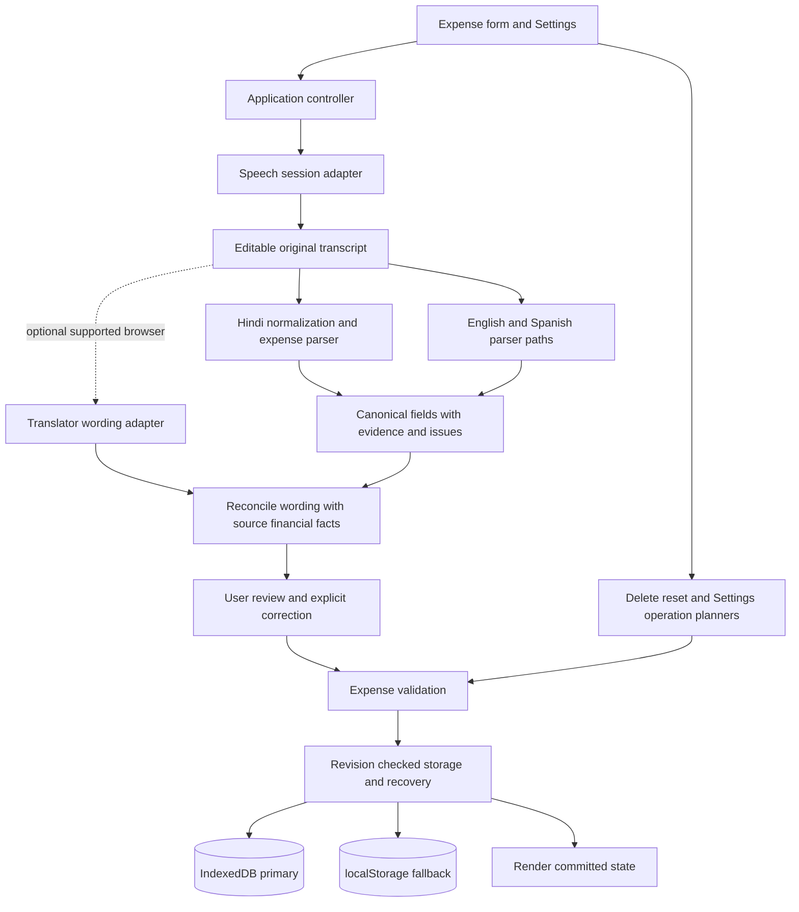
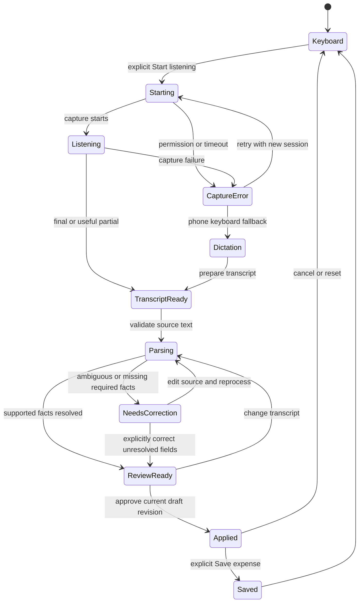
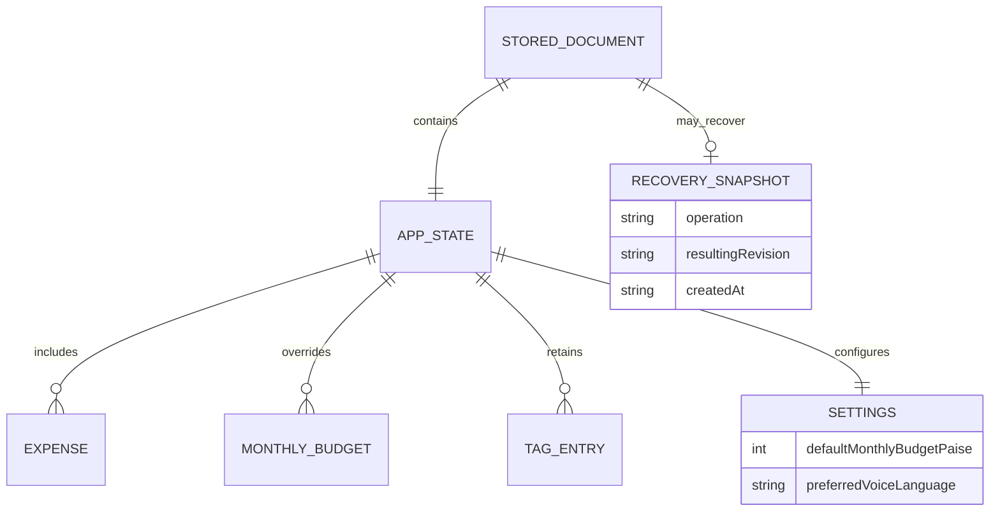
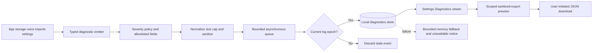
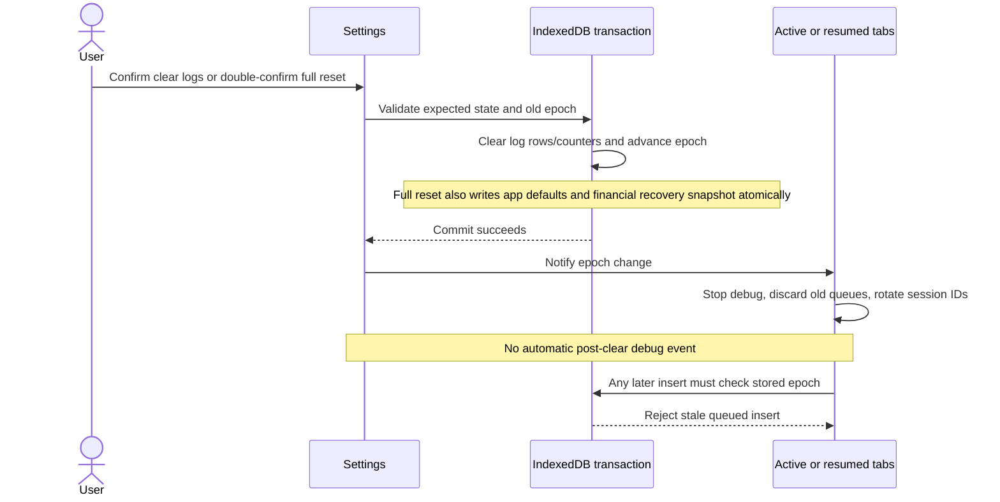

# Penny V3.2 architecture and design

Date: 19 October 2026  
Design revision: 3 — HCI continuity and requirement traceability  
Status: Proposed implementation design; current failures are diagnosed, not fixed  
Companions: [plan.md](plan.md) revision 5, [TRACEABILITY.md](TRACEABILITY.md), [V3.2-TEST-CASES.md](V3.2-TEST-CASES.md), [EVENT-LOG-TEST-CASES.md](EVENT-LOG-TEST-CASES.md)

## 1. Design priorities

1. Never silently change financial facts while interpreting Hindi speech.
2. Give the user clear capture feedback, a correctable transcript and an expense draft that exposes uncertainty.
3. Make month-scoped deletion safe by default and full reset unmistakably app-wide.
4. Preserve tags independently of expense records, retain existing saved budgets during upgrades, and support recovery without overwriting later work.
5. Keep the app static and browser-owned. Studio remains a product hub; GitHub Pages and Docker serve assets, not personal financial databases.
6. Make failures traceable through sanitized local session/action events without exposing financial content or letting diagnostics compromise application writes.

The vocabulary is an expense-domain language layer, not universal Hindi translation. Unfamiliar terms and unsupported grammar must be visible rather than silently omitted. V3.2 release claims must name tested capabilities and remaining capture limitations.

## 2. Architecture and module responsibilities



| Area | Target responsibility |
| --- | --- |
| `app.js` | Coordinate sessions, render fields/issues, freeze operation previews, handle approval and commits |
| `voice.js` | Capture lifecycle only: permission/start/error/end/partial/retry/cancel; no expense interpretation |
| `translation.js` | Route languages, generate controlled wording, reconcile optional translator output and fall back safely |
| New Hindi parser module | Normalize variants, classify source spans, parse money/date/rail/item facts and expose unresolved spans |
| `core.js` | Shared field validation, integer-money helpers, search/totals and compatibility with English/Spanish |
| `data.js` | Schema 4 migration, catalogue/settings validation, budget resolution and pure data-operation plans |
| `storage.js` | Main state, revision guard, dedicated recovery snapshot and linked-file semantics |
| `spreadsheet.js` / worker | Validated Tags/Settings portability and bounded workbook processing |
| Corpus fixtures | Independent expected facts, natural phrases, ambiguity cases, regressions and documented test provenance |
| `diagnostics.js` and Settings viewer | Fixed event schema, severity filtering, local bounded storage, per-tab debug timers, correlation, export, purge and non-recursive failure isolation |

A new parser module requires script load-order, worker imports where needed, Docker allowlist and test-import updates. Avoid moving unrelated functionality merely to reorganize files.

## 3. Current Hindi defects and design response

| Current behavior reproduced | Cause or risk from source inspection | Proposed response |
| --- | --- | --- |
| `1,250 रुपये` becomes 250 and complete | Numeric tokenization splits grouped values; amount matching accepts a suffix | Parse maximal numeric spans before punctuation stripping; validate whole expression and prohibit suffix extraction |
| `साढ़े तीन सौ` becomes 300 with an unknown qualifier | Dictionary conversion and number matching operate separately | Parse qualifier and numeric phrase together; unresolved qualifier invalidates the complete money span |
| `डेढ़ हजार` unresolved | Common Hindi fractional idiom missing | Add reviewed phrase grammar: डेढ़ हजार = 1500; test scale-dependent forms explicitly |
| `सब्ज़ियाँ`, `किये`, `खरीदने` flagged | Finite dictionary misses variants/inflections | Reviewed Unicode normalization, aliases and conservative morphology; retain raw evidence |
| Romanized Hindi loses amount/type | Current fallback expects Devanagari vocabulary | Bounded reviewed Romanized/Hinglish vocabulary; no fuzzy money guessing |
| Milk and fruit becomes only fruit | First matching description label compresses multiple items | Preserve all meaningful item spans in source order, then infer category separately |
| Optional Translator may be trusted when local result is incomplete | Current amount mismatch check is conditional on complete local parsing | Independent financial evidence validation regardless of description completeness; unresolved source facts require review |

These examples were executed locally against the current parser. They do not diagnose whether the user's microphone/provider also misheard the source. The new design must preserve that distinction.

<a id="voice"></a>
## 4. Voice state machine



- Every attempt gets a session/generation identifier; every source edit produces a new draft revision. Ignore late events that do not match both.
- Reuse the existing fresh-session, timer and useful-partial behavior, and regression-test repeated results for duplicate concatenation.
- Cancel/reset/dialog close/language change invalidates pending capture and parser/translator callbacks.
- A partial transcript is visibly labelled partial. It can produce a reviewable draft but cannot imply that the entire utterance was captured.
- Translator preparation and response are separately time-bounded; all failure paths end in a usable correction/typing route.
- Messages name the actual stage: “No speech captured,” “Words captured; expense needs correction,” or “Draft ready for review.” Never label an unknown Hindi word as a network/offline failure.

## 5. Structured draft contract

The parser must return facts, not just a fluent English sentence. Suggested logical contract:

```text
draftRevision
sessionId
sourceLanguage
originalTranscript
normalizedTranscript
captureKind              final | partial | keyboard
fields
  amountPaise            integer or null
  date                   YYYY-MM-DD or null
  category               supported value or null
  paymentMethod          supported value or unspecified
  descriptionItems       ordered source-preserving terms
  tags                   normalized validated tags
evidence                 source spans and rule identifiers for each derived field
issues                   field, source span, reason, required user action
unknownSpans             meaningful words not understood
englishDraft             controlled presentation, not authoritative financial storage
reviewState              needs-correction | review-ready
```

Use explicit deterministic statuses such as resolved, ambiguous, missing and user-corrected, not fabricated model confidence percentages. A missing rail is visibly unspecified, not silently UPI/cash. “Other” must be labelled as a user-reviewed fallback, not asserted as a recognized category.

Unknown amounts/dates remain null and highlighted. Names can retain original spelling/script as labelled proper nouns. The current blanket Devanagari rejection in the apply handler must become field/issue-aware: preserve merchant names while preventing unresolved financial text from being treated as an approved translation. Approval is bound to the current transcript, corrected fields and draft revision.

Changing punctuation alone must not resolve a semantic issue. Removing an unknown field requires an explicit user decision rather than a generic checked box. Final expense validation remains independent of draft approval.

## 6. Hindi normalization and financial integrity

### Normalization

- Retain immutable original text for the open draft; normalization is a separate working representation.
- Normalize whitespace and Unicode consistently; handle Devanagari digits and reviewed nukta/spelling variants without damaging names.
- Apply longest reviewed phrase matches before shorter token aliases. Respect Unicode token boundaries; avoid Latin-only word-boundary rules for Devanagari.
- Recognize currency/grouping context before deleting commas or punctuation. Dates, quantities, IDs and merchant numbers are not automatically amounts.
- Support reviewed Hindi, Latin Hindi and mixed-script forms. Do not fuzzy-match a numerical term into another numerical term.

### Amount parsing

1. Identify complete money expressions including currency marker, signs, grouping, units, qualifiers and surrounding negation/correction cues.
2. Validate grouped formats as whole strings: Western `1,250`, Indian `1,25,000`, ungrouped digits and reviewed Devanagari equivalents. Reject malformed grouping.
3. Parse Hindi word forms with unit tests for 0–99 and reviewed scale compositions. Handle fractional idioms by grammar and scale: डेढ़ हजार = 1500, ढाई सौ = 250, साढ़े तीन सौ = 350. Unsupported combinations remain unresolved.
4. Convert through exact integer/decimal-string arithmetic into paise. Reject sub-paise precision, invalid ranges and foreign currency unless the user explicitly supplies a valid INR amount; do not convert automatically.
5. With multiple money candidates, negation, approximation or self-correction, resolve only a specifically tested grammar; otherwise ask which amount applies. Never choose first/last/largest by accident.
6. Preserve source evidence. A qualifier that cannot be parsed invalidates its entire money expression; `साढ़े तीन सौ` must not leave an apparently reliable 300 behind.

### Date and description

Use the draft's captured local reference date for relative dates so an async callback crossing midnight cannot change it silently. Hindi `कल` requires explicit date resolution unless context is supported by a reviewed unambiguous rule. Multi-item descriptions retain each item; category inference is a separate decision. Ambiguous dates never become the current date merely to satisfy a required field.

## 7. Optional translation adapter

The deterministic parser owns source financial evidence. A supported browser Translator may improve wording but cannot replace canonical money/date/rail values unchecked.

- If local amount evidence is resolved, translated financial fields must match it exactly.
- If local evidence is unresolved, a fluent translated number does not make it resolved; require user confirmation/correction of that specific field.
- Missing or conflicting facts, multiple currencies and dropped negation become explicit issues.
- Provider errors/timeouts/rejections fall back locally and leave the original transcript intact.
- Do not add a new cloud provider or download a general-purpose model. Explain that offline parsing works after capture; this does not promise offline browser speech recognition.

<a id="data"></a>
## 8. Settings and data model



Schema 4 separates `tagCatalog` and `settings` from expense rows. The recovery snapshot is storage metadata, not ordinary portable application state. Default budget is 12,500,000 paise (₹1,25,000); existing saved monthly overrides, including zero, survive migration. Effective budget uses the explicit monthly value when present and otherwise the default.

Scope reduction keeps the existing language selector. Preferred-language persistence can be deferred; if deferred, remove that setting and its import/export promises consistently. Budget, tag catalogue, data/recovery and destructive controls are core Settings scope. No voice permissions/audio history are saved as preferences.

<a id="reset"></a>
## 9. Delete and reset operation design

```mermaid
sequenceDiagram
  actor User
  participant UI as Settings / Start fresh
  participant Planner
  participant Store
  User->>UI: Select month (current by default) or all months
  UI->>Planner: Request preview against current revision
  Planner-->>UI: Scope, target IDs, totals and retained data
  User->>UI: Explicit scope-specific delete confirmation
  Note over User,UI: Full reset instead requires acknowledgement, final review and RESET PENNY phrase
  UI->>Store: Submit frozen operation plus expected revision
  Store->>Store: Validate revision and atomically snapshot/commit
  alt revision changed or persistence fails
    Store-->>UI: No write; refresh preview and require confirmation again
  else local success
    Store-->>UI: Committed revision and recovery metadata
    UI-->>User: Updated view and guarded undo
  end
```

Selected-month deletion affects only that month; all-month deletion is an explicit broader scope. Both keep budgets/settings/tags. Full reset replaces all expenses with sample defaults, restores budgets/preferences, keeps catalogue tags, cancels active voice work and disconnects the linked file without overwriting it.

Undo is valid only while current revision matches the recorded post-operation revision. A later edit invalidates destructive undo. localStorage fallback must use a safe single-envelope write for replacement plus snapshot; do not claim multi-key atomicity. Never clear unrelated browser storage.

<a id="security"></a>
## 10. Security and privacy

- Treat spoken text, model wording, tag names and file imports as untrusted strings; render as text and bound length/complexity.
- Validate structured fields independently at the save boundary. No transcript may trigger commands, invoke reset or bypass confirmations.
- Do not store audio or transcripts by default. Optional diagnostic exports require a preview and user action; redact personal/merchant information before committing fixtures.
- A browser/keyboard provider may process audio; listening starts only after explicit action. Saving a voice preference never grants permission or starts capture.
- Keep existing CSP, top-level browsing guard, bounded workbook worker processing, import protections and financial validation. Review actual current OWASP edition and record scope without certification claims.
- Test forged session IDs, stale draft approvals, prototype keys, HTML-shaped text, unusual Unicode, long repeated tokens, unexpected Translator output and repeated events.
- Every required control from `plan.md` remains a release gate; no security or data-loss test is optional polish.

## 11. Verification and release evidence

| Layer | Required evidence |
| --- | --- |
| Number primitives | Exact grouped/Devanagari/word/qualifier/paise cases, no partial suffix extraction |
| Hindi intent corpus | At least 250 reviewed distinct cases: 150 Devanagari, 50 Romanized/Hinglish, 50 ambiguity/negative cases |
| Structured facts | Exact expected amount/date/rail/category and item preservation; unresolved status for unsupported facts |
| Native translation | Success, mismatch, incomplete source, timeout, reject and unusable output fixtures |
| Capture/controller | Partial/final/retry/error/cancel/switch/reset and generation/review-revision invalidation |
| Browser/mobile | Original-source correction, per-field review, no accidental save, accessible focus and 390-pixel layout |
| Physical device | iPhone 13 Chrome: versions recorded, at least 20 Hindi attempts over two sessions with repeated capture and permission retry |
| Regression | Existing English/Spanish, expenses, search, imports/exports, storage and release checks |

All supported captured financial facts must be exact or explicitly unresolved; no silent financial substitutions may remain. Report native-speaker/device gaps as pending. Separate corpus pass counts from microphone success rates and from named automated test counts. A successful generated-template suite cannot stand in for natural Hindi coverage.

Update README, What's New, test/security/adversarial records, architecture diagrams and release evidence with the actual implementation and source SHA. Preserve historical documents. Detailed execution/model allocation and the revised 350,000-token planning envelope are in `plan.md`; this design does not activate an execution budget, delegate agents or publish a build.

<a id="diagnostics"></a>
## 12. Event log architecture

### 12.1 Flow and failure isolation



Application mutations emit diagnostic facts after/around their own operation without awaiting an ordinary log write. Diagnostics never calls back into an expense mutation, never throws into its caller and never logs its own storage failure recursively. Startup fallback must work even if the persistent diagnostics store cannot open. A single constant UI notice communicates diagnostic unavailability.

Full reset is an explicit exception to ordinary write independence: the **purge** of diagnostic stores participates in the reset transaction so reset cannot claim to have cleared logs while retaining them. This does not mean ordinary event inserts share an expense-save transaction.

### 12.2 Event contract

Log schema version 1 is separate from portable app schema 4 and from IndexedDB database version. Proposed event fields:

| Field | Meaning and validation |
| --- | --- |
| `eventId` | Random unique event reference; no expense-derived value |
| `schemaVersion`, `appVersion` | Fixed/validated versions to interpret an export |
| `sessionId` | Random per-tab-page-session ID; changes on reload and clear/reset |
| `sequence` | Monotonic sequence within the session for ordering even if wall clock changes |
| `actionId`, optional `parentActionId` | Correlate capture → parse → review, or preview → commit; random IDs, not record IDs |
| `timestampUtc` | ISO timestamp for display/export; not used alone to order a session |
| `component` | Enumerated startup/storage/voice/parser/translator/import/export/settings/reset/currency/runtime |
| `level` | `error` or `debug`; no additional user-configurable severity modes in V3.2 |
| `code`, `outcome` | Stable allowlisted codes and success/failure/cancelled/needs-correction outcomes |
| `durationMs` | Optional nonnegative bounded monotonic duration, not wall-clock subtraction |
| `logEpoch` | Generation identifier checked transactionally before persistence |
| `repeatCount` | Bounded count for a deduplicated error in one action |
| `metadata` | Code-specific allowlist of reason enum, file format, counts, scope kind and capability flags only |

Do not include arbitrary messages or payloads. Map codes to reviewed constant display text and suggested next actions. Provider exception text and stack traces are not persisted; map them to stable module/reason enums. No audio, transcript, draft, amount, budget, merchant, description, tag text, expense ID, file name/path, URL or credential is permitted. Failed redaction/validation drops the event rather than storing the original object.

Example safe record:

```json
{
  "schemaVersion": 1,
  "appVersion": "3.2.0",
  "eventId": "random-event-reference",
  "sessionId": "random-tab-session-reference",
  "sequence": 12,
  "actionId": "random-voice-action-reference",
  "timestampUtc": "2026-10-19T10:00:00.000Z",
  "component": "parser",
  "level": "error",
  "code": "VOICE_AMOUNT_AMBIGUOUS_INTEGRITY",
  "outcome": "failure",
  "durationMs": 8,
  "logEpoch": "random-generation-reference",
  "metadata": {"reason": "conflicting_numeric_candidates", "language": "hi"}
}
```

The example contains no actual utterance or monetary value. `language` is a fixed enum; it is permitted only for the voice code family. IDs are illustrative, not a prescribed non-random production generator.

### 12.3 Severity and session policy

- Default emitter mode is errors only. Error events still contain session/action context, but absent debug breadcrumbs are not reconstructed or invented.
- Explicit Enable debug creates a tab-local deadline using a monotonic timer. Check expiry both on emit and on visibility/resume; suspended timers must not prolong debug.
- Debug expires after 30 minutes, on Stop debug, reload, tab close, log clear or full reset. It is not stored in backups or restored automatically.
- Other tabs stay errors only unless separately enabled; clear/reset disables debug across all tabs using epoch metadata plus notification.
- A voice attempt has an action ID even when it fails before capturing words. An apply/save can refer to the reviewed voice action using a parent ID, without logging the words.
- Ordinary correction, cancelled dialogs and unknown vocabulary are debug outcomes, not errors. Integrity mismatches, parser exceptions, failed persistence and unexpected runtime failures are errors.
- Bound and deduplicate repeated errors. No silent fallback from disabled debug into informational events at error level.

### 12.4 Storage and bounded retention

Create `diagnostics` and `diagnosticsMeta` stores in the existing IndexedDB database through an explicit non-destructive upgrade. Keep indexes for timestamp, session and action. Reconcile the implementation's actual database version; do not confuse the current IDB version 1 with app schema version 3 or target schema 4.

Bounds per origin: 1,000 records and 2 MiB serialized retained payload, maximum 2 KiB per event; error retention seven days and debug retention 24 hours. Enforce age/count/byte bounds on startup, inserts and reads/export, including debug events after debug has stopped. Use UTF-8 bytes, not JavaScript character count. Evict expired then oldest records atomically with insert; keep the store bounded without a full unbounded in-memory load.

If log persistence is unavailable, retain a separately bounded memory ring (at most 100 events/200 KiB with the same event redaction rules), label its ephemeral status, and permit a previewed session export. No automatic localStorage expansion beyond a documented bounded store. Required clear/reset also purges fallback data and invalidates pending work.

Export scopes may include existing sessions and include schema/app version, time range, record count, known drop/eviction counts and coarse capability enums. Avoid fingerprinting details such as full user-agent strings, device serials or unrelated environment data. Logs are excluded from expense JSON, Excel, linked-file sync and reset recovery snapshots.

### 12.5 Clear and reset race safety



Error-only mode is re-established after clear/reset. New genuine errors can appear afterward; this is not log resurrection. A stale epoch must never be silently rewritten onto old queued events. A suspended tab checks persistent generation before any flush or debug reactivation.

Financial-state undo excludes diagnostics and debug state. A pre-reset recovery snapshot never resurrects cleared logs. Export/copy is user-initiated disclosure; Clear logs is irreversible in the app and requires a scoped acknowledgement. Full reset's existing review names log deletion and external-file disconnection in its impact summary.

### 12.6 MTTR and verification

The viewer groups related events by session/action and offers code-based recovery hints: retry capture or keyboard fallback, correct a draft, reload after a revision conflict, review linked file, export a backup or retry an import. Logs do not automatically repair financial data.

Run a scripted reproduction exercise and record time to locate the event chain and identify recovery. Without debug, report the limitation to error references only; debug can be enabled for a new reproduction, not retrospectively. No numerical MTTR benefit is claimed before measurement.

Execute `EVENT-LOG-TEST-CASES.md` during development and record actual results/source SHA separately. Required coverage includes default severity, debug expiry/resume, privacy payloads, retention, failure isolation, event flooding, scope filtering, export escaping, clear/reset races and cross-tab epoch checks. Test plans are not passing test evidence.

<a id="ui"></a>
## 13. UI design and HCI continuity

### 13.1 Preserve the learned V3.1 experience

This is an incremental evolution. Keep visual language, labels, currency format and task order familiar. Improve cramped touch targets and inaccessible focus/contrast where inspection shows a need, rather than preserving defects for visual similarity.

| Existing V3.1 task | V3.2 behavior | HCI principle |
| --- | --- | --- |
| Add expense from list header | Same dominant button, same keyboard-first form and field order | Consistency and minimal learning |
| Search/filter expenses | Same top search and progressive filters; search does not define destructive scope | Visible scope and error prevention |
| Set budget from monthly card | Same shortcut opens the budget section directly | Direct access and recognition |
| Data & backups | Retain header shortcut; share implementation with Settings data section | Continuity without duplicated state |
| Use voice | Remains optional; source/draft correction appears inside the existing form | Progressive disclosure and user control |
| What's New | Keep existing header button/dialog | Discoverable release explanation |
| New Settings / Start fresh | Secondary entry; dangerous actions in labelled section | Clear hierarchy and safe defaults |

Target field order remains Date → Amount → Category → Payment method → Description → Tags. Expanded voice controls must not force keyboard users through additional screens. Display budget source as Default or Saved without a new required concept to enter an expense.

### 13.2 Information architecture and low-fidelity layout

```text
Dashboard (familiar V3.1 structure)
  Penny            What's New | Data & backups | Settings
  Monthly overview / month selector
  Search and optional filters
  Monthly spending / budget / left to spend
  All expenses                          + Add expense
  Existing list + Edit / Delete          Start fresh (secondary)
  Budget shortcut and category chart

Settings (single dialog shell; mobile drill-down)
  Budget | Tags | Data & backups | Diagnostics | About
  Start fresh (separate destructive section)

Delete expenses
  Scope: Selected month [current month ▼]  /  All months
  Explicit affected / retained count and INR total
  Backup option; scope-specific unchecked confirmation
  Cancel                           Delete <explicit scope>

Full reset, same shell
  Step 1: impact summary + acknowledgement → Continue
  Step 2: repeat scope, type RESET PENNY → Reset entire Penny app
  Back / Cancel available throughout
```

Desktop may show section navigation beside content. Mobile shows a section list then a single content view with Back. Avoid tab bars too wide for the screen and avoid simultaneous nested modal dialogs. Keep existing shortcuts opening exactly the same underlying section state, not a second independent form.

### 13.3 Interaction contract

- **Focus:** modal title/intro or first appropriate field receives focus; destructive confirmation initially focuses safe introductory content, never the final destructive button. Focus remains in the active modal and returns to its opener on close. The visible page underneath is inert while modal.
- **Navigation:** Escape closes safe dialogs; unsaved Settings/source edits prompt a plain Save/Discard/Keep editing choice in the same shell. Closing never silently saves. No nested confirmation overlay; replace content and preserve return location.
- **Actions:** one visual primary action per stage. Cancel is always explicit. Specific labels replace generic OK. Disable a final action only with an adjacent explanation of what is required.
- **Input:** persistent field labels, INR/unit clarity, appropriate decimal keyboard hints, native calendar controls and visible month/year. Do not suppress browser zoom. For mobile editable text, use readable sizing that avoids unnecessary focus zoom; do not use small type merely to fit more controls.
- **Feedback:** pending state appears immediately, useful status is announced politely, and critical errors persist until addressed. Preserve typed input on failure. Never make a toast the only route to recovery or undo.
- **Voice:** original words and interpreted fields are associated and labelled, stacked on mobile. Show resolved/needs-review text as well as color; source edits invalidate acceptance. Explain the specific unresolved field without technical parser vocabulary.
- **Diagnostics:** default compact error list with readable time/code and a short message. Session/action references, raw-safe metadata and filters expand on request; empty, loading and unavailable states are distinct. No console-like wall of JSON as the initial view.
- **Danger:** month selection defaults current, all-month choice is explicit, and changing scope clears confirmation. Reset is visibly different from deleting expenses and from clearing logs. Typed confirmation appears only for full reset, not routine Add/Edit.

### 13.4 Responsive and accessible components

| Component | Mobile | Desktop | Required acceptance |
| --- | --- | --- | --- |
| Header shortcuts | Wrap naturally with text labels; no clipped essential actions | Compact existing header layout | Same entry points; no mandatory overflow hunt |
| Expense rows/tags | Wrap long text, accessible hit areas, amount and actions remain legible | Preserve scan-friendly table | No clipped INR digits, names or row action loss |
| Settings | One column, clear Back/Close, keyboard-aware action placement | Navigation + content where space permits | No hidden Save/Cancel; no nested scroll trap |
| Confirmation | Stacked summary and scope-specific actions | Readable constrained width | Scope before action; safe focus; confirmation not preselected |
| Voice source/draft | Sequential labelled fields | Side-by-side only when genuinely readable | Hindi script/diacritics preserved; corrections operable |
| Error log | Compact event summaries, expandable details | Optional wider columns | References selectable/copyable; paging and clear status |

Product touch target: 44 × 44 CSS pixels for frequent controls and dangerous actions. Audit the actual clickable area, including tag-remove controls. WCAG 2.2 AA target minimum is 24 × 24 CSS pixels with defined exceptions; 44 is Penny's stronger design aim, not an assertion that AA universally requires 44.

Check text contrast (normally 4.5:1; qualifying large text 3:1), component/focus contrast, visible/unobscured focus, keyboard-only operation, meaningful accessible names, label/error associations and status announcements. Do not rely on green/red or icons alone. Honor reduced motion and do not disable pinch zoom.

Reflow at 320 CSS pixels and text zoom at 200%; verify 390/768/1280 widths, mobile landscape, long Hindi content and the iPhone virtual keyboard. Avoid horizontal page scrolling; preserve semantic relationships if expense rows need a narrow-screen presentation. A successful browser resize alone does not establish physical-device usability or WCAG conformance.

### 13.5 Review and evidence contract

Use V3.1 reference screenshots and task-step counts before editing UI. Compare normal Add/Edit, budget and export tasks after implementation; new mandatory steps in those paths are regressions unless a specific requirement justifies them. Conduct the uncoached walkthrough from plan section 13 and report observed errors/hesitations honestly.

Acceptance IDs `UI-01`–`UI-10`, `ACC-UI01`–`ACC-UI10` and their artifact links live in `TRACEABILITY.md` and `V3.2-TEST-CASES.md`. Automated checks assist with semantics/contrast/reflow but do not replace keyboard, screen-reader and target-device inspection. Evidence remains pending until executed against a specific SHA.

References checked 19 October 2026:

- [W3C target-size guidance](https://www.w3.org/WAI/WCAG22/Understanding/target-size-minimum.html)
- [W3C reflow guidance](https://www.w3.org/WAI/WCAG22/Understanding/reflow.html)
- [WAI modal dialog pattern](https://www.w3.org/WAI/ARIA/apg/patterns/dialog-modal/)

These references inform the acceptance criteria; this design document is not an accessibility certification.
