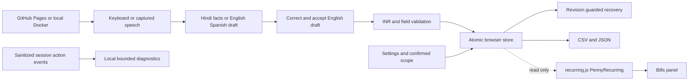
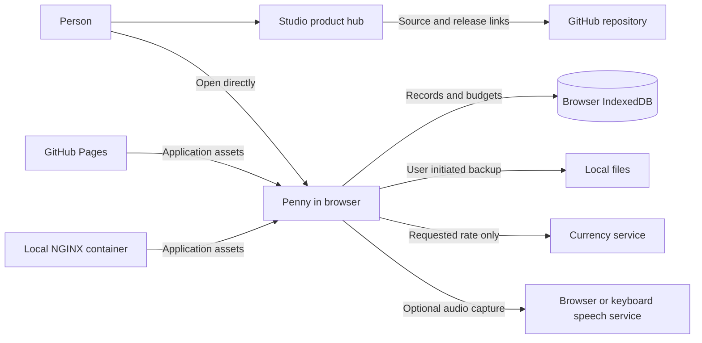
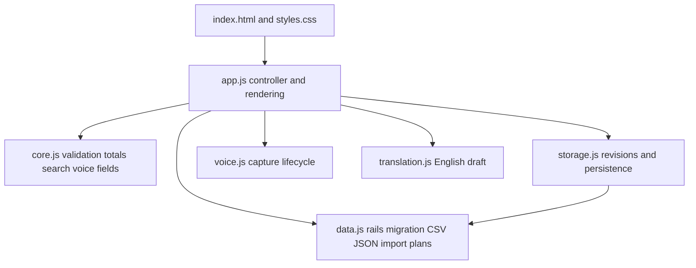
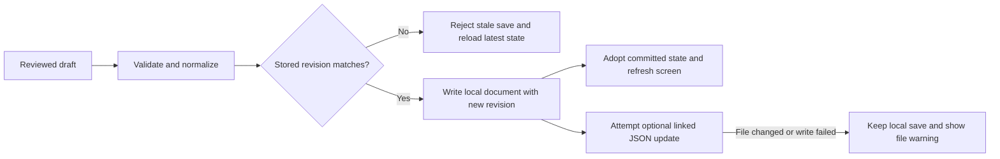
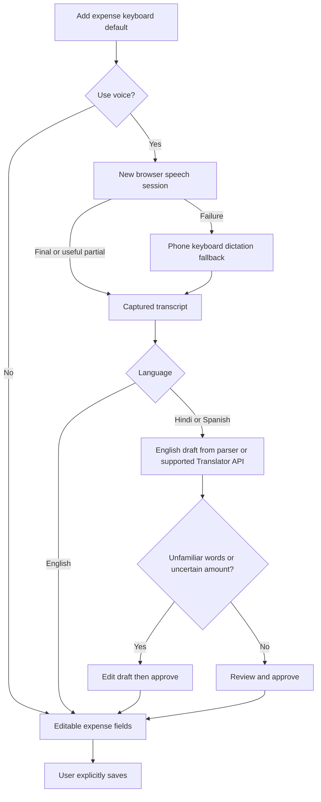
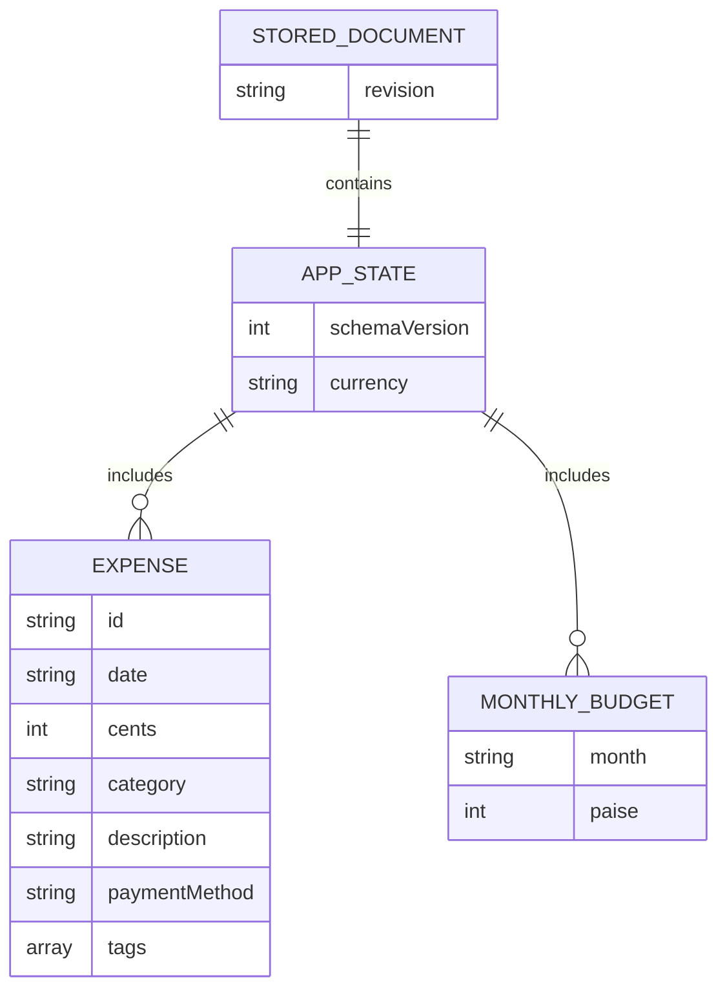
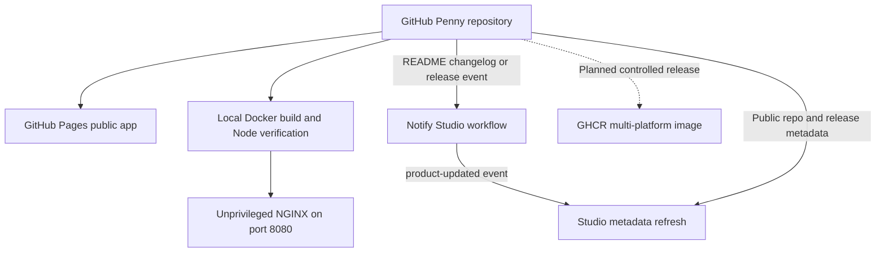

# Penny architecture (current: 3.3.6)

Updated 24 November 2026 for 3.3.6; first written 19 October 2026 for 3.2. This is Penny's one design document. Per-release design, test traceability and decisions for 3.3.1 onwards live in [docs/specs](specs/) (each spec has a traceability table and a status log); the notes below summarise what changed in the architecture. Historical 3.2 design, traceability and release notes: [design](https://github.com/debasisr66/PennyExpenseManager/blob/v3.2/design.md), [traceability](https://github.com/debasisr66/PennyExpenseManager/blob/v3.2/TRACEABILITY.md), [release notes](https://github.com/debasisr66/PennyExpenseManager/blob/v3.2/RELEASE-NOTES-v3.2.md) (all at tag v3.2).

Schema 4 adds saved tags and default-budget preferences. IndexedDB uses separate main, recovery and diagnostics keys in its existing store. Full reset changes state and log epoch together and disconnects the optional file. Logs are excluded from financial backups. An explicitly corrected numeric INR amount in the reviewed draft can resolve a missing source amount; unchanged guesses cannot.

### 3.3.6 note

Hindi parsing rules live only in `hindi.js`: Devanagari "whole word" checks use `(?<![\p{L}\p{M}])` and `(?![\p{L}\p{M}])` because `\b` does not work for Devanagari; uncertain words match whole (short ones) or as prefixes (long ones). `translation.js` gains the pure `plainIssues` helper (issue codes unchanged). `voice.js` asks for 3 alternatives but still reads only the first; `diagnostics.js` gains `VOICE_ALTERNATIVES` and `VOICE_END` (numbers only). The review reveal in `app.js` uses a `focusin` flag, not `activeElement`, because iOS leaves Date focused. No schema, storage, network or CSP change. See [the spec](specs/HINDI-VOICE-3.3.6-SPEC.md); the next step is [3.3.7](specs/VOICE-GUARD-3.3.7-SPEC.md).

### 3.3.5 note

One appended block `/* 3.3.5 mobile-first */` at the end of `styles.css`, all inside `@media (max-width: 700px)`: 44 px minimum size for buttons and summaries, 24 px checkbox and radio boxes, an 11 px text floor, 4 px between adjacent targets, and wrapping stat tiles (`auto-fit`, 10.4rem) and converter controls. Nothing before the block changed. `tests/mobile.test.cjs` checks the rules and a registry of control kinds, not computed layout; `tests/mobile-audit.js` is the in-browser measurement script. See [the spec](specs/MOBILE-FIRST-3.3.5-SPEC.md).

### 3.3.4 note

`C.categories` (in `core.js`) has 9 names; `category` stays a validated string, so schema 4 and the CSV and JSON formats are unchanged. English voice rules in `core.js` put Utilities and Staff salary last in `categorySignals`, so words for older categories win. `app.js` maps a category to `var(--cat-N)` by its index, with "Other" mapped to the grey `--cat-6` and the two new categories to `--cat-7` and `--cat-8`. Confirming a discard in the expense dialog now leaves it closed (`askConfirmation` takes a `stayClosed` argument) instead of re-opening it first.

### 3.3.3 note

`theme.js` (global `PennyTheme`, UMD like `core.js`) is a synchronous script in `<head>` before `styles.css`. It reads the `penny-theme` key (`light` or `dark`; anything else is System), sets `data-theme` on `<html>` and both `theme-color` metas, and never throws. System mode is pure CSS: the dark token block sits under `@media (prefers-color-scheme: dark)` with `:root:not([data-theme='light'])`, and an identical `:root[data-theme='dark']` block serves the explicit choice. `app.js` owns the ◐ button handler and writes chart bars as `var(--cat-N)`. The preference is outside the IndexedDB document, so backups, import, undo and reset neither read nor clear it. Outside the token blocks `styles.css` has no colour literals (test C01). See [the spec](specs/THEME-TOGGLE-3.3.3-SPEC.md).

### 3.3.2 note

`PennyRecurring.detectMarked(expenses, today)` is a second pure track beside `detect`. It groups entries by category and normalised description. A group counts as marked when any entry carries the `recurring` tag. The step comes from the latest marked entry (`every-2-months`, `every-3-months`, `every-12-months`, else 1). It returns each bill's status, step, last and next dates and amount type. Tags are the storage: no schema change. The expense form is the only writer. On save it strips recurring tags from everything typed, then adds `markingTags(marked, step)` before validation. `app.js` calls `detectMarked` only for the current month and renders the Bills panel with `textContent`. See [the spec](specs/RECURRING-BILLS-3.3.2-SPEC.md).

### 3.3.1 note

`recurring.js` (global `PennyRecurring`) is a pure detector in the same UMD pattern as `core.js`. It has no DOM, storage, network or clock access, and takes the reference month as an argument. `app.js` stays the only DOM writer: it calls `PennyRecurring.detect` at the end of `render()`, memoises the result in memory only, and renders the "Looks recurring" panel with `textContent`. See [the spec](specs/RECURRING-DETECTOR-SPEC.md).

### 3.3.0 note

Excel `.xlsx` import and export, `spreadsheet.js`, `import-worker.js` and the vendored SheetJS library were removed in 3.3.0. Penny has no third-party runtime dependencies, creates no web workers, and the CSP sets `worker-src 'none'`.

### Realised 3.2 design details

Facts carried over from the retired 3.2 design document (full text at tag v3.2); each was checked against the current source.

- **Hindi parsing (`hindi.js`).** The parser extracts financial facts before wording. Indian and western digit grouping and Devanagari digits are accepted. Unsupported number compositions, multiple amounts, qualifiers, inequalities, negation and foreign currency leave the amount unresolved. Unknown source words stay visible. The English text is a draft only and never saves anything. Unresolved Hindi amount, category, date and payment method are cleared, and required fields block Save until the user corrects them. Editing the dictated source invalidates the earlier draft and its approval. `PennyHindi.draftAmount` and `reviewedAmount` let an explicit valid INR correction in the reviewed draft resolve the amount; unchanged source evidence cannot.
- **Optional browser Translator (`translation.js`).** Used for Spanish only; Hindi always uses `hindi.js`. When the local parse is complete, the translated amount is cross-checked against it, and a mismatch marks the draft incomplete. An incomplete Spanish draft clears Amount and Category for manual entry; date and payment method come from the reviewed English draft. Preparation times out after 2.5 s and translation after 3.5 s; errors and timeouts fall back to the local parser. No cloud provider or bundled model is added.
- **Data model.** Schema 4 adds `settings` and `tagCatalog` to expenses and budgets. The tag catalogue survives deletion and reset. The effective monthly budget is the saved value for that month, including zero, otherwise the Settings default budget (factory value 12,500,000 paise, ₹1,25,000). JSON carries the catalogue and preferences; importing preferences is opt-in, and the option is unavailable for CSV and for JSON files without preferences. CSV carries expenses only.
- **Storage keys.** The existing IndexedDB database (`penny-local-database`, version 1, store `documents`) holds separate `main`, `backup`, `recovery` and `diagnostics` keys. A destructive change commits the new main state and its recovery snapshot together; a reset also writes the new diagnostics epoch in that same transaction. The localStorage fallback stores one envelope under `penny-v32-envelope`, uses one write per envelope and does not claim multi-key atomicity.
- **Delete, reset and undo.** The user picks one month or all months and sees the count and total first. Both keep budgets, settings and tags. Full reset needs an acknowledgement and the typed phrase `RESET PENNY`; it restores sample data and default budgets, clears diagnostics, and disconnects the linked file without overwriting it. Undo restores financial data only, and only while the stored revision still matches the one recorded after the operation.
- **Diagnostics (`diagnostics.js`).** Logs stay on the device and are excluded from backups and undo. Events carry stable codes, opaque session and action IDs, and allowlisted metadata only (counts, durations, language, scope); never transcripts, amounts, descriptions, tags, file names or stack traces. Error level is the default. Debug lasts 30 minutes in one tab and then stops. Retention is 1,000 events and 2 MiB, with errors kept 7 days and debug events 24 hours. Repeated errors in one action are merged. If storage is unavailable, a memory buffer of at most 100 events and 200 KiB is used. Clearing or resetting advances an epoch so stale queued events are discarded. Export is user initiated. Diagnostics never throw into callers and do not log their own failures recursively.
- **Security posture.** User text, tags, imported files and translated wording are rendered as text. The page sets a Content Security Policy (`default-src 'self'`, no inline script, `object-src 'none'`, with `connect-src` limited to `self` and the exchange-rate host). `nginx.conf` sends an equivalent header, adding `frame-ancestors 'none'`. A top-level guard stops Penny running inside a frame. Imports are bounded as described in the README.
- **Interface.** Add/Edit, search, budget shortcut, backups and What's New keep their V3.1 places. Settings and Start fresh are secondary, with one active dialog at a time. Unsaved-change and log-clear confirmations use an in-app dialog instead of the browser's native one.

The original V3.1 diagrams below are preserved for history. GHCR remains planned; local Docker is verified. Device capture, native-language and full HCI acceptance limits are recorded in the current test report.

---

# Penny Architecture and Design

Version 1.0 | 16 October 2026 | Application baseline V3.1.0

A visual guide to the implemented browser application and its delivery options. Solid relationships describe existing code; the GHCR publication path is planned. This document is based on local source inspection and the verified Studio registry/workflow relationship, not a new deployment test.

## 01 The system at a glance

Penny V3.1.0 is a static browser application. GitHub Pages or a local NGINX container serves the same application assets. All expense calculations and record management happen in the browser. Studio is the discovery hub; it is not a shared expense database.

*Studio currently exposes source and release/download links. The hosted app is opened directly or through those product entry points; it does not run inside Studio.

## 02 Inside the application

The interface orchestrates small modules with distinct responsibilities. Calculation and validation rules are separated from browser storage and voice capture. These modules use browser globals and can also be loaded by the Node test suite.

CSV and JSON imports are parsed directly on the main thread; Penny creates no web workers.

## 03 A save that protects existing data

Penny validates a draft before asking the storage layer to commit it. The screen adopts the new state after the local write succeeds. Revision checks reject stale writes from another tab. An import can keep an undo snapshot. An optional linked JSON file is updated after the local commit.

IndexedDB is primary. A localStorage adapter is used when IndexedDB cannot open. Browser locking strengthens fallback writes where available; without it, Penny warns the user to keep one tab open. This is not cloud synchronization.

## 04 Voice capture and understanding are separate

The mobile voice defect revealed two separate reliability problems: receiving words from a speech provider, and understanding the expense. Penny now resets capture for each attempt, keeps useful partial words and times out stalled sessions. Offline parsing begins only after text exists.

The parser is deliberately limited to expense vocabulary. For Spanish only, a supported browser Translator API can supply an English draft, with an amount-mismatch check; Hindi always uses the local parser. English fills editable fields immediately. Hindi “कल” remains date-ambiguous and requires manual date selection. No voice path saves automatically.

## 05 Data model and privacy boundary

The stored document contains a schema version, INR currency, expenses and monthly budgets. Storage wraps it with a revision identifier for conflict detection. Amounts use integer paise even though the legacy expense field is named cents.

The diagram is conceptual: budgets are stored as a month-keyed object, not SQL rows. IndexedDB, localStorage, JSON backups and linked files are not encrypted by Penny. Data is scoped to browser profile and origin; hosted and localhost records do not automatically merge.

## 06 Delivery and the Studio relationship

GitHub is the source and evidence record. GitHub Pages serves the public app. Docker provides a local serving option. Studio reads product and release metadata; Penny’s notify workflow requests a hub refresh after selected documentation changes or published releases.

Local operation was reported working by the user. A full recorded Docker security/platform validation and public GHCR image release remain pending. A notification workflow definition does not prove successful delivery. Studio receives no expense data through this integration.

## Design patterns

| Area | Design response |
| --- | --- |
| Progressive enhancement | Keyboard entry works independently of optional voice and currency helpers. |
| Human approval | Translated drafts and import previews require review before data changes. |
| Storage adapter | IndexedDB and localStorage share a persistence interface. |
| Optimistic concurrency | Revision checks reject a stale tab’s write rather than silently replacing newer data. |
| Boundary validation | Validate imported files and expense fields before committing state. |
| Separation of concerns | Rules, storage and speech lifecycle live in distinct modules. |

## Nonfunctional requirements

| Area | Design response |
| --- | --- |
| Accuracy | Integer paise, validated INR fields, amount checks and user review. |
| Privacy | Browser-owned records; explicit audio and rate requests; no server expense database. |
| Reliability | Capture timeouts, keyboard fallback, stale-write rejection and import undo. |
| Security | Escaped user content, bounded imports and anti-embedding guard. |
| Portability | CSV and JSON exports; optional linked JSON file; static serving. |
| Maintainability | Small modules, Node tests, GitHub history and release documentation. |

## Evidence and limits

- Existing release evidence: 189 automated tests and 37 recorded browser checks; 200 structured language phrases are covered within the automated suite, not 200 additional test cases.
- These counts describe the recorded V3.1.0 verification. No fresh microphone, container or security scan was run to create this design document.
- Local browser storage does not guarantee the app can be reloaded without a network connection. No service-worker/PWA installation path is claimed.
- Browser data is not shared between different origins or profiles. Switching local ports or moving from hosted Penny to localhost may require JSON export/import.
- OWASP-oriented review is targeted evidence, not certification. Full Docker security/platform validation and public registry publication remain pending.

## Sources and ownership

- Application: `app.js`, `core.js`, `data.js`, `storage.js`, `voice.js`, `translation.js`, `hindi.js`, `diagnostics.js`, `theme.js`, `index.html` and `styles.css`.
- Local serving: `Dockerfile`, `compose.yaml`, `nginx.conf` and `scripts/penny`.
- Product source: https://github.com/debasisr66/PennyExpenseManager
- Release evidence: https://github.com/debasisr66/PennyExpenseManager/blob/v3.2/TEST-RESULTS.md
- Studio registry: https://github.com/debasisr66/studio/blob/main/content/products.json
- Studio notification: https://github.com/debasisr66/PennyExpenseManager/blob/main/.github/workflows/notify-studio.yml

Maintain this document when storage, speech behavior, import boundaries or deployment relationships change. Mermaid diagrams can be edited in a compatible Markdown viewer.
