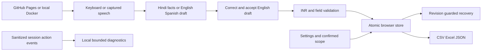
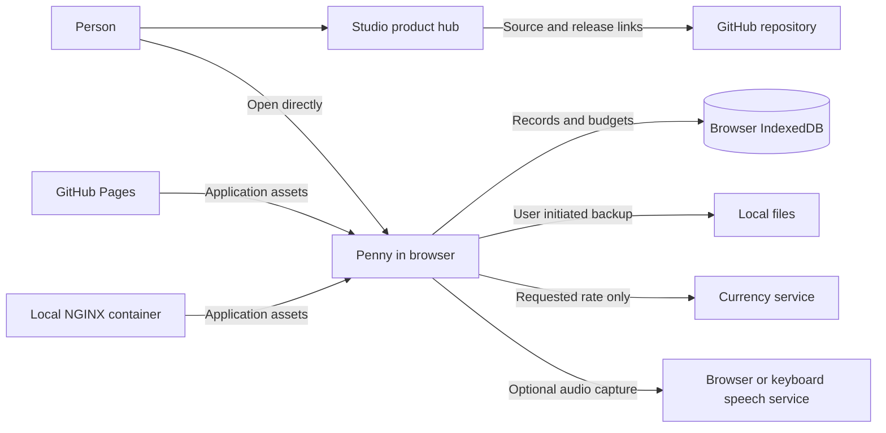
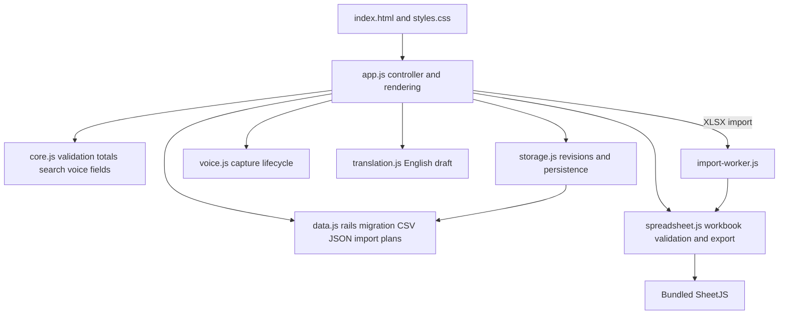
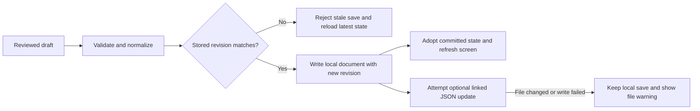
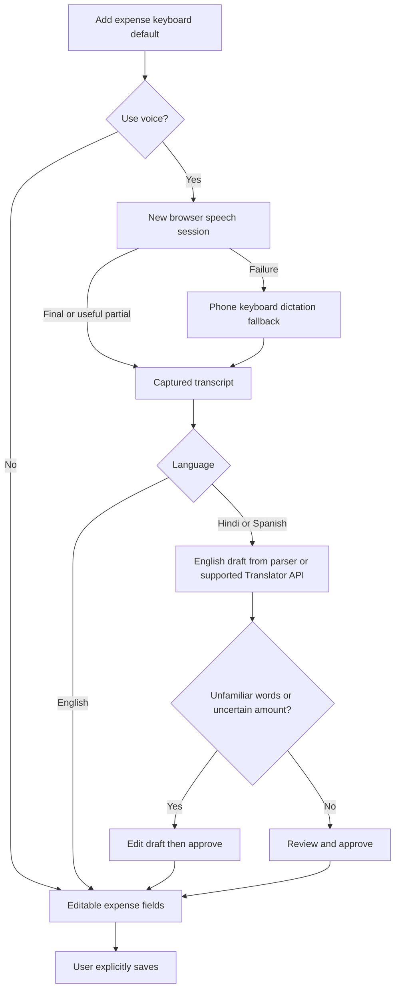
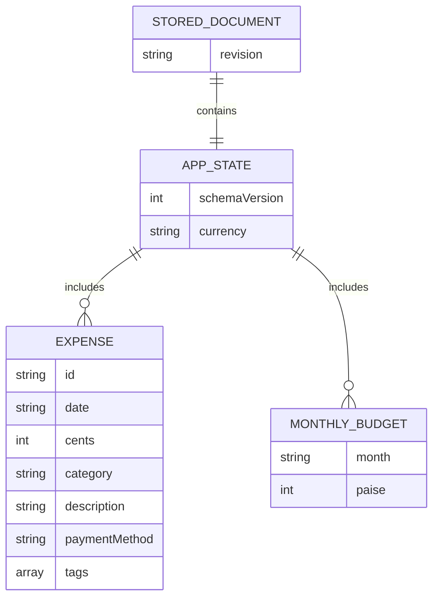
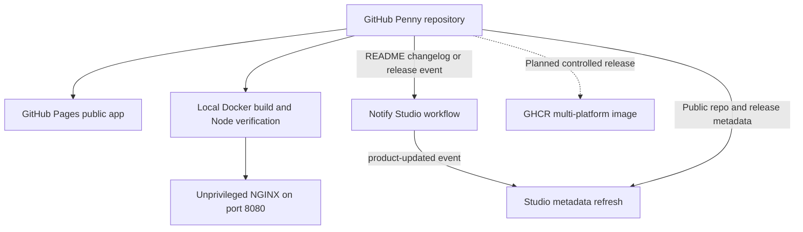

# Penny 3.2 architecture update

19 October 2026. Current contracts: [design](../design.md), [traceability](../TRACEABILITY.md), [release notes](../RELEASE-NOTES-v3.2.md).

Schema 4 adds saved tags and default-budget preferences. IndexedDB uses separate main, recovery and diagnostics keys in its existing store. Full reset changes state and log epoch together and disconnects the optional file. Logs are excluded from financial backups. An explicitly corrected numeric INR amount in the reviewed draft can resolve a missing source amount; unchanged guesses cannot.

The original V3.1 diagrams below are preserved for history. GHCR remains planned; local Docker is verified. Device capture, native-language and full HCI acceptance limits are recorded in the current test report.

---

# Penny Architecture and Design

Version 1.0 | 16 October 2026 | Application baseline V3.1.0

A visual guide to the implemented browser application and its delivery options. Solid relationships describe existing code; the GHCR publication path is planned. This document is based on local source inspection and the verified Studio registry/workflow relationship, not a new deployment test.

## 01 The system at a glance

Penny V3.1.0 is a static browser application. GitHub Pages or a local NGINX container serves the same application assets. All expense calculations and record management happen in the browser. Studio is the discovery hub; it is not a shared expense database.

*Studio currently exposes source and release/download links. The hosted app is opened directly or through those product entry points; it does not run inside Studio.

## 02 Inside the application

The interface orchestrates small modules with distinct responsibilities. Calculation and validation rules are separated from browser storage, voice capture and spreadsheet handling. These modules use browser globals and can also be loaded by the Node test suite.

CSV and JSON imports are parsed directly. XLSX import receives ZIP preflight checks, then a worker parses the workbook with a five-second timeout. Spreadsheet exports use the main-thread helper.

## 03 A save that protects existing data

Penny validates a draft before asking the storage layer to commit it. The screen adopts the new state after the local write succeeds. Revision checks reject stale writes from another tab. An import can keep an undo snapshot. An optional linked JSON file is updated after the local commit.

IndexedDB is primary. A localStorage adapter is used when IndexedDB cannot open. Browser locking strengthens fallback writes where available; without it, Penny warns the user to keep one tab open. This is not cloud synchronization.

## 04 Voice capture and understanding are separate

The mobile voice defect revealed two separate reliability problems: receiving words from a speech provider, and understanding the expense. Penny now resets capture for each attempt, keeps useful partial words and times out stalled sessions. Offline parsing begins only after text exists.

The parser is deliberately limited to expense vocabulary. A supported browser Translator API can supply an English draft, with an amount-mismatch check. English fills editable fields immediately. Hindi “कल” remains date-ambiguous and requires manual date selection. No voice path saves automatically.

## 05 Data model and privacy boundary

The stored document contains a schema version, INR currency, expenses and monthly budgets. Storage wraps it with a revision identifier for conflict detection. Amounts use integer paise even though the legacy expense field is named cents.

The diagram is conceptual: budgets are stored as a month-keyed object, not SQL rows. IndexedDB, localStorage, JSON backups and linked files are not encrypted by Penny. Data is scoped to browser profile and origin; hosted and localhost records do not automatically merge.

## 06 Delivery and the Studio relationship

GitHub is the source and evidence record. GitHub Pages serves the public app. Docker provides a local serving option. Studio reads product and release metadata; Penny’s notify workflow requests a hub refresh after selected documentation changes or published releases.

Local operation was reported working by the user. A full recorded Docker security/platform validation and public GHCR image release remain pending. A notification workflow definition does not prove successful delivery. Studio receives no expense data through this integration.

## Design patterns

| Area | Design response |
| --- | --- |
| Progressive enhancement | Keyboard entry works independently of optional voice and currency helpers. |
| Human approval | Translated drafts and import previews require review before data changes. |
| Storage adapter | IndexedDB and localStorage share a persistence interface. |
| Optimistic concurrency | Revision checks reject a stale tab’s write rather than silently replacing newer data. |
| Boundary validation | Validate imported files and expense fields before committing state. |
| Separation of concerns | Rules, storage, speech lifecycle and workbook processing live in distinct modules. |

## Nonfunctional requirements

| Area | Design response |
| --- | --- |
| Accuracy | Integer paise, validated INR fields, amount checks and user review. |
| Privacy | Browser-owned records; explicit audio and rate requests; no server expense database. |
| Reliability | Capture timeouts, keyboard fallback, stale-write rejection and import undo. |
| Security | Escaped user content, bounded imports, workbook rejection rules and anti-embedding guard. |
| Portability | CSV, XLSX and JSON exports; optional linked JSON file; static serving. |
| Maintainability | Small modules, Node tests, GitHub history and release documentation. |

## Evidence and limits

- Existing release evidence: 189 automated tests and 37 recorded browser checks; 200 structured language phrases are covered within the automated suite, not 200 additional test cases.
- These counts describe the recorded V3.1.0 verification. No fresh microphone, container or security scan was run to create this design document.
- Local browser storage does not guarantee the app can be reloaded without a network connection. No service-worker/PWA installation path is claimed.
- Browser data is not shared between different origins or profiles. Switching local ports or moving from hosted Penny to localhost may require JSON export/import.
- OWASP-oriented review is targeted evidence, not certification. Full Docker security/platform validation and public registry publication remain pending.

## Sources and ownership

- Application: `app.js`, `core.js`, `data.js`, `storage.js`, `voice.js`, `translation.js`, `spreadsheet.js`, `import-worker.js`, `index.html` and `styles.css`.
- Local serving: `Dockerfile`, `compose.yaml`, `nginx.conf` and `scripts/penny`.
- Product source: https://github.com/debasisr66/PennyExpenseManager
- Release evidence: https://github.com/debasisr66/PennyExpenseManager/blob/main/TEST-RESULTS.md
- Studio registry: https://github.com/debasisr66/studio/blob/main/content/products.json
- Studio notification: https://github.com/debasisr66/PennyExpenseManager/blob/main/.github/workflows/notify-studio.yml

Maintain this document when storage, speech behavior, import boundaries or deployment relationships change. Mermaid diagrams can be edited in a compatible Markdown viewer; the HTML includes self-contained SVG diagrams and needs no external diagram library.
