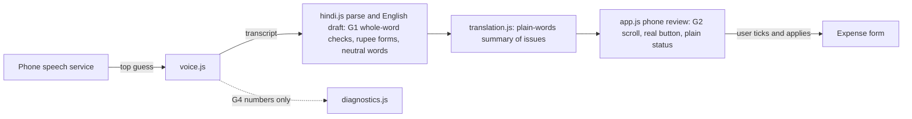

# 3.3.6: Hindi voice that lands, or is quick to correct. Architecture, design, mock, impact, plan

Status: **RELEASED 23 November 2026 as [v3.3.6](https://github.com/debasisr66/PennyExpenseManager/releases/tag/v3.3.6) (merge `5eb8030`, PR 29, 844 tests).** Approved 23 November 2026: D1–D7 all as recommended (owner: "All as recommended"). Independent review folded in (§12). Date 23 November 2026. Baseline: Penny 3.3.5 on `main` (`ad558d9`, 800 tests). Gated Build Playbook stage: **Released** (live check on the owner's phone reported separately; see [VOICE-GUARD-3.3.7-SPEC](VOICE-GUARD-3.3.7-SPEC.md)).
Owner report (23 November 2026, 3.3.5 smoke test): "the hindi voice translation and capture is not working well. Rest are working fine." Then, with two screenshots: iPhone Chrome; said "kamwali ke advance 1000 rs"; "Penny showed an expense made no amount, for whom was not there. Correct the english box and button didnot appear. The problem is missing or wrong words. The problem is also - inconsistency - sometime it works, and suddenly is misses one."

## 1. Bottom line

**The phone misheard you, and then a Penny bug threw away the one thing it heard right.** The phone wrote "कामवाली के एडवांस 1000 रुपये" as "कमल कवन हज़ार रुपी". "हज़ार" (1,000) was right. Penny then discarded it for two reasons of its own.

| What happened | Evidence (parser runs on `main`) | Whose fault | Fix in 3.3.6 |
|---|---|---|---|
| "कामवाली के एडवांस" heard as "कमल कवन"; "एक हज़ार" as "हज़ार" | Owner screenshot | Speech service (every iPhone browser, Chrome included, uses Apple's) | None possible; make correction easy (G2) |
| **"कमल" contains "कम" ("less than").** Penny's check for uncertain amounts matches "कम" inside any word, so the amount is refused | `hindi.js:407` has no word boundary. "कमल हज़ार रुपये" → no amount; "कवन हज़ार रुपये" → ₹1,000 | **Penny bug** | G1a: match those words as whole words |
| **The same bug hits ordinary phrases.** "कमरे का किराया 5000 रुपये" (room rent) → no amount. Also likely for कमीज़ (shirt), कमीशन (commission), कमाई | Same | **Penny bug** | G1a |
| "रुपये" written as "रुपी"; Latin `rupee` also fails | "एक हज़ार रुपी" and "1000 rupee" → no amount | **Penny** | G1b: accept spoken rupee forms |
| "एडवांस", "बिल", "पेमेंट", "बकाया" are unknown words, so the draft is marked incomplete even when amount and category are right | "कामवाली के एडवांस 1000 रुपये" → ₹1,000, Staff salary, flagged incomplete | **Penny** | G1c: a small set of known neutral words |
| After the draft, the confirm checkbox and **Use English draft** sit about 490 px below the visible part of the dialog; focus stays on Date | Voice harness at 390 × 750 px (simulated speech; on the device this is a strong hypothesis, not a measurement) | **Penny** | G2 |
| **Correct heard words** is shown, but looks like a heading: no background, no border, muted text | Same | **Penny** | G2 |
| The phone shows internal issue codes ("amount: extra numeric evidence") | Owner screenshot | **Penny** | G2: plain words |

**With 3.3.6, your exact capture "कमल कवन हज़ार रुपी" gives ₹1,000** with the category and description left for you to choose, and the review right in front of you. That is the same result Penny already gives today for "कवन हज़ार रुपये".

**Safety rule kept:** genuinely uncertain phrases still leave the amount empty: "कम से कम 500 रुपये", "लगभग 500 रुपये", "500 नहीं 600" (TC-HV-S01).

**Why it feels inconsistent:** the speech service's guess changes with noise, pace and network, and any word starting with "कम" silently blanks the amount. G1 removes the second cause. Two more possible causes (Penny uses only the first guess; the phone may stop at a short pause) are measured, not built (G4, D4).

**Estimate:** about **10 build hours (range 9–12)** plus about **1 hour of owner time** (§8).

## 2. Architecture

No new runtime file, dependency, network path, storage key or schema change.



| Principle | How |
|---|---|
| Human approval stays | Voice never saves. An uncertain amount stays empty. The confirm checkbox is still required |
| One place for Hindi rules | `hindi.js` builds the parse and the English draft for Hindi; all G1 changes live there. `translation.js` only gains a pure helper that turns issue codes into plain words |
| Whole words in Devanagari | JavaScript `\b` does not work for Devanagari, so "whole word" means bounded by the start or end of text, whitespace or punctuation, the same lookarounds the existing `रू` rule uses |
| Privacy | G4 logs only numbers (guesses offered, words captured, duration) through the existing diagnostics allowlist |
| Freeze | Schema 4, CSV and JSON, F02 golden, `detect` and `detectMarked`, CSP, deploy file lists. The 250 synthetic corpus cases keep their expected values; 3.3.6 only adds cases |

## 3. Design

### 3.1 G1: understand what the phone writes

| ID | Rule |
|---|---|
| G1a | The uncertain-amount words (`नहीं`, `नही`, `लगभग`, `करीब`, `ज्यादा`, `अधिक`, `कम`, `न्यूनतम`, `अधिकतम`, `वापस`, `रिफंड`, `नहीँ`) match only as whole words. "कमरे", "कमल", "कमीज़" no longer trigger it; "कम से कम" still does |
| G1b | Rupee: `रुपी`, `रूपी`, `रुपीज`, `रूपीज`, `रुपीस`, `रूपीस` → `रुपये`, as whole words, after amounts and before them ("रुपी 1000"), after the existing nukta removal. Latin: add `rupee` and `rupiya` (the `rs.` form already works) |
| G1c | Neutral known words: `एडवांस` → advance, `बिल` → bill, `पेमेंट` → payment, `बकाया` → dues, `किस्त` → instalment. They count as known, set no category (and raise no category issue), and are added to the English description: "Spent 1000 rupees on maid advance". `फीस` is not added: it already exists as "school fees" |
| Unchanged | Number words, the "extra numeric evidence" check, category vocabulary, Spanish |

### 3.2 G2: correcting on a phone takes one tap

| Item | Rule |
|---|---|
| After a draft arrives (Hindi or Spanish) | Scroll the review block (heard words, **Correct heard words**, English draft, checkbox, **Use English draft**) into view inside the dialog. Move focus to **Correct heard words** (a button, so no keyboard opens and hides the block). No smooth scroll under `prefers-reduced-motion` |
| Correct heard words | Styled as a secondary button (`.secondary`); label unchanged |
| Keyboard microphone block | While browser speech works, it collapses to one 44 px button with the same label; it expands fully, as today, when speech fails or is unavailable |
| Status text (`#translation-status`) | Shows a plain sentence from `PennyTranslation.plainIssues(issues)`: for example "Amount not clear. Tap Correct heard words, or type the amount below." or "Category not clear. Choose it below." The issue codes themselves are unchanged (other code reads them) |

### 3.3 G3: a real-phrase test set

`tests/hindi-real.json`: the owner's test phrases (not real expenses), each with what the phone heard and the expected result (amount, category, or "amount must stay empty"). Starting set: this report's capture, plus "कमरे का किराया 5000 रुपये". A case is never edited to make a test pass.

### 3.4 G4: measure before building more (no behaviour change)

- `voice.js`: `maxAlternatives = 3`; `transcriptFrom` still uses `result[0]` only.
- Two new diagnostics codes, added to `CODES`: `VOICE_ALTERNATIVES` (`count` = guesses returned) and `VOICE_END` (`count` = words captured, `durationMs`). Only the existing allowlisted fields.
- The owner turns on debug logging (it lasts 30 minutes) just before the live check, then exports the log: numbers only. This decides D4 for 3.3.7.

### 3.5 Gate

| Part | Rule |
|---|---|
| Automated gate (blocks release) | Every case in `tests/hindi-real.json` and every TC-HV test passes in CI. This replays the phone's exact transcripts, so it tests Penny, not the phone's luck |
| Live check (reported, does not block) | 10 fixed Hindi phrases on the owner's iPhone Chrome, before (3.3.5) and after (3.3.6). Owner reports counts only: landed first time, landed after one correction, failed, **wrong amount filled**. Any wrong amount filled is investigated before "publish" |
| Fallback | If the live check is not run, release on the automated gate and record "live check not run" |

## 4. Mock

**Phone, 390 px, after "कमल कवन हज़ार रुपी" (scrolled into view):**
```
 ┌──────────────────────────────────────┐
 │ Heard: "कमल कवन हज़ार रुपी"            │
 │ [ Correct heard words ]               │  secondary button, focused
 │ English draft                         │
 │ ┌───────────────────────────────────┐ │
 │ │ Spent 1000 rupees on expense      │ │
 │ └───────────────────────────────────┘ │
 │ Category not clear. Choose it below.  │
 │ [ ] I checked and corrected this      │
 │     English draft.                    │
 │ [ Use English draft ]                 │
 │ [ Use phone keyboard microphone ]     │  collapsed
 └──────────────────────────────────────┘
```

**After "कामवाली के एडवांस 1000 रुपी":** "Spent 1000 rupees on maid advance": ₹1,000, Staff salary, description kept, draft complete.

## 5. Impact

| Area | Change | Risk and control |
|---|---|---|
| `hindi.js` | G1a whole-word check; G1b rupee forms; G1c neutral words in the parse and its English draft | 250 corpus cases unchanged (F01); new U and S tests |
| `translation.js` | `plainIssues(issues)` pure helper | U06 |
| `app.js` | Scroll and focus after the draft; collapsed keyboard block; plain status | Browser checks; existing voice tests pass unedited |
| `voice.js` | `maxAlternatives = 3`; reports count and end | U05 with a fake that returns 3 alternatives |
| `diagnostics.js` | Two codes added to `CODES` | S02 |
| `styles.css` | Correct heard words as secondary; collapsed block | 3.3.3 contrast and 3.3.5 44 px rules |
| `VERSION` and copies | 3.3.6 (including `diagnostics.js` `appVersion`) | `tests/version.test.cjs` |
| `tests/hindi-real.json` | New test data, not deployed | Deploy lists unchanged |
| Unchanged | Schema 4, CSV, JSON, F02, `detect`, `detectMarked`, CSP, deploy lists, Studio | Existing tests |

## 6. Plan

One branch from `origin/main`, one PR. Sonnet 5.5 builds, Opus 5.5 reviews.

| Step | Work | Gate |
|---|---|---|
| 0 | Owner decides D1–D7; merge this spec | **Owner** |
| 0a | Optional: owner runs the 10-phrase live check on 3.3.5 and reports counts | Owner |
| 1 | Tests first, proven to fail on 3.3.5 where they should: U01–U06, S01–S03, `hindi-real.json` | |
| 2 | G1 in `hindi.js` | |
| 3 | G2 in `translation.js`, `app.js`, `styles.css` | |
| 4 | G4 in `voice.js`, `diagnostics.js`; version 3.3.6 | |
| 5 | Browser checks B01–B05 at 320, 375 and 390 px, both themes | |
| 6 | Opus review; fix Blocker and High; open the PR; CI `verify` | |
| 7 | Merge with `--match-head-commit` | **Owner approves** |
| 8 | Owner live check on 3.3.6 (counts), smoke, then "publish" | **Owner** |
| 9 | Release with zip and SHA-256; Studio sync; docs close-out | |

## 7. Tests

| ID | Test |
|---|---|
| TC-HV-U01 | Each Devanagari rupee form, before and after the amount, and Latin `rupee`, gives the same amount as `रुपये` |
| TC-HV-U02 | Each neutral word: known, no category issue, appears in the English description; amount and category unchanged |
| TC-HV-U03 | "कामवाली के एडवांस 1000 रुपी": ₹1,000, Staff salary, "maid advance", draft complete |
| TC-HV-U04 | Words containing "कम" (कमरे, कमल, कमीज़, कमीशन, कमाई) no longer block the amount: "कमरे का किराया 5000 रुपये" → ₹5,000, Housing |
| TC-HV-U05 | With 3 alternatives from the fake, the transcript is still the top guess |
| TC-HV-U06 | `plainIssues` returns the plain sentence for each issue family (amount, category, date, payment method, unknown words) |
| TC-HV-S01 | Safety: "कम से कम 500 रुपये", "लगभग 500 रुपये", "500 नहीं 600 रुपये", "करीब हज़ार रुपये" still leave the amount empty |
| TC-HV-S02 | Diagnostics: the two codes keep only `count`, `durationMs`, `language`; a transcript or amount passed in is dropped |
| TC-HV-S03 | Owner capture "कमल कवन हज़ार रुपी": ₹1,000, category empty, draft incomplete (review required) |
| TC-HV-R01 | Every `tests/hindi-real.json` case meets its expectation |
| TC-HV-F01 | Freeze: all 800 existing tests pass unedited, including the 250 synthetic corpus cases and Spanish |
| B01 | 390 × 750 px: after a Hindi draft the review block is in view; focus on Correct heard words; the keyboard does not open |
| B02 | Correct heard words looks and works like a button; screen-reader name unchanged |
| B03 | Keyboard microphone block is one button while speech works, and full after harness "permission denied" |
| B04 | Reduced motion: no smooth scroll |
| B05 | 320 px and 200% text: no overflow; both themes |

| Req | Requirement | Tests |
|---|---|---|
| R1 | Words containing "कम" never block an amount; uncertain phrases still do | U04, S01, S03 |
| R2 | Spoken rupee forms are understood | U01, U03 |
| R3 | Common expense words keep the description and a complete draft | U02, U03 |
| R4 | Review in view; one tap to correct; plain status | U06, B01–B04 |
| R5 | Real phone captures are regression-tested | R01 |
| R6 | Measure guesses and pauses without logging words | U05, S02 |
| R7 | Freeze intact | F01, B05 |

## 8. Estimate

| Work | Build hours |
|---|---|
| Tests first, voice fake with alternatives | 2 |
| G1a, G1b, G1c in `hindi.js` | 2 |
| G2 review flow and plain status | 2.5 |
| G4 measurement, version | 1 |
| Browser checks | 1 |
| Review and fixes | 1 |
| Release and docs | 0.5 |
| **Total** | **10 (range 9–12)** |

| Owner gate | Time |
|---|---|
| Decide D1–D7 | 15–20 min |
| Approve merge | 10 min |
| Live check on 3.3.6 (and optionally 3.3.5), smoke, "publish" | 20–25 min |
| **Total** | **about 1 hour** |

## 9. Decisions (approved 23 November 2026: all as recommended)

| # | Decision | Options | Recommendation |
|---|---|---|---|
| **D1** | Scope | (a) G1 + G2 + G3 + G4 measurement; (b) G1 + G2 only; (c) also build alternatives and longer listening now, unmeasured | **(a).** Fixes what is proven, measures what is not |
| **D2** | The "कम" bug (G1a) | (a) fix in 3.3.6; (b) separate hotfix first | **(a).** It is the main cause in your capture and a one-rule change with its own tests |
| **D3** | Rupee forms and 5 neutral words (G1b, G1c) | (a) as listed; (b) rupee forms only | **(a).** Each is a word you or the phone will say; none can set an amount |
| **D4** | Using the phone's 2nd and 3rd guesses, and listening through short pauses | (a) measure in 3.3.6, decide in 3.3.7 with numbers; (b) build now | **(a).** An unmeasured alternative could fill a wrong amount |
| **D5** | Gate (§3.5) | (a) automated replay blocks; live 10-phrase check reported, any wrong amount investigated; (b) live check must reach 8 of 10 | **(a).** Ten live tries mostly measure the phone's luck; replaying exact transcripts measures Penny |
| **D6** | Real-phrase test set (G3) | (a) add your test phrases as you find failures; (b) synthetic only | **(a).** The synthetic corpus has never had a native-speaker review |
| **D7** | "हज़ार रुपये" with no number before it | (a) keep reading it as ₹1,000 (common speech; the review checkbox guards it); (b) flag it for review every time | **(a).** People say it; (b) adds a step to a correct phrase. Watch it in the live check |

## 10. Status log

| Date | Event |
|---|---|
| 2026-11-23 | Owner smoke of 3.3.5: Hindi voice not working well. Repro on iPhone Chrome with screenshots |
| 2026-11-23 | Draft v1 (Opus 5.5): parser runs on `main`, voice harness at 390 × 750 px |
| 2026-11-23 | Draft v2: independent review (Sonnet 5.5) found the real cause: "कम" matched inside "कमल". Verified by parser runs. Diagnosis, G1, tests, gate and estimate corrected (§12) |
| 2026-11-23 | **Approved by the owner: D1–D7 all as recommended.** Next: merge this spec, then build on one branch (Sonnet builds, Opus reviews) |
| 2026-11-23 | Built (Sonnet 5.5): G1, G2, G3, G4; 844 tests. Opus review found a Blocker (inflected "कम" forms could fill amounts): fixed with prefix matching and 13 tests. A second review finding (iOS keeps Date focused, so the reveal was skipped) fixed with a `focusin` guard |
| 2026-11-23 | Merged (PR 29, `5eb8030`), Pages deployed, live site shows V3.3.6 |
| 2026-11-23 | Released v3.3.6 (zip and SHA-256 `88ffbe70…2ec4`) after the owner's "publish 3.3.6" |
| 2026-11-24 | Owner four-phrase check on iPhone Chrome: the safety phrase passes; three phrases failed at capture (no text from the phone). Follow-up: [VOICE-GUARD-3.3.7-SPEC](VOICE-GUARD-3.3.7-SPEC.md). The diagnostics show 2–3 alternatives per final result |
| 2026-11-24 | Docs closed out (CHANGELOG, README, ARCHITECTURE, SECURITY-REVIEW, IDEAS). Actual-versus-estimate not recorded |

## 11. Limits of this evidence

- The mishearing is from one owner capture; its frequency is unknown until the live check.
- Whether iPhone Chrome returns more than one guess is unknown; G4 measures it.
- The harness uses simulated speech: it proves layout and flow, not recognition. The 490 px figure is from the harness.
- Other substring checks in `hindi.js` may have the same flaw; the build reviews every Devanagari regex for word boundaries and lists any found.

## 12. Independent review (Sonnet 5.5, 23 Nov 2026): disposition

| Finding | Severity | Disposition |
|---|---|---|
| "कम" substring (no word boundary) is the real cause, not a "सवा" ambiguity; also blanks "कमरे का किराया" | High | **Accepted and verified**: G1a, U04, S01, S03; diagnosis rewritten |
| Neutral words as specified could not make the draft complete | Blocker | **Fixed**: G1c defines a neutral-known set that joins the description |
| `फीस` already exists | Medium | **Fixed**: dropped |
| "Description cleared" claim wrong | Low | **Fixed** |
| Latin `rs.` key is dead; `rupee` is the real gap | Low | **Fixed** |
| Rupee mapping needs boundaries and the prefix form | Medium | **Fixed** (G1b) |
| Focusing the textarea opens the iPhone keyboard and hides the block | Medium | **Fixed**: focus Correct heard words |
| Status codes live in `#translation-status`; keep codes, change only the display | Low | **Fixed**: `plainIssues` helper, U06 |
| U05 needs a multi-alternative fake; diagnostics codes must be added to `CODES`; `appVersion` bump; debug lasts 30 min | Medium | **Fixed** in §3.4, §5, §8 |
| A live 8-of-10 gate measures recogniser luck | Medium | **Fixed**: automated replay blocks; live check reported (D5) |
| Bare "हज़ार" is accepted silently | Medium | **Offered as D7** |
| Estimate low | Low | **Fixed**: 10 h (9–12) |
| Number-word variants ("दौ हजार", Latin "hazaar") | Medium | Deferred to 3.3.7 with the G4 numbers |
