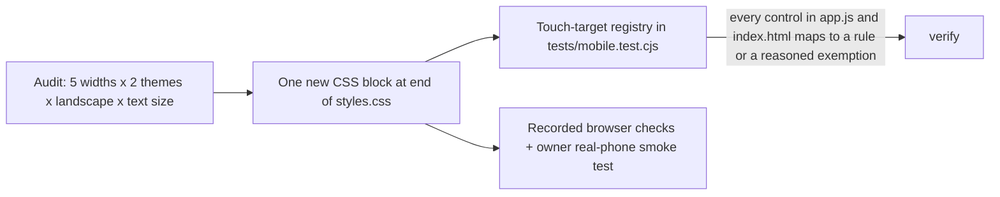

# 3.3.5: Mobile-first pass. 44 px targets, large-text reflow, audit. Architecture, design, mock, impact, plan

Status: **RELEASED 20 November 2026 as v3.3.5** (D1–D9 taken as recommended; see section 10). Originally a draft of 19 November 2026. Baseline: Penny 3.3.3 on `main` (`03078f3`, 783 tests). Prior work: [THEME-TOGGLE-3.3.3-SPEC §3.5 and D7](THEME-TOGGLE-3.3.3-SPEC.md) (the deferral that created this release), [IDEAS](../IDEAS.md) (roadmap row 3.3.5).
Owner direction (19 November 2026): "Penny must be mobile first." D7 of the 3.3.3 spec promised this pass its own spec and "a full audit on real phones".

## 1. Bottom line

**The phone problem is smaller and sharper than the 3.3.3 estimate suggested. Heights are already fine; widths, two disclosure controls and large text are not.** Every button, field and select has been 44 px tall since V3.2 (a global `min-height: 44px`). What fails is measured below.

| Finding (measured on 3.3.3, 19 Nov, Chromium phone emulation, sample data, both themes) | Size of the gap |
|---|---|
| **Edit** is 37 px wide at 320–412 px (Delete is 52 px at 375 px and passes at 320–412 px, contrary to the 3.3.3 note) | 24 of 24 rows |
| **Tag-chip buttons** under 44 px wide: only the shortest tags (38 px for `#upi`-length tags); most are 46–94 px | 13 of 50 chips in the sample |
| **"Enter rate manually"** is 18 px tall (fails WCAG 2.5.8, the 24 px AA minimum); **"Currency conversion"** is 27–42 px tall | 2 controls |
| Inline tag form **Add** button is 36 px wide, in a form only 153 px wide at 320 px | 1 control |
| **At 200% text size on a 320 px phone the page overflows sideways by 38 px** (stat tiles and the converter), and descriptions break mid-word ("Fresh produc/e") | A WCAG 1.4.4 and 1.4.10 gap, found only by the audit |
| Checkbox boxes are drawn 11–13 px (their labels are 44 px tall and full width, so taps work) | 5 checkboxes, visual only |
| **Density:** an expense is a 256 px card at 320 px (240 px at 375 px). 24 expenses are 9.6 screens. Tags take 133 px of each card | A design choice, not a defect (D1) |
| No horizontal overflow at 320, 360, 375, 390, 412 px or landscape 812 × 375, in either theme, on the page or in all 10 dialogs. Header 111 px at 320–412 (limit 112) | Clean |

**A three-rule CSS prototype, injected in the browser, brought every control on the page and in all 10 dialogs to 44 px at 320 px, with no overflow, the header unchanged at 111 px and the average card 5 px taller (256 → 261 px).** So the targets are a CSS change; no JavaScript, no markup, no data. That is the recommendation (D1 option A).

- **Recommendation:** ship **targets, large-text reflow and the audit** as 3.3.5. Keep the card layout; offer a denser one (tags behind a disclosure, or a tap-to-open sheet) as an owner choice **after** the owner has seen A on a real phone (D1).
- **Freeze list holds:** schema 4, CSV and JSON formats, goldens, CSP, deploy file list. The build is **CSS plus one new test file**. No new deploy file.
- **Merge-friendly with 3.3.4** (categories, running in parallel): 3.3.5 only appends one labelled block to the end of `styles.css`. It edits no token block and does not touch `core.js`, `hindi.js` or `translation.js`.
- **What cannot be proven here:** iPhone Safari and real Android Chrome. This Mac has the Command Line Tools only (`xcode-select -p` is `/Library/Developer/CommandLineTools`; `xcrun simctl` does not exist), so the iOS Simulator tool is unavailable. Every emulated number below is Chromium. Real-phone checks are an owner step (§3.6, D7).
- **Estimate:** about **8 build hours (range 6–10)** plus about **1 hour of owner time** over 3 gates (§8).

**Cut as good-to-haves:** swipe actions, a bottom navigation bar, pull to refresh, a PWA install prompt, haptics, per-row gestures, and any change to Hindi or Spanish text length.

**Defaults, not decisions:** the version is 3.3.5, a patch release; the rules apply at 700 px and below (the breakpoint the card layout already uses); wide screens are unchanged.

## 2. Architecture



| Principle | How |
|---|---|
| Fix at the source, not per control | Three rules inside `@media (max-width: 700px)`: `button { min-width: 44px }`, `summary { min-height: 44px; display: flex; align-items: center }`, checkbox box 24 × 24 px. New buttons inherit them, so a future control cannot regress silently |
| Additive only | One block at the end of `styles.css`, headed `/* 3.3.5 mobile-first */`. No edit to the 3.3.3 phone block, the token blocks or any existing rule. That keeps the 3.3.4 diff (new `--cat-7` and `--cat-8` tokens) and this one from touching the same lines |
| Pin what can be pinned in CI | CI has Node only (`verify.yml`: syntax, `node --test`, docker build). Penny has no DOM test harness and the repo takes no third-party code, so CI cannot lay out a page. It can pin the CSS rules and a **registry** that maps every control the code emits to a rule. Layout facts (width, overflow) are recorded browser checks (§7.2) |
| No behaviour change | Row markup, event handlers, tag logic, storage and exports are untouched under D1 option A |

**Why not add a browser to CI (D8):** a headless-browser dependency (for example Playwright) would be the first third-party code in the repo and a network install in CI and in the Docker test gate. It contradicts the no-third-party-code constraint for a showcase product. The registry test plus the recorded audit give most of the protection at none of that cost.

## 3. Design

### 3.1 Measured baseline (3.3.3)

Method: the in-app Chromium browser, the worktree served on `127.0.0.1:8791` (the main checkout holds 8767; another session holds 8777), the sample data (24 expenses in November 2026), `getBoundingClientRect` over every visible `button`, `a[href]`, `input`, `select`, `textarea` and `summary`. Dialogs were opened with `showModal()`; states that need a user flow are in §3.5.

| Check | 320 | 360 | 375 | 390 | 412 | 812 × 375 landscape |
|---|---|---|---|---|---|---|
| Horizontal overflow, page | none | none | none | none | none | none |
| Horizontal overflow, 10 dialogs | none | none | none | none | none | none; 5 dialogs scroll inside, as designed (90 dvh of 375 px) |
| Header height (limit 112) | 111 | 111 | 111 | 111 | 111 | 97 |
| Page controls under 44 px in one dimension | 39 of 191 | 39 | 39 | 39 | 39 | 39 (Edit 43 px: the table layout returns above 700 px) |
| Of which Edit / chip / summary | 24 / 13 / 2 | same | same | same | same | |
| Smallest form-field text | 16 px | 16 | 16 | 16 | 16 | |
| Dark theme (375 px) | | | 39 of 191, no overflow, 10 dialogs clean | | | |

| Control | Measured size (320–412 px) | Verdict |
|---|---|---|
| Edit (`data-edit`) | 37 × 44 | Fails width |
| Delete (`data-delete`) | 52 × 44 | OK |
| Tag chip, search (`data-search-tag`) | 38–94 × 44; 13 of 50 under 44 wide | Fails width for short tags |
| Tag chip ×, "＋ Tag" | 44 × 44, 47 × 44 | OK |
| "Enter rate manually" | 150 × 18 | **Fails WCAG 2.5.8 (24 px)** and 44 px |
| "Currency conversion" (summary) | 254–346 × 27–42 | Fails 44 px |
| Inline tag form: Add | 36 × 44, inside a 153 px form | Fails width; narrow form |
| Checkbox box (5) | 11–13 px drawn; label 301 × 44–48 | Taps work; box is small to see |
| Header buttons, ◐, Settings, Data & backups, What's New | 44 tall; widths sized to label | OK (3.3.3) |

**Large text (text-only scaling by script, a stand-in for the Android "Font size" setting; not browser zoom and not iOS Dynamic Type, which does not scale px text in Safari):**

| Scale at 320 px | Header | Overflow | Controls under 44 px | Notes |
|---|---|---|---|---|
| 100% | 111 px | none | 39 | |
| 150% | 177 px | none | 1 | Header wraps to 3 rows |
| 200% | 209 px | **yes, 38 px (358 px scroll width)** | 0 | Stat tiles (`.stats`, 342 px in a 288 px column) and the converter row overflow; the description column is about 80 px, so words break mid-word; one card is 568 px |

**Text floor (320 px, visible text):** 133 text items at 11 px (header and quiet buttons), 86 at 12 px, 60 at 13 px, **3 at 9 px** (the stat "eyebrow" labels, uppercase) and **1 at 10 px** (the converter's currency note). WCAG sets no minimum size; 9–10 px is below common phone guidance.

**Density:** average card 256 px at 320 px and 240 px at 375 px; 24 expenses are 5,750 px at 375 px (about 7 screens on an 812 px phone, 9.6 on a 640 px phone). Prototype bounds at 320 px: without the tag list the card is 123 px (the tag list is 133 px of 256); without tags and the payment-method label, 103 px.

### 3.2 Rules

All inside `@media (max-width: 700px)` and in the single new block unless noted.

| ID | Rule | Measured effect |
|---|---|---|
| MB1 | `button { min-width: 44px }`: Edit, short chips, inline Add and every future short button reach 44 px wide. Header buttons are already wider; ◐ is already 44 | Controls under 44 px: page 39 → 0, dialogs 0, at 320 px |
| MB2 | `summary { min-height: 44px; display: flex; align-items: center }`: "Enter rate manually" 18 → 44 px; "Currency conversion" 42 px floor | Both 44 px |
| MB3 | Checkbox box 24 × 24 px (drawn size; `accent-color` unchanged), so the control is visible as well as tappable (D6) | 5 boxes 11–13 → 24 px; labels unchanged |
| MB4 | **Large-text reflow (D5):** `.stats` becomes `grid-template-columns: repeat(auto-fit, minmax(min(100%, 9.5rem), 1fr))`, so tiles wrap instead of overflowing; the converter controls get `flex-wrap: wrap`; `.expense-name`, `.tag-chip` and `.description` get `overflow-wrap: anywhere` only as a last resort and `min-width: 0`; the inline tag form takes the card's full width | 200% at 320 px: no sideways scroll (to be verified by B-MB02) |
| MB5 | **Text floor (D4):** the 9 px eyebrow labels and the 10 px currency note go to 11 px, the same as the smallest text already used. Header and quiet-button text stays 11 px (3.3.3 sized the header to fit 270 of 288 px at 11 px) | 4 text items |
| MB6 | Spacing: adjacent targets keep at least 4 px between them (Edit and Delete, chip and ×), so a thumb miss does not hit the neighbour. Measured and recorded; changed only if under 4 px | See B-MB06 |
| MB7 | **Regression guard:** the 3.3.3 phone rules (header at most 112 px, ◐ 44 × 44, 16 px fields, hover guard) stay as they are and are asserted by the new tests | |

Everything outside 700 px is unchanged: wide screens keep the table, the compact buttons and their widths.

### 3.3 Options for the phone expense list (D1)

| | A. Targets only (recommended) | B. Tags behind a disclosure | C. Tap row opens a sheet |
|---|---|---|---|
| What the owner sees | The same card, with 44 px Edit and chips | Card shows description, amount, date, category, method, and one **"Tags (2)"** button; chips appear on tap | Card shows the same facts and tags as read-only text; **tapping the card** opens a sheet with Edit, Delete, and tag management |
| Card height at 320 px | **261 px** (measured prototype) | about 150–170 px (123 px measured without tags, plus a 44 px button; to be prototyped) | about 103–123 px (measured bound) |
| Screens for 24 expenses at 640 px | 9.8 | about 6 | about 4 |
| Tags at a glance | Yes | **No**: one extra tap | Count or short text only |
| Change | CSS only | Row markup in `app.js` (`tagChips`, row template), a toggle state, new tests | New sheet dialog, row click handler, focus management, new tests; Edit and Delete move |
| Touches 3.3.4? | No | `app.js` row template, not the category code | `app.js`, `index.html` (new dialog) |
| Risk | Lowest. Behaviour identical | Medium: tag search (`#tag`, a headline feature) gets slower to reach | Highest: a new interaction pattern; discoverability; accessibility of a sheet |
| Build cost | included (8 h total) | +about 4 h | +about 8 h |
| Verdict | Fixes every measured defect | Fixes density, trades a core feature | Best density, largest redesign |

**Why A first:** the audit found no defect that needs a new layout; it found small controls. Density is a taste question the owner can only settle by scrolling a real month of data on a real phone. Ship A, look, then decide B or C with evidence (they would be a later release, spec'd on their own).

### 3.4 Audit matrix (the "every screen" scope)

The audit is run twice: once now (§3.1, static states, done) and once after the build, on the full matrix. A cell passes only if there is no horizontal overflow, nothing is clipped, every control is at least 44 px (24 px for in-text links), focus is visible, and text is legible.

| Dimension | Values |
|---|---|
| Widths | 320, 360, 375, 390, 412 px portrait; 812 × 375 landscape; 700 and 701 px (the breakpoint) |
| Themes | Light, Dark (emulated `prefers-color-scheme`), and an explicit Light/Dark choice over the opposite OS setting |
| Text size | 100%, 150%, 200% (script scaling, §3.1) |
| Screens | Header; hero and search with filters open; currency converter (closed, open, manual rate); stat tiles; budget bar (normal, over budget); chart; Bills panel (needs expenses marked recurring: Paid, Due soon, Overdue, Stopped?); expense list with 0, 1 and 24 rows, long descriptions, 12 tags, a locked "Recurring" chip, "Review payment method"; footer |
| Dialogs and flows | Add and edit expense (including the tag draft with ×); budget; delete; Data & backups; import preview (all three choices); What's New; Settings (language, voice, debug log); Start fresh; log export; confirmation; inline tag form; notice toast; voice panel states |
| Inputs | Touch targets, field zoom (16 px), keyboard open (visual viewport), pinch-zoom allowed (no `user-scalable=no`) |

### 3.5 What is not yet measured (declared)

States that need a user flow or data the audit has not driven: Bills panel (the sample has no marked bills), import preview, the open inline tag form beyond its size, notice toast, voice panel, Hindi and Spanish label lengths, the keyboard open, and 12-tag rows. They are in the post-build matrix (§3.4) and the plan (§6), and are listed here so no one assumes they pass.

### 3.6 Real phone and Xcode

| Need | Reality on this Mac | Plan |
|---|---|---|
| iPhone Safari (field zoom, `theme-color` bar, safe areas, hit testing, text zoom) | Command Line Tools only. `xcrun simctl` is missing, so the iOS Simulator tool cannot attach. Installing full Xcode (multi-GB from the App Store, needs the owner's account and password) would give the Simulator, but it is still an emulation | **Owner smoke test on their own iPhone** with a checklist (B-MB10). Optional: full Xcode so a builder can do it (D7) |
| Android Chrome (real font scale, bar tint, back gesture, keyboard resize) | No device or emulator | **Owner smoke test on their own Android phone** (B-MB10), including Settings → Font size at the largest |
| Everything else | In-app Chromium: widths, themes, orientation, script text scaling, dialogs | Recorded in the PR (§7.2) |

Emulated results are evidence, not a pass for iOS or real Android. The release gate (§6, step 10) is the owner's phone check.

## 4. Mock

**Edit and chips at 320 px, today and after MB1:**
```
today                                   after
┌─────────────────────────────┐         ┌─────────────────────────────┐
│ Fresh produce       ₹322.00 │         │ Fresh produce       ₹322.00 │
│ UPI                         │         │ UPI                         │
│ [#groceries ×] [#upi ×]     │         │ [#groceries ×] [#upi ×]     │
│ [＋ Tag]                    │         │ [＋ Tag]                    │
│ 10 Nov 2026                 │         │ 10 Nov 2026                 │
│ Food & groceries  Edit Delete│        │ Food & groceries [Edit][Delete]│
└─────────────────────────────┘         └─────────────────────────────┘
 Edit 37 × 44, chip #upi 38 × 44         Edit 44 × 44, every chip ≥ 44 wide
 card 256 px                             card 261 px
```

**Converter (MB2):** "Enter rate manually" grows from an 18 px text line to a 44 px row with the same label and arrow. The card gets 26 px taller when it is open; closed, it is unchanged except the "Currency conversion" row (42 → 44 px).

**200% text at 320 px (MB4):** stat tiles stack one per row instead of three squeezed columns; the expense description keeps a readable column; the page does not scroll sideways.

## 5. Impact

| Area | Change | Risk and control |
|---|---|---|
| `styles.css` | One appended block, about 40 lines, headed `/* 3.3.5 mobile-first */` | Additive; 3.3.4 adds tokens in the token blocks, not here. Existing tests (`ui-colours`, `theme`) pass unedited |
| `app.js`, `index.html`, `core.js`, `data.js`, `storage.js`, `hindi.js`, `translation.js` | **None** under D1 A | Freeze intact; B and C would touch `app.js` (and C `index.html`) |
| `tests/mobile.test.cjs` (new) | About 120 lines: registry, rule pins, regression guard (§7.1) | A new control with no rule fails CI by name |
| `tests/mobile-audit.js` (new, not deployed) | The measuring script used in this spec, to paste into the browser console (not part of the deploy list; `no-excel.test.cjs` derives the deploy list from root `.js` files only) | Keeps the browser checks repeatable |
| `tests/line-length.test.cjs` | New files stay under the limit, so no baseline change; `tests/mobile-audit.js` is kept to short lines | Ratchet |
| `Dockerfile`, `pages.yml`, `nginx.conf`, CSP, deploy list | **Unchanged** | Pinned by existing tests |
| `VERSION` and copies, `README`, `CHANGELOG`, What's New | 3.3.5 | `tests/version.test.cjs` |
| Data, backups, CSV, JSON, schema 4, goldens | Unchanged | F02 and `detect` goldens pass unedited |
| Studio | None. Tag `v3.3.5`, asset `PennyExpenseManager-3.3.5.zip` | Post-release check as in 3.3.3 |
| Wide screens | Unchanged: every rule is at 700 px and below | B-MB09 at 1280 px |

**Merge order with 3.3.4:** independent. 3.3.5 builds from `origin/main` at the time (with or without 3.3.4). If 3.3.4 merges first, the only possible overlap is the end of `styles.css`; each block is labelled, and the tests read tokens by name, not position. The 3.3.4 category list adds chart tiles only through tokens, so no phone rule depends on the category count. B-MB02 is re-run after both are merged.

## 6. Plan

One feature branch `feat/mobile-3.3.5` from `origin/main`, one PR. Sonnet 5.5 builds, a different model reviews. The owner approves the merge and the release.

| Step | Work | Gate |
|---|---|---|
| 0 | Owner decides D1–D9 on this PR; merge the spec | **Owner** |
| 1 | Registry and rule-pin tests first, failing (TC-MB-T01…T05) | |
| 2 | MB1–MB3: targets (button width, summary, checkbox). Tests turn green. Browser re-measure at 320 and 375 px | |
| 3 | MB4–MB5: large-text reflow and text floor. Re-measure 150% and 200% at 320 px | |
| 4 | MB6: spacing check; adjust only where under 4 px | |
| 5 | Version 3.3.5; freeze test (F01); `tests/mobile-audit.js` | |
| 6 | **Full audit matrix** (§3.4), both themes, drive the flows listed in §3.5; screenshots and counts recorded in the PR | |
| 7 | Independent review; fix Blocker and High; push; open the PR; CI `verify` | |
| 8 | Merge with `--match-head-commit` | **Owner approves merge** |
| 9 | Post-merge: CI, Pages deploy, live site shows V3.3.5 | |
| 10 | **Owner smoke test, B-MB10**, on an iPhone and an Android phone, both themes, largest font; then "publish" | **Owner** |
| 11 | Release `v3.3.5` with a zip and SHA-256; confirm the Studio sync | |
| 12 | Docs close-out: spec RELEASED with log rows, traceability, README, CHANGELOG, IDEAS | |

If D1 is B or C, they become their own spec and release after step 11, using the owner's phone feedback.

## 7. Tests

### 7.1 Automated (new file `tests/mobile.test.cjs`)

| ID | Test |
|---|---|
| TC-MB-T01 | **Registry:** every `<button`, `<summary`, `<a href` and `<input` that `index.html` or a template in `app.js` emits is matched by a selector in a table in the test (tag, class or `data-*`) that is covered by a 44 px rule, or is on an exemption list with a written reason (hidden inputs, `sr-only` labels, the checkbox with its 44 px label). A new control with no entry fails by name |
| TC-MB-T02 | `button` has `min-width: 44px` and `min-height: 44px` inside `@media (max-width: 700px)`; `summary` has `min-height: 44px`; the 3.3.5 block is the last block in `styles.css` |
| TC-MB-T03 | Checkbox rule is at least 24 × 24 px inside the phone media query |
| TC-MB-T04 | **No fixed widths that cannot fit 320 px:** inside every `@media (max-width: 700px)` block, no `width` or `min-width` above 288 px (320 minus the 16 px gutters, 2 sides), and no `white-space: nowrap` outside the allowlist (the header buttons, already sized in 3.3.3) |
| TC-MB-T05 | **Text floor:** no `font-size` below 11 px anywhere in `styles.css` (the allowlist is empty after MB5) |
| TC-MB-T06 | `.stats` uses `auto-fit` or `flex-wrap`, and the converter controls wrap (MB4), by rule text |
| TC-MB-T07 | **Regression guard (MB7):** header `min-height: 44px`, `#theme-toggle` 44 × 44, phone fields 16 px, every `:hover` inside `@media (hover: hover)`, viewport meta has no `user-scalable=no` or `maximum-scale` |
| TC-MB-F01 | Freeze: existing tests pass unedited (schema 4, CSV and JSON, F02 and `detect` goldens, CSP in `index.html` and `nginx.conf`, deploy lists, `line-length`); only `VERSION` copies change |
| TC-MB-F02 | The change is additive: `styles.css` before the 3.3.5 block is byte-identical to `main` (checked by the review and recorded; CI pins the block's position by T02) |

**What CI cannot prove:** actual widths, overflow and wrapping. T01–T07 prove the rules exist and cannot silently be removed or bypassed by a new control; the browser checks below prove their effect.

### 7.2 Browser checks (recorded in the PR; the in-app browser plus the local server)

| ID | Check |
|---|---|
| B-MB01 | **Target sweep** with `tests/mobile-audit.js` at 320, 360, 375, 390, 412 px and 812 × 375, light and dark: page and all 10 dialogs: **0 controls under 44 px** (checkbox boxes excluded; their labels are checked) |
| B-MB02 | **No overflow**: `scrollWidth` equals the viewport width on the page and in every dialog at all widths, both themes, 100%, 150%, 200% text, with the full flow states of §3.5. Re-run after 3.3.4 is merged |
| B-MB03 | Header at most 112 px at 100% text (3.3.3 limit kept); at 150% and 200% it may wrap and must not clip or overflow |
| B-MB04 | 200% text at 320 px: stat tiles stack; no word breaks mid-word in a description of 12 or more characters; every control reachable by scroll |
| B-MB05 | Dialogs at 320 × 640 and 812 × 375: every field and button reachable by scrolling inside the dialog; no clipped button |
| B-MB06 | Spacing: at least 4 px between adjacent targets (Edit and Delete; chip and ×; header buttons) |
| B-MB07 | Both themes: focus ring visible on each control type; text contrast unchanged (3.3.3 tests pass) |
| B-MB08 | Tag flow on the phone layout: add a tag, remove a tag, search by a chip, with the 44 px targets: no mis-taps in 10 trials each (recorded as seen) |
| B-MB09 | 1280 px and 701 px: layout identical to 3.3.3 (screenshots side by side) |
| B-MB10 | **Real phones, the release gate, owner:** iPhone Safari and Android Chrome, light and dark, and the OS text size at the largest. Tap Edit, Delete, a short chip (`#upi`), "Enter rate manually", the inline tag Add, and each header button: each lands first time. Focus a field: no page zoom. Rotate to landscape. Open every dialog. No sideways scroll anywhere. Record the device, OS and browser versions |

### 7.3 Traceability

| Req | Requirement | Tests |
|---|---|---|
| R1 | Every interactive control is at least 44 px in both dimensions on phones (24 px AA minimum for in-text links) | T01, T02, B-MB01, B-MB10 |
| R2 | "Enter rate manually" meets WCAG 2.5.8 and the 44 px target | T02, B-MB01 |
| R3 | No horizontal overflow at 320–412 px, landscape, and up to 200% text, in both themes | T04, T06, B-MB02, B-MB04, B-MB05 |
| R4 | Text is legible: nothing below 11 px | T05 |
| R5 | A new control cannot ship without a size rule | T01 |
| R6 | The 3.3.3 phone work does not regress | T07, B-MB03, B-MB07 |
| R7 | Freeze list intact | F01, F02 |
| R8 | Wide screens unchanged | B-MB09 |
| R9 | Verified on real phones | B-MB10 |

## 8. Estimate

Build hours are AI-session hours, as in 3.3.3 (Sonnet builds, a different model verifies).

| Work | Build hours |
|---|---|
| Registry and rule-pin tests, then the CSS rules MB1–MB3 | 2.5 |
| Large-text reflow and text floor (MB4, MB5), re-measured | 1.5 |
| Spacing check (MB6), version, `mobile-audit.js` | 0.5 |
| Full audit matrix (§3.4), both themes, flow states, screenshots and counts | 2 |
| Independent review and fixes | 1 |
| Release and docs close-out | 0.5 |
| **Total (D1 option A)** | **8 (range 6–10)** |

D1 B adds about 4 hours; D1 C adds about 8 (new sheet, focus handling, tests). Both would be a separate spec and release.

| Owner gate | Owner time |
|---|---|
| Decide D1–D9 on this PR | 15–20 min |
| Approve the merge | 10 min |
| Real-phone smoke test (B-MB10) on an iPhone and an Android phone, then "publish" | 25–30 min |
| **Total** | **about 1 hour** |

## 9. Decisions

| # | Decision | Options | Recommendation |
|---|---|---|---|
| **D1** | Phone expense-list layout (§3.3) | (a) **A: targets only**, same card, CSS only, 261 px per card; (b) **B: tags behind a disclosure**, about 150–170 px per card, +4 h; (c) **C: tap a row to open a sheet** with Edit, Delete and tags, about 103–123 px per card, +8 h | **(a).** It fixes every measured defect with no behaviour change. Density is a taste call that needs your own month of data on your own phone; B or C then get their own spec |
| **D2** | Target-size standard | (a) **44 px everywhere** interactive on phones (Apple's guideline, and the 44 px you already approved for the header and ◐); in-text links 24 px; (b) 24 px, the WCAG 2.5.8 AA minimum, only; (c) 44 px for primary actions, 32 px for secondary | **(a).** Heights are already 44 px, so (a) costs only widths. 24 px (WCAG AA) is the legal floor; 44 px is the thumb-friendly one |
| **D3** | "Enter rate manually" and "Currency conversion" | (a) **44 px summary rows** (MB2: padding and flex, same label and arrow); (b) turn "Enter rate manually" into a visible secondary button; (c) leave "Currency conversion" at 42 px and fix only the 18 px control | **(a).** Same look, full target, one rule, nothing new to learn |
| **D4** | Text floor (§3.1: 3 items at 9 px, 1 at 10 px, 133 at 11 px) | (a) **raise only the 9 and 10 px items to 11 px** (MB5); (b) raise everything under 12 px to 12 px (re-measure the header: at 12 px the three buttons need about 294 of 288 px at 320 px, so it wraps to a third row); (c) leave | **(a).** Removes the smallest text without disturbing the header fit that 3.3.3 measured |
| **D5** | Large-text reflow (overflow of 38 px at 200% on 320 px) | (a) **fix in this release** (MB4); (b) record it and defer; (c) fix only the stat tiles | **(a).** It is a WCAG 1.4.4 and 1.4.10 gap, small to fix, and "mobile first" includes people who raise their text size |
| **D6** | Checkbox boxes (11–13 px drawn; labels are already tappable) | (a) **24 px boxes** (MB3); (b) leave as is | **(a).** The tap works today; a 24 px box also looks like a control |
| **D7** | Real-phone verification | (a) **owner smoke test on their own iPhone and Android** with the B-MB10 checklist, as in 3.3.3 B12; builder does the emulated matrix; (b) also install **full Xcode** (multi-GB, App Store sign-in, the owner's password) so a builder can run the iOS Simulator; (c) rely on emulation only | **(a).** The owner's phones are the real test and are already the release gate. (b) adds an emulation, not a device; revisit if iOS regressions keep appearing. (c) is not acceptable for "mobile first" |
| **D8** | Automated layout tests in CI | (a) **no browser in CI**: static CSS and registry tests (T01–T07) plus recorded browser checks; (b) add a headless browser such as Playwright to CI | **(a).** (b) is the repo's first third-party dependency, with a network install in CI and the Docker test gate, against the no-third-party-code constraint. Revisit if layout regressions slip past the registry |
| **D9** | Release shape | (a) **one release 3.3.5**: targets, text floor, reflow, checkboxes, audit; (b) split: 3.3.5 targets and audit, 3.3.6 reflow and text | **(a).** All four are CSS in one block with one set of tests; splitting adds a release cycle and an owner smoke test for a small rule |

## 10. Status log

| Date | Event |
|---|---|
| 2026-11-19 | 3.3.3 spec D7: 44 px Edit, Delete, chips and the rate control deferred to this pass. IDEAS roadmap row "3.3.5" added: "To write" |
| 2026-11-19 | 3.3.3 merged (`03078f3`, PR #19): phone header 111 px, 44 px ◐, 16 px fields, hover guard |
| 2026-11-19 | Draft v1 (Sonnet 5.5): baseline re-measured on 3.3.3 at 320, 360, 375, 390, 412 px and landscape, light and dark, 100–200% text; **Delete is already 52 px wide; Edit (37 px) and short chips (38 px) fail width; two summaries fail height; 200% text overflows 38 px at 320 px; checkbox boxes are small**. A three-rule CSS prototype cleared every control with no overflow and no change to the header. Options for the phone list (§3.3), tests (TC-MB-nn), real-phone and Xcode limits stated. Docs-only PR opened; owner asked to decide D1–D9. Independent review requested before the build |
| 2026-11-20 | Build (Sonnet 5.5, PR #25), D1–D9 as recommended: one CSS block, 44 px targets, 24 px boxes, 11 px floor, wrapping tiles. 800 tests. Audit at 320-412 px, both themes, 150-200% text: 0 small controls, no overflow. Opus 5.5 review: 2 High fixed (amounts breaking mid-number, rate arrow). Stat tiles use 10.4rem, not 9.5rem; card at 320 px grows 256 to 290 px |
| 2026-11-20 | PR #25 merged (`dfb1ca0`); released as v3.3.5. **B-MB10 owner phone test not run before release; landscape (B-MB01 at 812 × 375) not met** — follow-up needed |
| 2026-11-23 | **B-MB10 owner smoke result (owner's words): "Noticed one glitch - the hindi voice translation and capture is not working well. Rest are working fine."** Recorded as passed except the Hindi voice defect. The defect is outside this spec (voice, not mobile layout); it is being triaged separately and no fix is approved here. Device, OS and browser versions were not recorded. Landscape (B-MB01 at 812 × 375) is still open |

## 11. Limits of this evidence

| Limit | Effect |
|---|---|
| Chromium emulation, not iPhone Safari or real Android | Layout numbers are reliable for Chromium; Safari's text sizing, form zoom and bar tint are not proven. Hence B-MB10 |
| Text scaling by script, not the OS font setting | It scales every `font-size` by 1.5 or 2; real Android also scales line height and some `rem` values, and iOS Dynamic Type does not affect px text in Safari. Treat the 200% result as a lower bound for risk |
| Sample data only (24 expenses, no marked recurring bills) | Bills panel, long descriptions, 12-tag rows and the import preview are in the post-build matrix, not in this baseline |
| Dialogs opened with `showModal()`, not through their flows | Flow-only states (import preview choices, confirmation) are driven in the build audit |
| The 3.3.3 note said "54 of 227 controls under 44 px at 375 px" (3.3.2, counted differently). On 3.3.3 this audit finds 39 of 191 on the page, plus 5 small checkbox boxes in dialogs | The method here is stated in §3.1 and `tests/mobile-audit.js` will make it repeatable; the 3.3.3 figure is not reproduced exactly, and the finding that matters (widths, not heights) is |
