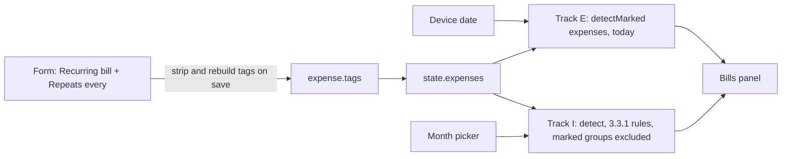

# 3.3.2: Bills you mark as recurring (type, occurrence, checkbox). Architecture, design, mock, impact, plan

Status: **APPROVED 19 November 2026: D1–D8 all as recommended** (owner). Independent review folded in (§11). Date 19 November 2026. Baseline: Penny 3.3.1 (`1f622fd`).
Prior work: [RECURRING-DETECTOR-SPEC](RECURRING-DETECTOR-SPEC.md) (3.3.1, inferred bills); [IDEAS](../IDEAS.md).

## 1. Bottom line

The owner's observation is that 3.3.1 recognises a bill only when its amount is stable (±10%) and its day is stable (a 7-day window). Indian utility bills break both rules:
- electricity, water, piped gas and postpaid mobile **vary in amount**;
- many are billed **every 2 months**;
- the **due date moves**.

The fix: **you say what is recurring and how often; Penny works out the rest.**
- **"Recurring bill" checkbox** on the expense form, with **"Repeats every"**: 1, 2, 3 or 12 months (D2).
- **Type is inferred, never asked.** With 3 or more entries a bill shows as **fixed** ("₹999") or **varies** ("₹1,840–₹2,610"). Below 3 entries it shows only the last amount.
- **Occurrence drives the status, not the day of the month.** Each bill shows one of: **Paid · next ~date**, **Due soon**, **Overdue**, or **Stopped?**
- **Unmarked expenses keep 3.3.1's strict inference**, unchanged.

**No data model change (D1).** The checkbox is stored as tags in the existing `tags` field (`#recurring`, `#every-2-months`, …). The checkbox and the "Repeats" choice are the only way to set or change it: on save, the form strips those tags and rebuilds them. CSV, JSON, schema 4 and 3.3.1 all keep working.

**Cut as good-to-haves** (to IDEAS): "Log it" pre-fill, bulk add, a "Mark as recurring?" button on inferred rows, and the search token `is:due`.

**Estimate:** about **4.5 build days (range 4–5.5)**.

## 2. Architecture



| Principle | How |
|---|---|
| One source of truth | Tags on each expense. Nothing new is stored; everything shown is derived |
| One way to write | The checkbox and radio are authoritative. Recurring tags are stripped from the tags box, voice and inline description on save, then rebuilt from the controls. The list shows them as **one locked label** ("Recurring · every 2 months"), not as removable chips. The inline "＋ Tag" form refuses these names with "Use Edit → Recurring bill" |
| Pure logic | `recurring.js` adds `detectMarked(expenses, today)`. `today` is passed in, so the module still has no clock. `detect` is unchanged; a test proves its output is byte-identical on the 3.3.1 fixtures |
| Explicit beats inferred | A group with any `#recurring` entry is in track E and excluded from track I |

## 3. Design: rules for marked bills (track E)

| Concept | Exact rule |
|---|---|
| **Group** | Same key as 3.3.1 (category + normalised description). **Limit:** if the description or category changes, it becomes a new bill. When the box is ticked, the form says "Use the same description and category each time" |
| **Marked** | Any entry in the group carries `#recurring` |
| **Step (occurrence)** | From the **latest marked** entry (ties broken by `id`): no cadence tag = 1 month, `#every-2-months` = 2, `#every-3-months` = 3, `#every-12-months` = 12 |
| **Last** | The latest entry in the group (marked or not), dated on or before today. Ties broken by `id` |
| **Next due** | Month of last + step; day = day of last, clamped to that month's length (31 Oct + 1 month = 30 Nov; 29 Feb + 12 months = 28 Feb). Every boundary (next, last + 2 × step, last + 3 × step) is clamped from the day of last, so a month-end clamp never drifts |
| **Status** | today < next − 7 days → **Paid {last date} · next ~{next}**. next − 7 ≤ today < next → **Due soon (~{next})**. next ≤ today < last + 2 × step → **Overdue (due ~{next})**. last + 2 × step ≤ today < last + 3 × step → **Stopped?** with the hint "Untick Recurring bill if it has ended". Later → hidden (still findable by searching `#recurring`) |
| **Type and amount** | Fewer than 3 entries: "last ₹X". 3 or more: if the last 3 amounts pass 3.3.1's integer ±10% test (`inBand`), show **fixed "₹median"**; otherwise **varies "₹min–₹max"** over the last 6 entries, plus "last ₹X" |
| **Early, late or several payments in a cycle** | Only the latest entry counts: an early payment moves next due forward; a correction in the same cycle replaces the amount shown |
| **As-of** | Track E is shown only when the month picker is the current month; for other months: "Bill status shows for the current month." Track I follows the picker, as in 3.3.1 |

## 4. Mock

**Expense form** (after Payment method):
```
[✓] Recurring bill   Use the same description and category each time.
    Repeats every:  (•) 1 month  ( ) 2 months  ( ) 3 months  ( ) 12 months
```

**Expense list row:** `Electricity  [Recurring · every 2 months]` is one locked label; other tags show as usual.

**Sidebar panel** (title **"Bills"**):
```
Bills
Your recurring bills
  Electricity   ₹1,840–₹2,610 · every 2 months · last ₹2,610   Overdue (due ~12 Nov)
  Broadband     ₹999 · monthly                                  Due soon (~23 Nov)
  Rent          ₹10,500 · monthly                               Paid 1 Nov · next ~1 Dec
  Insurance     last ₹14,200 · every 12 months                  Paid 3 Mar · next ~3 Mar

Looks recurring   Penny noticed these. Tick "Recurring bill" when you next add one.
  Netflix       ₹649 · around the 12th · seen 5 of 6 months
```
- **Order:** Overdue, Due soon, Stopped?, then Paid. Status is always text, never colour alone.
- **Caps:** 8 rows per section, then "and N more".
- **Empty state (track E):** "Tick 'Recurring bill' when you add a bill, and Penny tracks when it is next due."

## 5. Impact

| Area | File | Change | Size |
|---|---|---|---|
| Logic | `recurring.js` | `detectMarked` with its own row type that carries tags (`toRow` today strips tags, `:97-100`). Look-back = latest marked group entries, any age. Track I excludes marked keys | ~130 lines |
| Form | `index.html`, `app.js` | Checkbox and radio group; strip-and-rebuild on save; on edit, read the tags into the controls and remove them from the tags box; add both controls to `expenseDraft()` (`:68-79`) so unsaved changes still ask before closing | ~60 lines |
| Tags UI | `app.js` chip rendering (`:257`, `:276`), × handler (`:816`), inline tag form (`:836-840`) | Locked combined label; refuse recurring names inline | ~30 lines |
| Tag limit | form save | Clear message when rail + recurring + cadence + user tags > 12 (today the generic `parseTags` error, `core.js:62`) | ~5 lines |
| Panel | `index.html`, `app.js`, `styles.css` | Title "Bills", two sections, status text, as-of note | ~60 lines |
| Sample (D7) | `data.js` `defaults()` | Add `#recurring` to the sample Rent rows only. Counts unchanged | ~3 lines |
| Text audit | `index.html:236-238` (title, intro), empty state (`app.js` ~390), What's New 3.3.1 bullet (`:489`) and a new 3.3.2 bullet, README, search help (mention `#recurring`) | Wording listed in the PR |
| Tests | `tests/recurring.test.cjs`, a new form test with the existing browser fixtures | §7 | ~350 lines |
| Version and docs | `VERSION` and copies, CHANGELOG, ARCHITECTURE | 3.3.2 | small |

**Unchanged (checked):**

| Item | Evidence |
|---|---|
| Schema 4, storage, undo | Tags are an existing field |
| CSV and JSON formats | CSV headers unchanged (`data.js:297`). Tags are exported as `#tag` (`:342-344`). 3.3.1 imports a 3.3.2 file without error |
| F02 golden fixture | Reserved tags are rails only (`data.js:20`) and are not extended |
| Track I rules and output | `RULES` pinned; `detect` output test on the 3.3.1 fixtures |
| Voice | A spoken "tag recurring" lands in the tags box and is stripped on save, so voice cannot mark a bill |
| CSP, network, dependencies | None added |

## 6. Plan

One feature branch and one PR, built in a **fresh session** (practice 19), Sonnet builds and Opus reviews:

| Group | Contents | Gate (owner) |
|---|---|---|
| 0 | This spec + IDEAS update, merged by PR (docs only) | Approve D1–D8 |
| A | `detectMarked`, statuses, type, tests (no UI) | Tests green; Opus review clean |
| B | Form controls, locked label, inline refusal, dirty check, panel, sample, text audit, docs, version; browser checks | Approve the PR |
| C | Release 3.3.2 | **Owner smoke:** tick 2 real bills (one fixed monthly, one varying every 2 months), check statuses and the locked label, then "publish" |

**Freeze list:** schema, storage, CSV and JSON formats (F02); `detect` output and `RULES`; voice parsing; CSP.

## 7. Tests

| Group | Cases |
|---|---|
| Marking | any-entry marking; cadence from the latest marked entry; same-date tie by id; back-dated unmarked entry; two cadence tags on one entry (first valid wins, rebuilt on next save) |
| Next due | 31 Oct + 1 = 30 Nov; 29 Feb + 12 months; across a year end; steps 1, 2, 3, 12 |
| Status boundaries | next − 8 days (Paid), next − 7 (Due soon), next − 1, next (Overdue), next + step (Stopped?), next + 2 × step (hidden); month end |
| Type | 1, 2 and 3 entries; ±10% boundary with `inBand`; range over the last 6 |
| Purity and freeze | `detectMarked` never mutates input; `detect` output unchanged on the 3.3.1 fixtures; F02 golden unchanged |
| Form and tags | tick, change and untick round-trip; strip-and-rebuild removes typed or voiced `#recurring`; × and inline form cannot remove or add recurring tags; dirty check fires on checkbox-only changes; 12-tag message |
| Round trip | CSV and JSON export and import keep the tags; 3.3.1 importer accepts the 3.3.2 CSV header |
| Description drift | A renamed marked bill becomes a new group (documented limit) |
| Browser | both sections; as-of note on a past month; locked label; 375 px; keyboard and screen reader |

## 8. Estimate

| # | Item | Effort |
|---|---|---|
| E1 | `detectMarked`, statuses, type, purity and freeze tests | 1.5 d |
| E2 | Form controls, strip-and-rebuild, dirty check, tag limit | 0.75 d |
| E3 | Locked label, inline refusal | 0.5 d |
| E4 | Panel sections, as-of note, sample, text audit | 0.75 d |
| E5 | Docs, version, browser checks | 0.5 d |
| E6 | Independent review and fixes | 0.5 d |
| E7 | Release and Studio check | 0.25 d |
| | **Total** | **4.75 d (4–5.5)** |

## 9. Decisions (approved 19 November 2026: all as recommended)

| # | Decision | Options | Recommendation |
|---|---|---|---|
| D1 | Storage | (a) tags, with the form as the only writer; (b) new field, schema 4 → 5 (3.3.1 would then refuse new backups and CSVs) | **(a)** |
| D2 | Occurrence options | (a) 1, 2, 3 and 12 months: generic step logic, about +0.25 d of tests over (b); (b) 1 and 2 months only | **(a)**: covers bimonthly utilities, quarterly bills and yearly insurance, which you raised |
| D3 | Type | (a) inferred from 3 or more entries; (b) an "Amount varies" question | **(a)** |
| D4 | Ended bills | (a) derived "Stopped?" after one missed cycle beyond overdue, then hidden; (b) only by unticking | **(a)**: nothing stored |
| D5 | Unmarked utilities | (a) keep 3.3.1's strict rules; (b) relax with a utility keyword list | **(a)** |
| D6 | Deferred to IDEAS | "Log it" pre-fill (no pre-fill path exists today, `openExpense(id)` `app.js:697`), bulk add, "Mark as recurring?" button, `is:due` | **Defer all** |
| D7 | Sample data | (a) mark the sample Rent rows `#recurring` so a first-time visitor sees track E; (b) leave it | **(a)**: counts unchanged |
| D8 | Next releases | 3.3.2 this spec; **3.3.3 theme toggle** (your request, its own small release); 3.4 forecast | **As listed** |

## 10. Status log

| Date | Status |
|---|---|
| 2026-11-19 | Draft v1: the owner's observation on variable Indian utility bills (type, occurrence, checkbox) |
| 2026-11-19 | Draft v2: independent review folded in; "Log it" cut; rules made exact |
| 2026-11-19 | Approved by the owner: D1–D8 as recommended. Build in a fresh session, Groups A → B → C |
| 2026-11-19 | Group A built (Sonnet), reviewed (Opus): no Blocker or High. Status boundaries clarified as last + k × step, each clamped from the day of last |

## 11. Independent review (Sonnet 5.5, 19 Nov 2026): disposition

| Finding | Severity | Disposition |
|---|---|---|
| No pre-fill path for "Log it" | High | **Cut** (D6) |
| Tags editable elsewhere (box, chips ×, inline form, description, voice) | High | **Fixed**: form is the only writer; locked label; inline refusal |
| "Marked" defined two ways | High | **Fixed**: any entry; cadence from the latest marked entry; ties by id |
| Description and category drift split groups | High | Documented limit, plus a form hint |
| Cycle undefined; as-of mixed with the picker | High | **Fixed**: next due from the last entry; track E shown for the current month only |
| Two definitions of expected date; median wrap-around | High | **Fixed**: last + step, clamped; median dropped |
| "Due soon" needs a clock | High | **Fixed**: `today` passed in; boundaries tested |
| "Shown once" needs stored state | Medium | **Fixed**: derived "Stopped?" status |
| Type below 3 entries | Medium | **Fixed**: "last ₹X" only |
| Dirty check, tag headroom, text audit scope, voice claim | Medium | **Fixed** in impact and tests |
| `#yearly` collides with a common word | Low | **Fixed**: `#every-12-months` |
| Estimate optimistic | Medium | **Fixed**: 4.75 d without "Log it" |
