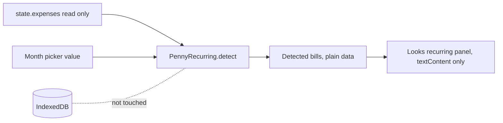

# Idea 1: Recurring detector. Impact, architecture, design, estimate and plan

Status: **APPROVED 18 November 2026: D1–D7 all (a), as recommended; D8 (a) added by the owner; D8 moved to 3.3.2 after the Group A spike** (owner). Next: Group A on a feature branch. Date 18 November 2026. Baseline: Penny 3.3.0 (`cb84ff7`), 644 automated tests passing.
Target release: **3.3.1**, the first step of the recurring-bills arc that rolls up to 3.4 (see [IDEAS.md](../IDEAS.md)).

## 1. Bottom line

Penny will **notice the bills you pay every month and list them, without being told**. A new read-only sidebar panel, **"Looks recurring"**, shows each detected bill with its usual amount, its usual day and the evidence ("seen 5 of the last 6 months").

The detector is **strict**: it would rather miss a bill than show a wrong one.

**Moved to 3.3.2 (D8, after the spike):** ~~Because strict detection needs 4 months of history, the panel also has a second, **factual** section from the first month of use: **"Paid last month, not yet this month"** (§7.4, owner decision D8). It does not claim anything is recurring; it only states what was logged last month and is missing this month.~~ On real data about half its rows were one-offs (cake, sneakers), so it returns in 3.3.2 built on an explicit "recurring" tick (see IDEAS.md).

It is **additive only**:
- no data model change (schema 4, storage keys, CSV and JSON formats are unchanged);
- the feature makes no network calls and adds no third-party code;
- nothing is stored or written.

The detector is a pure function over the expenses Penny already holds.

**Estimate:** about **5 build days (range 4.5–6.5)**, plus about 2 hours of your time across three gates. Size: medium. Details in §9.

## 2. Problem and goal

| | |
|---|---|
| Job | *When I open Penny, I want to see which fixed bills I pay every month, so that I know my committed spend without remembering it.* |
| Who | The owner. Penny is a showcase, so the first-visit demo matters as much as real use |
| Why now | Recurring bills were the most real pain in the 18 November brainstorm. Detection is also the engine for ideas 2 and 3 |
| Success | (1) **Precision 100%** on your review: every row is a real monthly bill. (2) **Recall ≥ 80% of fixed-amount monthly bills** you list before the spike (rent, SIPs, EMIs, subscriptions). Variable bills (electricity, phone usage) are excluded from the denominator, because strict rules are expected to miss them. (3) A first-time visitor sees the panel working (D3). (4) ~~A user with only one previous month logged still gets useful help (D8)~~ moved to 3.3.2. (5) Freeze checks pass (§8) |
| Non-goals | Reminders; adding entries (idea 2); forecasting (idea 3); bimonthly, quarterly or yearly bills; variable-amount bills; dismissing detections (that needs stored data) |

## 3. Impact analysis

### Changes

| Area | File | Change | Size |
|---|---|---|---|
| Logic | **`recurring.js` (new, root)** | Pure detector in the same UMD pattern as `core.js`, global `PennyRecurring`. No DOM, storage, network or clock access; the reference month is passed in | ~170 lines |
| UI | `index.html` | `<script src="recurring.js">`, one sidebar `<section class="panel">` after "Where it goes", one What's New item, version badge | ~25 lines |
| UI | `app.js` | `renderRecurring()` at the end of `render()`, `textContent` only. Result memoised per (expenses array, month), because `render()` runs on every search keystroke | ~45 lines |
| UI | `styles.css` | Reuses `.panel`, `.small` and `.empty`, plus a few lines for list rows | ≤ 10 lines |
| Deploy | `Dockerfile` `COPY --from=verify` list; `pages.yml` **`paths:` trigger** and **`cp`** lists | Add `recurring.js` in **3 places**. The existing test `no-excel.test.cjs:37-59` already fails if any root `.js` file is missing from `index.html` or any of the 3 lists | 3 lines |
| Sample (D3 = a) | `data.js` `D.defaults(date)` (`:129-190`) and `operation()` (`:210`, hard-coded `remaining: kind === 'reset' ? 9`) | Add past-month entries for 3 sample bills; derive the reset count instead of hard-coding 9 | ~20 lines |
| Tests that change (D3 = a) | `tests/v32.test.cjs` ACC-01 (`:7`) and ACC-03 (`:9`), plus any other `seed()` count assertions; `tests/import-safety.test.cjs:36` (`length === 9`) | Updated counts only. Each edit is listed in the PR | ~6 assertions |
| Version | `VERSION`; tested copies (`index.html`, `diagnostics.js`, `scripts/penny`, `compose.yaml`); **untested** doc mentions (`README`, `CHANGELOG`, `DEPENDENCIES`, `SECURITY-REVIEW`, `ARCHITECTURE`) | 3.3.1 (D6) | mechanical |
| Docs | `README.md` (feature text; "nine sample expenses" at `:41` if D3 = a), `CHANGELOG.md`, `docs/ARCHITECTURE.md` (module diagram), `SECURITY-REVIEW.md` (one line: no new surface) | | small |
| Tests (new) | `tests/recurring.test.cjs` plus a golden fixture | §8 | ~350 lines |

### Unchanged (checked)

| Item | Why it is safe |
|---|---|
| Data model: `schemaVersion` 4, `expenses` (amounts in integer paise in the `cents` field), `budgets`, `settings`, `tagCatalog` | The detector reads `state.expenses` only |
| `storage.js`, keys, revisions, recovery, undo | Not called |
| CSV and JSON export and import, linked file | Not touched |
| CSP (`index.html:8`, `nginx.conf`) | `script-src 'self'` covers a local file. `connect-src` (the currency converter's rate host) is unchanged |
| Diagnostics allowlist | No new events (D5) |
| Voice, Hindi, translation, converter | Not touched |
| Cards, budget panel, chart, list, search | Not touched; the panel is appended to the sidebar |
| README sample total (₹13,338.50, current month) | Unchanged under D3 = a (new rows are in past months) |
| Studio | Penny's `notify-studio.yml` sends `product-updated` on a published release, as for 3.3.0. Verified at release by watching Studio's sync run |

### Risks

| Risk | Likelihood | Mitigation |
|---|---|---|
| Real descriptions drift, so the detector misses bills | **High: the riskiest assumption** | Normalisation (§7.2) plus a **spike before any UI** (D2). Plan for one rule iteration (in the estimate) |
| A wrong guess on a showcase | Medium | Strict rules (§7.3), including ≥ 4 of 6 months, which rejects bimonthly bills. A residual risk is documented in §7.5 |
| One accidental duplicate in a month hides a real bill for up to 6 months | Medium | Accepted as the cost of strictness. Measured in the spike |
| Price rise above 10% (₹499 → ₹649) hides a subscription for months | Medium | Accepted for 3.3.1. Logged for idea 3 ("price rises") |
| First-time visitor sees an empty panel | Certain without D3 = a | D3 |
| `render()` cost on every keystroke | Low | Memoised per (expenses, month); detection under 50 ms for 10,000 entries |
| Panel buried under the list on phones (sidebar stacks below at 375 px) | Medium | Checked in browser test B04; moving it is a later decision, not a 3.3.1 change |

## 4. Architecture



- **Placement:** a new module beside `core.js`. Logic stays separate from DOM and storage, and `app.js` remains the only DOM writer.
- **Contract:** `PennyRecurring.detect(expenses, referenceMonth) → { bills: Bill[], window: {from, to} }`. Deterministic, never mutates its input, no side effects. `Bill = { description, category, cents, lastCents, day, monthsSeen, monthsChecked, paidThisMonth }`.
- **Rules as data:** thresholds live in one exported frozen object `RULES`. Tests pin each value, so any loosening is visible.
- **Reference month:** the month picker (D4). Entries dated after the end of the reference month are ignored, which also makes a future picker month behave predictably.

## 5. Design (user-facing)

```
Looks recurring
Bills Penny has seen most months. Nothing is saved or changed.

Rent                         ₹10,500
Housing · around the 1st · seen 6 of 6 months · paid this month

Netflix                         ₹649
Entertainment · around the 12th · seen 5 of 6 months

▸ Paid last month, not yet this month (4)        [collapsed by default]
  Electricity                 ₹2,140   paid 7 Oct
  Broadband                     ₹999   paid 3 Oct
```

- Rows are sorted by usual amount, highest first. At most 8 rows are shown, then "and N more".
- The usual amount is the median (the lower middle value when the count is even, so it stays whole paise). "last ₹X" is added when the latest amount differs.
- The description shown is the most recent original wording.
- "Paid this month" appears only when a reference-month entry passes the same amount and day rules (D7).
- Empty state: "No regular monthly bills found yet. Penny looks for the same expense, at about the same amount and day, in at least 4 of the last 6 months."
- **"Paid last month, not yet this month"** is a `<details>` element, **collapsed by default**, so the strict list stays the headline. Its summary shows the count. Up to 5 rows by amount, then "and N more". Wording is factual: no row is called a bill.
- `<section>` with an `<h2>` and a `<ul>` of plain text. No meaning is carried by colour alone. Rows are not clickable in 3.3.1.

## 6. Data flow on one render

1. `render()` reads the picker month.
2. The memo is checked: same `state.expenses` reference and same month? Then reuse.
3. Otherwise run `detect` and store the result in memory only (never persisted).
4. `renderRecurring()` rebuilds the list with `textContent`.

## 7. Detection rules (strict)

### 7.1 Window
The **6 calendar months before the reference month** (complete months). The reference month itself is used only for "paid this month" (D7).

### 7.2 Grouping key
Category + normalised description:
1. Lower-case, using Unicode-aware handling (`\p{L}\p{M}\p{N}`), so Devanagari combining marks survive.
2. Remove whole-word English month names and 3-letter abbreviations, plus `sept`.
3. Remove 4-digit years (`19xx`, `20xx`). **Other numbers are kept**, so "Room 1 rent" and "Room 2 rent", or "Airtel 499" and "Airtel 599", stay separate (strict).
4. Remove punctuation and collapse spaces.
5. **An empty key never groups.** A description that is only "Nov" or "2026" is ignored.

`#tags` are already removed from stored descriptions by `core.js` `extractTags` (`:65-71`).

### 7.3 A group is recurring only if all of these hold

| Rule | Exact definition | Why |
|---|---|---|
| Months seen | Matches in **≥ 4** of the 6 window months | Rejects bimonthly bills (at most 3 of 6) and young patterns |
| Once per month | No window month has 2 or more matches | Rejects groceries, coffee, fuel |
| Amount stable | Every match satisfies `abs(cents − median) × 10 ≤ median` (integer arithmetic) | ±10%, exact at the boundary |
| Day stable | `max(day) − min(day) ≤ 6` after mapping days 29–31 to 28 | A 7-day-wide window, with the boundary pinned by tests (spread 6 passes, 7 fails) |
| Still active | A match in at least one of the 2 most recent window months | A cancelled subscription drops off |

### 7.4 Paid last month, not yet this month (D8)

> **Moved to 3.3.2 (owner, 18 Nov, after the spike).** The rules below are kept for reference; 3.3.1 does not build them.

A factual list, not a detection. An entry from the **month before the reference month** is shown when all of these hold:

| Rule | Exact definition |
|---|---|
| Single | Its key (§7.2) appears **exactly once** in that month (filters groceries, coffee and fuel) |
| Missing now | No entry with the same key in the reference month |
| Not duplicated | The key is not already in the "Looks recurring" list |
| Has a key | Non-empty normalised key |

One-off purchases (for example "New sneakers") can appear here. That is why the section is collapsed, factually worded and capped at 5 rows. A month of history is not enough to tell a bill from a one-off, and the section does not pretend otherwise. When the month picker is on a past month, the section compares that month with the one before it.

### 7.5 Known limits (documented, accepted for strictness)
- **Due dates that cross a month boundary** (paid on the 30th one month and the 2nd the next) fail the day rule. This is a false negative.
- **Fixed-price habits logged once a month** (a haircut at ₹500 around the same date) can pass. This is the main residual false-positive risk, and the spike measures it. If it shows up, the fallback rule is: "the original description is identical in ≥ 3 matches."
- **A category change** in one month splits the group, which loses that month.

## 8. Test plan

| ID | Case |
|---|---|
| TC-RD-U01…U12 | Normalisation: month names and `sept`, years, kept numbers, punctuation, spacing, Devanagari kept intact, empty key ignored |
| TC-RD-R01…R18 | Rules: 4 of 6 pass; 3 of 6 fail; bimonthly (months 2, 4, 6) fail; twice in a month fail; amount at exactly +10% pass and +10% + 1 paise fail; day spread 6 pass, 7 fail; days 31 and 28 equal; inactive in the 2 latest months fail; payment-method change pass; category change splits; fixed-price habit fixture (documents the residual) |
| TC-RD-W01…W05 | Window: January reference (year wrap), past picker month, future picker month, entries after the reference month ignored, empty history |
| TC-RD-L01…L06 | **Moved to 3.3.2 (owner, 18 Nov, after the spike).** Last-month section: single entry shown; twice last month not shown; present this month not shown; already in recurring list not shown; empty key not shown; January reference uses December; cap 5 plus "N more" |
| TC-RD-O01…O05 | Output: lower-median whole paise, "last ₹X", sort order, max 8 plus "N more", "paid this month" only when amount and day rules pass |
| TC-RD-F01 | `detect` never mutates input (deep-frozen fixture) |
| TC-RD-F02 | **Golden fixture** (committed `tests/fixtures/freeze-3.3.0.json`, generated from the 3.3.0 code before any change): JSON backup and CSV export of a fixed state, and `migrateState` output, are byte-identical after the change |
| TC-RD-F03 | CSP meta string and `nginx.conf` header equal committed baseline strings in the test file |
| TC-RD-F04 | `RULES` constants pinned |
| — | Existing `no-excel.test.cjs` runtime-file test stays green (it enforces `index.html` and all 3 deploy lists) |
| TC-RD-S01 | With D3 = a: detection on `D.defaults(date)` returns exactly the 3 sample bills and never "Weekly groceries" |
| TC-RD-P01 | 10,000 expenses detected in under 50 ms in Node |
| TC-RD-B01…B04 | Browser (manual, recorded): panel on sample data; month picker changes the result; empty state; 375 px width (position noted), keyboard and screen reader |

**Honest limit of the freeze proof.** F02 and F03 prove that data, formats and security headers are frozen. That existing screens behave the same is proven by the 644 existing tests (only the D3 count assertions are edited, each named in the PR and checked in review) and by browser check B01. There is no automated DOM snapshot, so that part is checked by human review.

## 9. Estimate

Built by a Sonnet 5.5 subagent, reviewed independently by Opus 5.5. "Days" are build effort, not calendar time.

| # | Work item | Effort | Confidence |
|---|---|---|---|
| E1 | Golden freeze fixture from 3.3.0 (before any change) | 0.25 d | High |
| E2 | `recurring.js` and unit tests (U, R, W, O, F01, F04, P) | 1.25 d | Medium |
| E3 | Spike on your data (D2), and **one rule iteration** | 0.75 d | Medium |
| E4 | Panel, memo, styles, accessibility | 0.5 d | High |
| E4b | ~~Last-month section (D8)~~ moved to 3.3.2 | 0 d (was 0.5 d) | — |
| E5 | D3 sample bills, `operation()` count, updated assertions, S01 | 0.5 d | Medium |
| E6 | Deploy lists (3), version and all doc copies, What's New, README, CHANGELOG, ARCHITECTURE, SECURITY-REVIEW | 0.25 d | High |
| E7 | Browser checks B01–B04 | 0.25 d | Medium |
| E8 | Independent review and fixes | 0.5 d | Medium |
| E9 | Release 3.3.1, Pages check, Studio sync check | 0.25 d | High |
| | **Total** | **4.5 d (range 4–6)**, after D8 moved to 3.3.2 | |
| | Your time | ~2 h: decisions now, spike review after Group A, release approval | |

The draft estimate (3.75 d) was too low. It missed the 3-list wiring, the `operation()` code change, the untested doc version copies and a likely second spike iteration. **6 days** is the case where the spike needs two rule iterations.

## 10. Delivery plan

Gated as in the operating checklist (**Impact → Plan → Build → Test → Release → Update**), with a pause after each group.

**Branch strategy (fixes a review blocker):** an existing test requires every root `.js` file to be in `index.html` and in all 3 deploy lists, and any of those files in `pages.yml` `paths:` triggers a Pages deploy. So Group A cannot merge an unwired engine. **Groups A and B are built on one feature branch** and reviewed at each gate there. They merge to `main` in **one PR** at the end of Group B. Pages deploys once, and only the finished feature.

| Group | Contents | Exit gate (your approval) |
|---|---|---|
| **0. Spec** | This spec and `docs/IDEAS.md`, merged by PR (docs only; no deploy) | You approve D1–D7 |
| **A. Engine** (branch) | E1 → E2 → E3 | Spike: precision 100% and recall ≥ 80% (§2). All tests green on the branch. Opus review clean |
| **B. Panel** (same branch) | E4 → E5 → E6 → E7 → E8. PR to `main`; CI `verify` green | Browser checks recorded; Opus diff review; checklist smoke (§4 of the operating checklist). **You approve the merge** |
| **C. Release** | E9: tag `v3.3.1`, release notes; watch Studio's sync | **You approve publishing** |

**Owner's 2-minute smoke test** before the `v3.3.1` release (checklist §4):
- Add, edit and delete an expense.
- Export CSV and JSON, then re-import.
- On sample data (a fresh browser, or after Reset), "Looks recurring" lists Rent, Train pass and Music subscription.
- **Empty panel:** pick a month with no earlier history (for example March 2026). The panel shows the empty-state text from §5, laid out cleanly, with no blank gap, stray rows or "and 0 more".
- The version shows 3.3.1.

**Freeze list:** data schema and storage keys (F02); CSV and JSON formats (F02); CSP and headers (F03); diagnostics allowlist (unchanged file, review); existing screens and behaviour (existing tests plus B01, human review); no new network or third-party code (CSP unchanged; `DEPENDENCIES.md` unchanged apart from the version).

**Artifacts:**

| Artifact | Group |
|---|---|
| This spec (impact, architecture, design, rules, tests, estimate, plan), `docs/IDEAS.md` | 0 |
| Golden freeze fixture, `tests/recurring.test.cjs`, spike result note (**counts only, no personal data, nothing derived from your real data committed**) | A |
| `recurring.js`, panel, What's New, README, ARCHITECTURE, CHANGELOG, SECURITY-REVIEW updates, browser check record | B |
| v3.3.1 release notes; Studio listing refreshed | C |

## 11. Decisions (approved 18 November 2026: all (a))

| # | Decision | Options | Recommendation |
|---|---|---|---|
| D1 | Strictness | (a) §7.3 as written (≥ 4 of 6, ±10%, 7-day window); (b) looser (3 of 6, ±15%) | **(a)**: strict, as you chose. It also rejects bimonthly bills |
| D2 | Spike on real data | (a) **you run** a one-line local script on a fresh JSON backup and read the output yourself; you tell me only the counts (right, wrong, missed). Nothing is sent anywhere; (b) I run it and see the list. That output then passes through the AI service like any chat content; (c) skip it and use synthetic fixtures only | **(a)**: the proof the idea works, with your data staying on your Mac |
| D3 | Showcase sample data | (a) add past-month entries for Rent, Train pass and one subscription to `D.defaults`, so first-time visitors (and Reset) see detection working. Costs: the reset count becomes derived, about 6 test assertions and the README "nine sample expenses" change; (b) leave the sample (empty panel on first visit) | **(a)**. Applies only when no saved data exists, or after Reset |
| D4 | Reference month | (a) month picker; (b) always today | **(a)**: consistent with the cards and chart |
| D5 | Diagnostics event | (a) none; (b) one count event | **(a)** |
| D6 | Version | (a) 3.3.1 as you planned; (b) 3.4.0 (semver: new feature = minor) | **(a)**, with a CHANGELOG note on the deliberate roll-up to 3.4 |
| D8 | "Paid last month, not yet this month" (added by the owner after approval) | (a) include in 3.3.1 as a collapsed, factual section; (b) leave for idea 2 | **(a)**, approved 18 November 2026: waiting 4 months for strict detection is too long on its own. **Moved to 3.3.2 (owner, 18 Nov, after the spike).** Spike: about half the rows were one-offs. It returns with an explicit "recurring" tick |
| D7 | "Paid this month" | (a) shown when a reference-month entry passes the amount and day rules; (b) not shown | **(a)**: no cost, and it sets up idea 2 |

## 12. Independent review (Sonnet 5.5, 18 November 2026): disposition

| Finding | Severity | Disposition |
|---|---|---|
| S1 Group A cannot merge an unwired root `.js` file (`no-excel.test.cjs:41`); 3 lists, not 2; `paths:` triggers deploy | Blocker | **Fixed**: one feature branch, one PR; 3 lists named |
| S2 Freeze tests tautological or without baseline; F03 duplicates an existing test | High | **Fixed**: golden fixture from 3.3.0, baseline strings, existing test reused; honest limit stated |
| S3 Wrong function name; hard-coded `remaining: 9`; tests that break; grocery row risk | High | **Fixed**: `D.defaults`, `operation()` change, tests listed, S01 excludes groceries |
| S4.1 Bimonthly bills pass as monthly | High | **Fixed**: ≥ 4 of 6 |
| S4.2 "Paid this month" unchecked; partial or future reference month | Medium | **Fixed**: same rules apply; window is complete months only; later entries ignored |
| S4.3 Day window ambiguous; month-boundary miss | Medium | **Fixed**: `max − min ≤ 6`, boundary tests; miss documented |
| S4.4 Float ±10%, median rounding, price rises, variable bills | Medium | **Fixed**: integer rule, lower median; recall denominator excludes variable bills; price rise documented |
| S4.5 Duplicate hides a bill | Low | Documented as accepted |
| S4.6 Fixed-price habits | Medium | Documented residual; fallback rule ready; fixture test |
| S4.7 Normalisation (numbers, empty key, Unicode, tags) | Medium | **Fixed**: numbers kept, empty key ignored, Unicode classes, tag step dropped |
| S5 "Nothing is sent" was untrue if I run the spike | High | **Fixed**: D2 (a), where you run it; (b) states the trade-off |
| S6 Estimate low | Medium | **Fixed**: 4.5 d (4–6) |
| S6 Per-keystroke cost | Low | **Fixed**: memo |
| S7 Phone placement; idea 2 bulk-add write path | Low | B04 notes position; IDEAS.md flags idea 2's own impact check |

## 13. Status log

| Date | Status |
|---|---|
| 2026-11-18 | Draft v1 from the brainstorm (ideas 1–3, strict detection) |
| 2026-11-18 | Draft v2: independent review folded in |
| 2026-11-18 | D8 added by the owner: keep 4 of 6 for accuracy, and add "paid last month, not yet this month" so help starts after one month. Estimate 5 d |
| 2026-11-18 | Approved: D1 strict, D2 owner runs the spike locally, D3 sample bills added, D4 month picker, D5 no diagnostics event, D6 3.3.1, D7 "paid this month" |
| 2026-11-18 | Group A spike: "Looks recurring" made no wrong calls; the D8 list was about half one-offs. **D8 moved to 3.3.2** (owner), to return on an explicit "recurring" tick. Estimate 4.5 d |
| 2026-11-18 | **Group A gate closed by the owner:** spike returned 0 bills because the backup has about 1 month of real history (4 needed), so recall cannot be measured yet. Owner chose to proceed to Group B on the unit-test evidence (45 detector tests) and **re-run the spike on real data before 3.3.1 is released** |
| 2026-11-18 | **Group B built** (Sonnet 5.5), 692/692 tests. Browser checks on sample data, 18 Nov: **B01** pass, panel lists Rent (6 of 6, paid), Train pass (5 of 6, paid), Music subscription (4 of 6); console clean. **B02** pass, October shows Rent 5 of 6 and Train pass 4 of 6 only. **B03** pass, March 2026 shows the §5 empty text. **B04** pass, 375 px: no horizontal scroll, panel is last in the stacked sidebar (about 7,100 of 7,600 px, noted, not moved); labelled section, h2, plain list, no focus stops. **E8 Opus review:** no Blocker; High fixed (Reset preview said 9 samples, now derived); Medium fixed (README sample breakdown); Lows fixed (wording 'about the same', S01 January case); Nit fixed (space between row name and detail). Open: README links the v3.3.1 tag before Group C creates it |
| 2026-11-18 | **Release gate (owner): "Release, gate on tests".** PR #12 merged to `main` as `fe2ee80`. Spike re-run on real data: Looks recurring 0 bills, window 2026-05 to 2026-10. That is about 1 month of real history, short of the 4 needed, so recall cannot be measured yet. The owner accepted the synthetic tests (46 detector tests, including TC-RD-S01) as the gate for 3.3.1. The smoke test gains an empty-panel step (§10). Tag and publish wait for the owner's "publish" |
