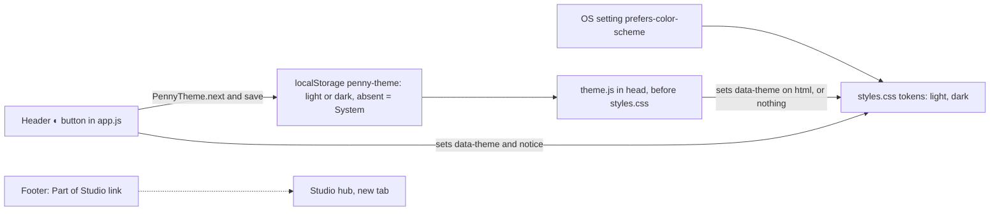

# 3.3.3: Dark and light theme, with Studio lineage. Architecture, design, mock, impact, plan

Status: **RELEASED 19 November 2026 as [v3.3.3](https://github.com/debasisr66/PennyExpenseManager/releases/tag/v3.3.3)** (PR #19, merge `03078f3`). Approved earlier the same day: D1–D10 all as recommended (owner: "All as recommended"). Release notes record what was and was not checked.  3.3.4 (new categories, §11) and 3.3.5 (mobile pass) follow. Independent review folded in (§12). Date 19 November 2026. Baseline: Penny 3.3.2 on `main` (`ae701eb`, 762 tests).
Owner requests (18 November 2026): "dark and light toggle is not in penny - it should be" and "It should also carry the Studio product lineage". Prior work: [IDEAS](../IDEAS.md) (rows "Dark and light theme toggle" and "Studio product lineage").

## 1. Bottom line

- **Three modes: System (default), Light, Dark.** System follows the phone or computer setting live, with no JavaScript. One header button, ◐, cycles System → Light → Dark (D2, D3), as on Studio.
- **Saved on this device only.** One `localStorage` key, `penny-theme`. It is not part of the expense data, backups, CSV, JSON or schema 4, so the F02 freeze holds (D1).
- **No flash of the wrong theme, and no CSP change.** A new 20-line `theme.js` runs in `<head>` before the stylesheet. It is allowed by today's `script-src 'self'`. The cost is one new file in the three deploy lists (D4).
- **Studio lineage, as proposed for confirmation (D5):**
  - a "Part of Studio" link with the Studio mark in the footer, back to the hub;
  - the dark theme uses Studio's own dark neutral tokens (background, surfaces, borders, text);
  - Penny keeps its green accent and its light palette, so it stays recognisably Penny.
- **WCAG AA in both themes.** Text is at least 4.5:1. Focus rings, input borders, chart bars and the budget bar are at least 3:1. The audit found **4 kinds of existing light-theme gap, covering 11 colour pairs** (§3.4). The recommendation is to fix them in this release (D6).
- **Mobile first (owner, 19 November 2026).** The phone is the primary design target. Penny's header is designed at 320 px first: the brand and ◐ (44 × 44 px) sit on row 1 and the three actions on row 2, so the header drops from 181 px to at most 112 px tall at 320 px. The phone's address and status bar match the theme (`theme-color`). Hover effects apply only on devices that can hover. Real-phone checks on iPhone Safari and Android Chrome are part of the release. The audit also found 3 existing mobile gaps. D7 recommends fixing the worst one now: form fields go to 16 px on phones, so iPhone Safari stops zooming on focus. The other two go to a follow-up mobile pass (§3.5).
- **New categories (owner, 19 November 2026): Utilities and Staff salary.** Entertainment is already in the list. Adding the two is small, but it is a data and voice change, not a theme change. D8 recommends shipping it as its own release, 3.3.4, straight after 3.3.3. §11 has the impact.
- **Nothing Studio reads changes.** Studio's sync reads repository metadata and the latest release (tag, name, notes, assets). The release keeps the `PennyExpenseManager-*.zip` asset name.

**Cut as good-to-haves:** a separate theme for printing, theme in Settings as well as the header, a visible text label beside ◐, live sync between open tabs, self-hosting Studio's fonts, and a Studio-side change.

**Defaults, not decisions:** the Studio link opens in a new tab (it protects an unsaved expense form), and the version is 3.3.3, a patch release of its own.

**Estimate:** about **16 build hours (range 14–18)** plus about **1 hour of owner gate time** over 3 gates (§8).

## 2. Architecture



| Principle | How |
|---|---|
| One source of truth for colour | Every colour is a CSS custom property. `:root` holds the light values. The dark values appear in two identical blocks: `@media (prefers-color-scheme: dark) { :root:not([data-theme="light"]) {…} }` and `:root[data-theme="dark"] {…}`. Outside the token blocks, `styles.css` has no colour literals (a test enforces this) |
| System needs no script | System mode is pure CSS. With JavaScript off, or `localStorage` blocked, Penny still follows the OS |
| Explicit choice is applied before first paint | `theme.js` is a synchronous, external script in `<head>`: it reads `penny-theme` and sets `document.documentElement.dataset.theme` to `light` or `dark`. It never throws: storage errors mean System |
| Pure and testable | `theme.js` exposes `PennyTheme` in the UMD pattern used by `core.js`: `resolve(stored)`, `next(mode)`, `label(mode)`, `save(storage, mode)`, `apply(root, mode)`. The Node tests load it directly |
| Preferences are not data | The key is outside the IndexedDB document. Backups, undo, import, "Start fresh" and full reset neither read nor clear it. Diagnostics log no theme events |
| Native controls follow | Each token block sets `color-scheme` (`light` or `dark`), so date, month and select controls, scrollbars and dialog backdrops match |
| Chart colours become tokens | `app.js` writes `background:var(--cat-N)` instead of a hex literal. Inline `style=` is already allowed by the CSP (`style-src 'self' 'unsafe-inline'`) |

**Why not a `settings` field (D1):** `settings` is inside schema 4. A new field changes the JSON export, the import preview and the F02 golden, and a theme would then travel with backups to other devices. A display preference belongs to the device.

**Why a new file rather than another option (D4):** Penny loads all of its scripts at the end of `<body>`. If the theme were applied there, a user whose saved choice differs from the OS setting could see a flash on each load. The other ways to run early are an inline script, which needs a CSP hash or `'unsafe-inline'`, or moving `core.js` into `<head>` and giving it DOM access, which breaks its purity. A separate small file keeps the CSP byte-identical. `tests/no-excel.test.cjs` already requires `index.html`, the `Dockerfile` and the Pages workflow to list the same files, so the new file cannot be half-deployed.

## 3. Design

### 3.1 Modes and the control

| Item | Rule |
|---|---|
| Modes | **System** (no key saved, no `data-theme`), **Light** (`penny-theme=light`), **Dark** (`penny-theme=dark`). Any other stored value counts as System |
| Default | System, for new and existing users |
| Control | One header button `#theme-toggle` showing ◐ (`aria-hidden`), as on Studio. **44 × 44 px at every width** (set through the id selector, because `.header-actions button` sets its own padding, styles.css:874 and :1022). Placement is mobile first (§3.5): top right of row 1 on phones; after "What's New" on wide screens. `title` repeats the name for mouse users |
| Cycle | System → Light → Dark → System. Enter and Space both work (it is a native `<button>`) |
| Name | `aria-label="Theme: {mode}. Change theme"`, updated in the same handler as the press. This label is the accessible source of truth; screen readers re-read the focused button's new name. No `aria-pressed` (three states). The existing notice also shows "Theme: Dark. Saved on this device." (or "Theme: System. Follows your device setting.") as a visual confirmation only: today's notice is `hidden` until set and auto-hides after 3.2 s (app.js:254-258), so it is not relied on for announcement |
| Storage blocked | The choice still applies for this page view; the notice says "Theme: Dark for now. This browser is not saving settings." |
| Live OS change | In System mode the theme follows the OS immediately (CSS only). Explicit modes ignore the OS |
| Other tabs | A choice made in one tab applies to other open tabs on their next load. No `storage` listener (cut as a good-to-have) |

### 3.2 Tokens

The builder replaces each colour literal in `styles.css` with one of these tokens. In light mode, each token's value is today's value, except for the fixes in §3.4.

| Token | Used for | Light (today, unless marked fix) | Dark |
|---|---|---|---|
| `--bg` | Page | `#f5f7f3` | `#0D0D0F` (Studio `--bg`) |
| `--surface` | Panels, inputs, search, dialogs (`white` today) | `#ffffff` | `#151519` (Studio `--surface`) |
| `--surface-2` | Secondary buttons, help, filter, budget, voice, version badge, category pill, "＋ Tag", log preview, table row lines | `#edf2eb`. Today there are 7 near-identical tints (`#eef3e8`, `#edf2e9`, `#eef3ea`, `#edf2ed`, `#efefeb`, `#edf0e9`, `#edf2eb`); they merge into one, at most 3 out of 255 apart in any channel, which is not visible | `#1C1C22` (Studio `--surface-2`) |
| `--line` | Dividers, panel borders (decorative) | `#e1e7df` | `#26262E` (Studio `--border`) |
| `--line-2` | Version badge border (`.preview`, decorative) | `#d5dfd1` | `#26262E` |
| `--field` | Input, select, textarea and search borders | **fix** `#7f8f86` (was `#d4ded4` and `#cbd8ce`) | `#6E6E7C` (Studio `--field`) |
| `--ink` | Body text | `#193c36` | `#EDEDF0` (Studio `--text`) |
| `--muted` | Secondary text and input placeholders (new `::placeholder` rule; phone header layout (M1); hover rules inside `@media (hover: hover)` (M4); today the browser default, about 3.95:1 on a dark surface) | `#5d7069` | `#8B8B97` (Studio `--muted`) |
| `--brand-dot` | The "." after "penny" (inline style in index.html:18 today; decorative) | `#9fae9d` (unchanged) | `#8B8B97` |
| `--green` | Primary fill, links, accents | `#216653` | `#4FC59A` |
| `--on-accent` | Text on green or red fills (`white` today) | `#ffffff` | `#0D0D0F` |
| `--red` | Errors, overdue, over budget, delete | `#ad3e35` | `#FF8A80` |
| `--focus` | Focus ring | **fix** `#9a6b00` (was `#d6aa51`) | `#E2B660` |
| `--track` | Budget track (rail) | `#d8e2d3` | `#26262E` |
| `--bar-track` | Category bar track (rail) | `#f0f3ed` | `#26262E` |
| `--warn-bg` | Warning box | `#fff2ed` | `#2A1A18` |
| `--locked-bg`, `--locked-line` | Recurring locked label | `#eef3fb`, `#c4d3ea` | `#1A1F2E`, `#3A4566` |
| `--tag-l`, `--tag-line-l`, `--tag-s` | Tag chip lightness and saturation (the hue stays per tag) | `96%`, `81%`, `65%` / `48%` | `18%`, `34%`, `25%` |
| `--chip-hover` | Tag chip button hover overlay (`#ffffff77` today: in dark it would drop chip text to 2.6:1) | `#ffffff77` | `#ffffff1f` |
| `--shadow`, `--shadow-soft`, `--backdrop` | Dialog and notice shadow, search box shadow, dialog backdrop | `#173a3526`, `#193c3605`, `#14372f65` | `#00000066`, `#00000033`, `#000000a6` |
| `--cat-0` … `--cat-6` | Category bars, in `C.categories` order | **fix** `#28745b #6f8a4a #a2741a #3d8389 #7d68a3 #b0613a #6f7768` | `#4FC59A #B4C48E #E2B660 #8FC6CA #B9A6D6 #E39A74 #A4AB99` |

`filter: brightness(0.94)` on button hover (styles.css:47) is not a colour literal and stays; it keeps text contrast in both themes. The 5 Studio neutral values are copied from `debasisr66/studio` `css/site.css` at commit `8faaf62` and named in a comment. Penny does not load anything from Studio at runtime.

### 3.3 Contrast evidence (measured, WCAG 2.x formula)

| Pair | Need | Light | Dark |
|---|---|---|---|
| Body text on surface | 4.5 | 12.06 | 15.59 |
| Muted text on page and on `--surface-2` | 4.5 | 4.89 / 4.64 | 5.77 / 5.04 |
| Placeholder (`--muted`) on surface | 4.5 | 5.27 | 5.41 |
| Red text on surface | 4.5 | 5.97 | 7.98 |
| Green text on surface | 4.5 | 6.80 | 8.49 |
| Button text on green / on red | 4.5 | 6.80 / 5.97 | 9.05 / 8.51 |
| Focus ring on page and surface | 3 | 4.35 / 4.69 | 10.26 / 9.62 |
| Input border on surface | 3 | 3.40 | 3.63 |
| Budget fill on track: green / red | 3 | 5.09 / 4.47 | 6.99 / 6.57 |
| Category bars on track (lowest of 7) | 3 | 3.47 | 6.34 |
| Tag chip text, all hues 0–359, resting and hover | 4.5 | tested in TC-TH-C05 | tested in TC-TH-C05 |
| Red text on warning box | 4.5 | 5.45 | 7.30 |
| Ink on locked label | 4.5 | 10.83 | 14.05 |
| Green text and focus ring on `--surface-2` | 4.5 / 3 | 5.99 / 4.13 | 7.90 / 8.96 |

### 3.4 Existing light-theme gaps found by the audit (D6)

| Item | Today | Fix |
|---|---|---|
| "＋ Tag" text `#66716a` on `#efefeb` | 4.41 (text, fails 4.5) | `--muted` on `--surface-2`: 4.64 |
| Focus ring `#d6aa51` on page and surface | 2.00 and 2.16 (fails 3) | `#9a6b00`: 4.35 and 4.69 |
| Input borders `#d4ded4`, `#cbd8ce` on white | 1.38 and 1.47 (fails 3) | `#7f8f86`: 3.40 |
| 6 of 7 category bar colours on their track | 1.80–2.33 (fails 3) | New set, same hue order: 3.47–4.28 |

The fixes keep each colour's hue and make it darker. Apart from these fixes and the `--surface-2` tint merge, the light theme keeps its exact values (TC-TH-C04 pins this). The brand dot (`#9fae9d`) is decorative and exempt; it keeps its light value through `--brand-dot`.

### 3.5 Mobile first

**Baseline measured on 3.3.2** (19 November 2026, Chromium phone emulation, sample data):

| Check | 320 px | 375 px |
|---|---|---|
| Horizontal overflow | None | None |
| Header height | **181 px** (brand plus 3 rows of buttons: 28% of a 640 px screen) | **131 px** (2 rows of buttons beside the brand) |
| Header buttons | 44 px tall | 44 px tall |
| Expense dialog | Fits (288 px wide); scrolls inside | Fits |
| Visible controls under 44 px in one dimension | — | 54 of 227 (tag chip buttons about 34 px wide, Edit about 37 px wide) |
| Controls under 24 px (fails AA 2.5.8) | — | 1: "Enter rate manually" (18 px tall) |
| Form field text | 13 px (rate 12 px) | Same. **iPhone Safari zooms the page when a field under 16 px gets focus** |
| Hover rules on touch | 2 `:hover` rules, no `(hover: hover)` guard: a tapped button can stay in its hover state | Same |

**In 3.3.3 (part of the theme work):**

| ID | Rule |
|---|---|
| M1 | **Header, phone (700 px and below):** row 1 has the brand on the left and ◐ on the right; row 2 has What's New, Settings and Data & backups, each sized to its label (`flex: 1 1 auto`, `white-space: nowrap`, 10 px side padding, `min-height: 44px`, never a fixed height), allowed to wrap at large text sizes rather than clip. Measured at 11 px, as today: label widths 66, 46 and 86 px, so the row needs 270 of the 288 px available at 320 px. Equal widths would not fit ("Data & backups" needs 106 px including padding, an equal share is 92 px). Header padding on phones drops from 26 px to 8 px, with a 6 px row gap: 8 + 44 + 6 + 44 + 8 = **110 px**, target **at most 112 px** (today 181 px at 320 px, 131 px at 375 px). **Wide screens:** one row as today, with ◐ after What's New |
| M2 | ◐ is 44 × 44 px at every width (Apple's 44 pt guideline; above AA's 24 px) |
| M3 | **Phone browser bar follows the theme.** Two `<meta name="theme-color">` tags with `media="(prefers-color-scheme: light)"` and `(dark)` (`#f5f7f3` and `#0D0D0F`) cover System. For an explicit choice, `theme.js` sets both tags' `content` to the chosen theme's colour. A meta tag needs no CSP change. This reverses the earlier cut: on a phone, a dark page under a light browser bar is the most visible flaw |
| M4 | The 2 `:hover` rules in `styles.css` (button brightness, tag chip hover) move inside `@media (hover: hover)`, so taps leave no stuck state. `:active` feedback stays. `-webkit-tap-highlight-color` is set from a token (a translucent `--green`), so the default grey flash does not show on dark surfaces |
| M5 | The notice and dialogs stay inside the visible area. Penny does not set `viewport-fit=cover`, so the browser keeps content clear of the notch and home indicator; no safe-area change is needed. If a later release adds `viewport-fit=cover`, it must add the safe-area insets |
| M6 | **Form fields 16 px on phones (D7):** `@media (max-width: 700px) { input, select, textarea { font-size: 16px } }`. iPhone Safari stops zooming the page on focus. One rule; its layout effect is checked at 320 px in B11 and pinned in TC-TH-M01 |
| M7 | The "p" logo uses `--on-accent` (today `white`: on dark `--green` it would be about 1.9:1); it is in the C03 pairs |

**Existing mobile gaps (D7):** 13 px form fields (zoom on focus in iPhone Safari: recommended for 3.3.3 as M6), Edit, Delete and tag-chip buttons under 44 px wide, and the 18 px "Enter rate manually" control (recommended for a follow-up mobile pass with a full audit of every screen and dialog on real phones, because they change the table and chip layout everywhere).

### 3.6 Studio lineage (D5)

| Element | Rule |
|---|---|
| Footer link | After "Small habits. Clearer finances.": the Studio mark (inline SVG, 16 px, `aria-hidden="true"`) and the text **"Part of Studio"**. `href="https://debasisr66.github.io/studio/"` (the hub address from Studio's own registry), `target="_blank"`, `rel="noopener noreferrer"`, accessible name "Part of Studio (opens in a new tab)". A new tab protects an unsaved expense form (a default, §1) |
| Mark | Studio's Lattice Ascent mark from `assets/logo.svg`, inline in `index.html` (no new file, no `img-src` change), unchanged per Studio's brand rules: dark tile, purple grid, amber cell |
| Tokens | Dark theme neutrals are Studio's (§3.2). Penny keeps its green accent, its light palette and its system font. Studio's fonts are not copied |
| Behaviour | Same `data-theme` attribute contract as Studio; same ◐ glyph. Penny adds System, which Studio does not have |
| Studio side | No change. Studio is read-only for this work. A later Studio release could adopt "System"; that is logged in IDEAS, not done here |

## 4. Mock

**Header, 1280 px** (light, then dark):
```
 [p] penny.   V3.3.3 · INR   What's New  [◐ System]  [Settings]  [Data & backups]
 ───────────────────────────────────────────────────────────────────────────────
 bg #f5f7f3 · text #193c36 · green #216653          (light)
 bg #0D0D0F · text #EDEDF0 · green #4FC59A          (dark, Studio neutrals)
```

**Header, 320 px and 375 px (designed first):**
```
 ┌──────────────────────────────────────┐
 │ [p] penny.                      [◐]  │  row 1: brand, theme (44 × 44)
 │ [What's New] [Settings] [Data & backups] │  row 2: sized to labels, 44 px tall
 └──────────────────────────────────────┘  at most 112 px tall (today 181 px at 320 px)
```
The version badge stays hidden below 700 px, as today. The browser's address and status bar take the page colour in both themes (M3).

**After a press:** the notice at the bottom shows `Theme: Dark. Saved on this device.`

**Footer:**
```
 Local data store ready · INR (₹)        Small habits. Clearer finances.   [▦] Part of Studio ↗
```

**Overview panel, dark:**
```
 ┌ #151519 ───────────────────────────────────────────┐
 │ Budget  ₹82,400 of ₹1,25,000                        │
 │ [████████████████████░░░░░░░░░]  #4FC59A on #26262E │
 │ Food      ₹18,200 · 22%  [██████░░░░░░░░] cat-0     │
 │ Bills     ₹14,900 · 18%  [█████░░░░░░░░░] cat-1     │
 │ Electricity   Overdue (due ~12 Nov)   text #FF8A80  │
 └─────────────────────────────────────────────────────┘
```
Status is always text as well as colour, as in 3.3.2.

## 5. Impact

| Area | Change | Risk and control |
|---|---|---|
| `theme.js` (new) | About 25 lines, UMD. Its only DOM writes are the `data-theme` attribute and the `content` of the two `theme-color` meta tags | Unit tests; security checks TC-TH-S03 |
| `index.html` | `<script src="theme.js">` in `<head>` before `styles.css`; two `theme-color` meta tags; header markup for the two-row phone layout; header button; footer link and mark; brand dot uses `var(--brand-dot)`; version text 3.3.3 | Deploy-list test; CSP byte-identical test |
| `styles.css` | About 40 literals become tokens; new `::placeholder` rule; one light block, two identical dark blocks; `color-scheme`; button styles | Literal ratchet (C01); light pin (C04); contrast (C03) |
| `app.js` | Button handler (about 15 lines); chart uses `var(--cat-N)`; budget fill keeps `var(--green)` and `var(--red)` | Browser checks; no change to data paths |
| `Dockerfile`, `.github/workflows/pages.yml` | Add `theme.js` to the `Dockerfile` `COPY` list and to **both** places in `pages.yml` (trigger `paths` and the assemble `cp`) | **Freeze-list change: needs D4 approval.** `tests/no-excel.test.cjs` derives the list from every root `.js` file, so it forces all three to agree |
| `tests/line-length.test.cjs` | Update the exact-count baselines for any file whose long-line count changes (`index.html` is at 1, `tests/ui-colours.test.cjs` at 6). New files (`theme.js`, `tests/theme.test.cjs`) have no long lines | Ratchet test |
| `tests/ui-colours.test.cjs` | Rewritten to read both themes; the existing 7 checks are kept as a subset | Done in the same commit as the CSS |
| `VERSION` and its copies | 3.3.3 | `tests/version.test.cjs` |
| Unchanged (freeze) | Schema 4, CSV and JSON formats, F02 golden, `detect` and `detectMarked` outputs, CSP in `index.html` and `nginx.conf`, the other modules | Existing 762 tests pass unedited, except `ui-colours` (rewritten, superset) |
| Studio | None. Release keeps tag `v3.3.3` and asset `PennyExpenseManager-3.3.3.zip`. README and CHANGELOG changes trigger the usual notify | Post-release check of Studio's cache |
| Privacy and security | One new non-sensitive key on the device. One outbound link, opened only when clicked, with no referrer | SECURITY-REVIEW row |

## 6. Plan

One feature branch `feat/theme-3.3.3` from `origin/main`, one PR. Sonnet 5.5 builds, a different model (Opus 5.5) reviews.

| Step | Work | Gate |
|---|---|---|
| 0 | Owner decides D1–D10 on this PR; merge the spec | **Owner** |
| 1 | `theme.js` and its unit tests (U01–U04) | |
| 2 | Tokenise `styles.css` with light values unchanged; prove with C01, C02 and C04 before any dark value or fix | |
| 3 | Dark blocks, light fixes (D6), contrast tests (C03, C05, C06) | |
| 4 | Header button, notice, chart tokens in `app.js`; footer lineage link | |
| 5 | Deploy lists, version 3.3.3, security tests (S01–S03), freeze check (F01) | |
| 6 | Browser checks B01–B11 in both themes, phone widths first (320–412 px), then 1280 px; B12 in the iOS Simulator | |
| 7 | Independent review (Opus 5.5); fix Blocker and High; push; open the PR; CI `verify` | |
| 8 | Merge with `--match-head-commit` | **Owner approves merge** |
| 9 | Post-merge: CI, Pages deploy, live site shows V3.3.3 and `theme.js` loads | |
| 10 | Owner smoke test in both themes on an iPhone and an Android phone (B12); then "publish" | **Owner** |
| 11 | Release `v3.3.3` with a zip and its SHA-256; confirm the Studio sync (B10) | |
| 12 | Docs close-out (practice 26): spec RELEASED with log rows, traceability, ARCHITECTURE, SECURITY-REVIEW, README, CHANGELOG, IDEAS | |

## 7. Tests

### 7.1 Automated (new file `tests/theme.test.cjs`, plus the rewritten `tests/ui-colours.test.cjs`)

| ID | Test |
|---|---|
| TC-TH-U01 | `resolve`: `light` → light; `dark` → dark; absent, empty, `DARK`, `system`, other strings, `null` → system |
| TC-TH-U02 | `next`: System → Light → Dark → System; `label` gives the three exact notice texts |
| TC-TH-U03 | `save`: System removes the key; Light and Dark set it; a storage object that throws on `getItem`, `setItem` or `removeItem` never throws and reports `saved: false` |
| TC-TH-U04 | `apply`: System removes `data-theme` and restores both `theme-color` tags to their light and dark values; Light and Dark set `data-theme` and both tags to that theme's colour (fake elements) |
| TC-TH-C01 | Outside the token blocks, `styles.css` has no hex, `rgb(`, `hsl(` with literal numbers, or named colours (`white`, `black`); `app.js` has no hex colour literals; inline `style=` attributes in `index.html` use only `var(--…)` colours |
| TC-TH-C02 | The light block and each dark block define the same token set; the two dark blocks are identical |
| TC-TH-C03 | Every pair in §3.3 meets its threshold in both themes (data-driven table in the test) |
| TC-TH-C04 | Light pin: each light token equals the 3.3.2 value it replaced, except the 4 fix rows in §3.4 (new values pinned) and the `--surface-2` tint merge (each old tint within 3 per channel of `#edf2eb`) |
| TC-TH-C05 | Tag chips: ink on the chip background, resting and with the `--chip-hover` overlay composited, for hues 0–359 in steps of 15: at least 4.5 in both themes |
| TC-TH-C06 | Each token block sets `color-scheme` to match its theme; a `::placeholder` rule uses `var(--muted)` |
| TC-TH-C07 | Dark pin: the 5 Studio neutrals (`--bg`, `--surface`, `--surface-2`, `--line`, `--ink`, `--muted` map) equal the values copied from Studio `8faaf62` |
| TC-TH-S01 | CSP in `index.html` and `nginx.conf` is byte-identical to 3.3.2 (pinned strings) |
| TC-TH-S02 | `theme.js` is the only script in `<head>`, before the stylesheet link, without `async`, `defer` or `type=module` (that the deploy lists include it is already enforced by `no-excel.test.cjs`) |
| TC-TH-S03 | `theme.js` uses no `innerHTML`, `eval`, `Function`, `fetch`, `XMLHttpRequest` or `document.write`, and touches only the key `penny-theme`, the `data-theme` attribute and `meta[name=theme-color]` |
| TC-TH-M01 | Markup and CSS: two `theme-color` tags with the right `media`, each equal to that theme's `--bg`; `#theme-toggle` has a 44 px minimum width and height; every `:hover` rule is inside `@media (hover: hover)`; the phone rule sets fields to 16 px; `.logo` uses `var(--on-accent)` |
| TC-TH-L01 | Footer link: exact `href`, `target="_blank"`, `rel="noopener noreferrer"`, accessible name, and the SVG is `aria-hidden="true"` |
| TC-TH-F01 | Freeze: the existing tests (F02 golden, `detect` and `detectMarked` goldens, schema 4, CSV and JSON, version) pass unedited; only `ui-colours.test.cjs` (rewritten, its 7 original checks kept) and the `line-length` baselines change |

### 7.2 Browser checks (recorded in the PR)

| ID | Check |
|---|---|
| B01 | No flash: with `penny-theme=dark` on a light OS, and the reverse, hard reload 5 times: `data-theme` is set before `DOMContentLoaded` and the first screenshot is already in the chosen theme |
| B02 | Both themes at 375 px and 1280 px (screenshots recorded, including how the header wraps at 375 px): header, overview, chart, budget (normal and over budget), Bills panel, expense list with tags and the locked label, every dialog, notice, footer. No overflow at 375 px |
| B03 | Keyboard: Tab reaches ◐; Enter and Space cycle; focus ring visible on every control in both themes |
| B04 | Screen reader (VoiceOver): the button name includes the mode and is re-read after each press; the footer link says it opens a new tab |
| B05 | System mode follows an OS switch live, with no reload |
| B06 | Storage blocked (private window or blocked site data): the button still changes the theme for the page view and shows the "for now" notice; no console errors |
| B07 | Native date, month and select controls, scrollbars and the dialog backdrop follow the theme |
| B08 | Data untouched: export JSON before and after changing the theme: byte-identical; "Start fresh" and full reset keep the theme |
| B09 | Footer link opens the Studio hub in a new tab; an unsaved expense form in Penny is unaffected |
| B11 | Phone header at 320, 360, 375, 390 and 412 px, landscape 812 × 375, and 200% text size: at most 112 px tall in portrait at default text size, ◐ top right, labels never clipped (row 2 may wrap at 200%), all header targets 44 px, no horizontal overflow. Every form and dialog at 320 px with 16 px fields: no overflow |
| B12 | **Real phones, both themes:** iPhone Safari (iOS Simulator on this Mac by the builder, then the owner's phone at the smoke test) and Android Chrome (the owner's phone): no flash on a cold load; the browser bar matches the theme in all 3 modes on Android Chrome; on iPhone Safari the pass criterion is no regression and the bar tint is best effort, because Safari decides its own tinting (recorded as seen); switching the phone to dark in System mode follows live; tapping ◐ leaves no stuck hover; focusing a field does not zoom the page; the Studio link opens a new tab and Penny's form is intact on return |
| B10 | After release: Studio's cache and hub show v3.3.3 with the zip asset |

### 7.3 Traceability

| Req | Requirement | Tests |
|---|---|---|
| R1 | Three modes, default System, follows the OS live | U01, U02, U04, B05 |
| R2 | Choice persists per device; not in data, backups or schema | U03, F01, B08 |
| R3 | No flash of the wrong theme on load | S02, B01 |
| R4 | CSP unchanged | S01 |
| R5 | WCAG AA text 4.5:1 and non-text 3:1 in both themes, including chart, budget, rails, placeholders and hover | C03, C05, C06, B02, B03 |
| R6 | Light theme unchanged except the approved fixes | C01, C02, C04 |
| R7 | Toggle usable by keyboard and screen reader | B03, B04 |
| R8 | Studio lineage: link with mark; Studio dark neutrals | L01, C07, B09 |
| R9 | Freeze list intact (except the approved deploy-list addition) | F01, S01, S02 |
| R10 | Studio sync unaffected | B10 |
| R11 | Native controls and dialogs follow the theme | C06, B07 |
| R13 | Mobile first: phone header at most 112 px tall, 44 px theme target, 16 px fields (no iPhone zoom), browser bar follows the theme, no stuck hover, verified on real phones | M01, U04, B11, B12 |
| R12 | `theme.js` is safe, small and never throws | S03, U03, B06 |

## 8. Estimate

Build hours are AI-session hours (Sonnet builds, Opus verifies), from the 3.3.2 actual (about 3 hours elapsed against 4.75 person-days).

| Work | Build hours |
|---|---|
| `theme.js` and unit tests | 1.5 |
| Tokenise `styles.css` (about 40 literals, 1,196 lines) and prove light unchanged | 3.5 |
| Dark blocks, light fixes, placeholder and hover, contrast tests | 2 |
| Header button, notice, chart tokens, footer link | 1.5 |
| Phone header layout, `theme-color`, hover and tap guard, 16 px fields, logo (M1–M7) | 2.5 |
| Deploy lists, version, line-length baselines, security and freeze tests | 1 |
| Browser checks B01–B11 and iOS Simulator (B12) | 2 |
| Independent review and fixes | 1.5 |
| Release and docs close-out | 0.5 |
| **Total** | **16 (range 14–18)** |

| Owner gate | Owner time |
|---|---|
| Decide D1–D10 on this PR | 25–35 min |
| Approve the merge | 10–15 min |
| Smoke test on an iPhone and an Android phone in both themes, then "publish" | 20–25 min |
| **Total** | **about 1 hour** |

The elapsed time is mostly waiting for the gates.

## 9. Decisions (approved 19 November 2026: all as recommended)

| # | Decision | Options | Recommendation |
|---|---|---|---|
| **D1** | Where the choice is saved | (a) `localStorage` key `penny-theme` on this device; (b) a `settings` field in schema 4 (changes JSON export and import, the F02 golden, and travels with backups); (c) not saved | **(a).** Lightest; keeps every freeze; a display preference belongs to the device |
| **D2** | Modes | (a) System, Light, Dark, default System; (b) Light and Dark only, starting from the OS (Studio's behaviour) | **(a).** Lets a user return to "follow my phone"; System needs no script |
| **D3** | Where the control sits | (a) one header button ◐ cycling the 3 modes, top right on phones (M1); (b) a radio group in Settings; (c) both | **(a).** You asked for a toggle; one thumb tap, visible, and the same control as Studio's |
| **D4** | How to avoid the flash on load | (a) new `theme.js` in `<head>`: CSP unchanged, **adds 1 file to the frozen deploy lists**; (b) apply from `app.js` at the end of `<body>`: no new file, but users whose choice differs from the OS may see a flash; (c) inline script with a CSP hash: changes the CSP | **(a).** Approve the deploy-list addition; the CSP stays byte-identical |
| **D5** | What "Studio lineage" means | (a) "Part of Studio" footer link with the Studio mark, **and** Studio's dark neutral tokens; Penny keeps its green accent and light palette; (b) the link and mark only, with Penny's own dark neutrals; (c) Studio's dark neutrals only, no link | **(a).** Visible lineage plus a shared look in dark mode, without losing Penny's identity. Please confirm this is what you meant |
| **D6** | The 4 existing light-theme contrast gaps (§3.4) | (a) fix all 4 in 3.3.3; (b) fix the text, focus ring and input borders, and defer the chart colours to IDEAS (saves about 1 build hour); (c) defer all to IDEAS | **(a).** You asked for AA "including chart" colours; both themes go through one contrast pass; colours only get darker within the same hues |

| **D7** | The 3 existing mobile gaps (§3.5) | (a) **fix the 16 px fields in 3.3.3** (M6: one rule, stops iPhone zoom, the most visible mobile defect) and put the 44 px Edit, Delete and chip targets and the 18 px rate control in a **follow-up mobile-first pass** (3.3.5 if D8 is (a), else 3.3.4) straight after, with its own spec and a full audit on real phones (about 6–8 build hours); (b) all 3 in the follow-up pass; (c) all 3 in 3.3.3 (about +4 hours; the table and chip layout change in the same release as the theme) | **(a).** The worst phone defect is fixed now at almost no cost; the layout-changing items get a thorough pass of their own |

| **D8** | The new categories (§11) | (a) **own release 3.3.4** straight after 3.3.3 (about 4 build hours; the mobile pass becomes 3.3.5); (b) include in 3.3.3 as a second commit group in the same PR (about +4 hours; one release changes look, phone layout and data rules together); (c) defer | **(a).** Each release stays single-purpose and easy to roll back. The theme release already defines the chart colour tokens, so 3.3.4 only adds two |
| **D9** | Names in the list | (a) **"Utilities"** and **"Staff salary"**, in sentence case like "Food & groceries"; (b) "Utility" and "Staff Salary" as written | **(a).** Matches the existing list and common Indian usage ("utility bills") |
| **D10** | Electricity and water spoken or typed by voice | (a) **move them from Housing to Utilities**, plus gas, broadband, Wi-Fi, recharge and DTH; update the 15 Hindi-corpus phrases that expect Housing, as a declared test change; (b) leave voice as is (Utilities only chosen by hand) | **(a).** Otherwise "बिजली 2,400" keeps landing in Housing and the new category is half done |

## 10. Status log

| Date | Event |
|---|---|
| 2026-11-18 | Owner requests: a dark and light toggle, and Studio product lineage. Logged in IDEAS |
| 2026-11-19 | Draft v1 (Opus 5.5): architecture, tokens, contrast measured for both themes, 4 existing light gaps found, Studio sync read paths checked (`sync-products.js` reads repository metadata and latest release only) |
| 2026-11-19 | Draft v2: independent review (Sonnet 5.5) folded in (§12): placeholder, chip hover and 4 missed literals tokenised; notice no longer relied on for announcement; tests C07 and B10 added; estimate raised to 13 h; D7 and D8 made defaults. Docs-only PR opened; owner asked to decide D1–D6 |
| 2026-11-19 | Draft v3: owner said Penny should be mobile first and asked for a thorough check. Baseline measured at 320 px and 375 px (§3.5); phone header redesigned (M1), 44 px toggle, `theme-color` restored, hover guard, real-phone checks B11 and B12; D7 added for 3 existing mobile gaps; estimate 15 h. Mobile changes reviewed independently (§12.2): equal-width row 2 replaced by label-sized buttons (measured), header target corrected to 112 px, 16 px fields moved into 3.3.3 (M6), logo contrast (M7), tap highlight, text-zoom and landscape checks, iPhone bar tint made best effort; estimate 16 h |
| 2026-11-19 | Draft v4: owner asked for Utility, Entertainment and Staff Salary in the category list. Entertainment already exists; impact of the other two analysed (§11) and offered as 3.3.4 (D8–D10). 3.3.3 scope unchanged |
| 2026-11-19 | **Approved by the owner: D1–D10 all as recommended.** 3.3.3 = theme, Studio lineage, mobile first (M1–M7, including 16 px fields). 3.3.4 = Utilities and Staff salary. 3.3.5 = mobile-first pass (44 px Edit, Delete and chip targets; rate control) |
| 2026-11-19 | **Built** (Sonnet 5.5) and reviewed independently (Opus 5.5: no Blocker or High; 2 Medium and 4 Low fixed, the rest recorded in the PR). PR #19 merged at `03078f3`; 783 tests; header 111 px at 320–412 px. Deviations: extra tokens `--tag-line-s` and `--tap`; notice text uses `--surface`; a `dialog` background token and a `PennyTheme` guard were added after review |
| 2026-11-19 | **Released v3.3.3** on the owner's "publish" (zip `PennyExpenseManager-v3.3.3.zip`, SHA-256 `f973f50a…eb76`; the asset keeps the `-v3.3.x` naming of earlier releases). Pages deploy, live `V3.3.3` and `theme.js` 200 confirmed. Not run: B04 (VoiceOver), B12 (iOS Simulator needs full Xcode; owner phone smoke test), true 200% text size, B10 (Studio cache) |

## 11. New categories: Utilities and Staff salary (D8–D10)

Owner request, 19 November 2026: "Utility, Entertainment, Staff Salary should be added in the list of category drop down". **Entertainment already exists** (`core.js:13`). Two categories are new.

| Area | Today | Change | Freeze and risk |
|---|---|---|---|
| Category list | `core.js:7`, 7 items, "Other" last | Add "Utilities" and "Staff salary" before "Other" (9 items). The form default stays "Food & groceries" | No schema change: `category` is already a validated string |
| Chart colours | `--cat-0`…`--cat-6` (3.3.3) | `--cat-7`, `--cat-8`; "Other" keeps its grey by being mapped last. Light `#4f6fa8` (4.49:1 on the bar track) and `#a8506e` (4.64); dark `#9DB4E8` (7.24) and `#E89BB5` (7.00) | Contrast test C03 extended |
| CSV and JSON | Import rejects unknown categories (`core.js:78`, `data.js:428`) | Both new names import and export. File format unchanged | A 3.3.4 backup that uses a new category does not import into 3.3.3 or older (one-way, like any new value). Stated in the release notes |
| English voice | `core.js:440`: "electricity" and "utilities" → Housing | Utilities: electricity, water, gas, utilities, broadband, wifi, internet, recharge, DTH. Staff salary: salary, maid, cook, driver, nanny, staff | Existing English tests for those words updated as a declared change |
| Hindi (`hindi.js:210`) and Spanish (`translation.js`) | बिजली, पानी → Housing | Utilities: बिजली, पानी, गैस, रिचार्ज; electricidad, agua, gas, internet. Staff salary: तनख्वाह, वेतन, पगार, बाई, कामवाली, ड्राइवर; salario, sueldo, empleada | **15 Hindi-corpus phrases** change from Housing to Utilities (declared, in the same commit). Offline-language coverage (at least 6 categories) still holds |
| Existing entries | Electricity logged under Housing | **Not moved.** Penny never rewrites past data | **Bills panel:** a bill marked recurring under Housing becomes a new bill if you log it under Utilities (the 3.3.2 rule: category + description). The old one shows "Stopped?", then hides. Release notes say: "To move a bill, edit its last entry's category" |
| Goldens | F02, `detect` and `detectMarked` | Unchanged: sample data uses neither new category, and the detect corpus has its own category list | Pinned by the existing tests, unedited |
| Search, filters, budgets | Category filter built from the list (`app.js:817`) | New names appear automatically | Browser check |

**Tests (3.3.4):** TC-CAT-01 the list is the 9 names in order; TC-CAT-02 each new category round-trips through CSV and JSON; TC-CAT-03 English, Hindi and Spanish keywords map to the new categories; TC-CAT-04 the declared corpus changes are exactly the 15 Housing → Utilities phrases; TC-CAT-05 F02 and the detect goldens are unchanged; TC-CAT-06 the chart tokens for 9 categories pass contrast in both themes; browser check at 320 px that the 9-row chart and the longer dropdown fit.

**Estimate (3.3.4):** about 4 build hours plus about 30 minutes of owner gate time.

## 12. Independent reviews: disposition

### 12.1 Spec review (Sonnet 5.5, 19 Nov 2026)

Verdict: core architecture sound (synchronous external `theme.js` is allowed by `script-src 'self'`; dual-block CSS works; Studio sync reads only repository metadata and `releases/latest`; Studio hub URL and neutral tokens match). Most contrast numbers reproduced independently.

| Finding | Severity | Disposition |
|---|---|---|
| Dark tag-chip hover (`#ffffff77`) drops chip text to 2.6–2.9:1 | High | **Fixed**: `--chip-hover` token; C05 covers hover |
| Placeholder colour unset; browser default fails in dark (3.95:1) | High | **Fixed**: `::placeholder` uses `--muted`; pair in C03 |
| 4 literals missing from the token table (`.preview` border, chip hover, search shadow; `filter` noted) | High | **Fixed**: `--line-2`, `--chip-hover`, `--shadow-soft`; `filter` stays and is noted |
| Brand dot would change in light; `index.html` inline styles escape C01 | Medium | **Fixed**: `--brand-dot` keeps its light value; C01 scans `index.html` inline styles |
| Notice is `hidden` until set, so announcement is unreliable | Medium | **Fixed**: the button's `aria-label` is the source of truth; notice is visual only |
| Deploy-list test already derived from root `.js`; `line-length` baselines missed | Medium | **Fixed**: S02 narrowed; impact row for baselines; `pages.yml` has two places |
| 40 × 40 px button and the 375 px header | Medium | **Fixed**: 36 px minimum via id selector; wrapping accepted and recorded in B02; visible text label cut |
| Estimate light; D5(c) a straw man; D7 and D8 not real decisions | Medium | **Fixed**: 13 h (11–15); D5 options rebalanced; D7 and D8 made defaults |
| Muted on `--surface-2` is 4.64, not 4.67 | Low | **Fixed** |
| No dark-value pin; R10 not a test | Low | **Fixed**: C07 and B10 |
| Cut System mode (doubles tests) | Suggestion | **Kept**: your brief lists it, it is CSS-only, and it is the default most users want. It is D2 for you to decide |
| Reduce the footer mark to text only | Suggestion | **Offered** as part of D5 for you to decide |

### 12.2 Mobile-first review (Sonnet 5.5, 19 Nov 2026): disposition

| Finding | Severity | Disposition |
|---|---|---|
| Row 2 equal-width buttons cannot fit "Data & backups" at 320 px | High | **Fixed** (M1): label-sized buttons. Measured in the browser at 11 px: 66 + 46 + 86 px of text, 270 of 288 px with padding and gaps |
| "100 px" target was asserted, not computed | Medium | **Fixed**: phone padding 8 px, gap 6 px, 110 px computed; target 112 px |
| `theme-color` on iPhone Safari is not guaranteed | Medium | **Fixed**: Android must match; iPhone is no-regression and best effort; tag values pinned to `--bg` |
| 16 px fields belong in 3.3.3 for a mobile-first owner | Medium | **Accepted** as the D7 recommendation (M6) |
| White "p" logo on dark green is about 1.9:1 | Medium | **Fixed** (M7) |
| No 200% text-size or landscape check | Medium | **Fixed** in B11; `min-height`, wrapping allowed |
| No tap-highlight colour | Low | **Fixed** in M4 |
| Safe-area claim | Low | Confirmed; guard added to M5 |
| Hover guard covers both rules; reduced motion already global; OS sunset switch in B12 | Low | No change |
