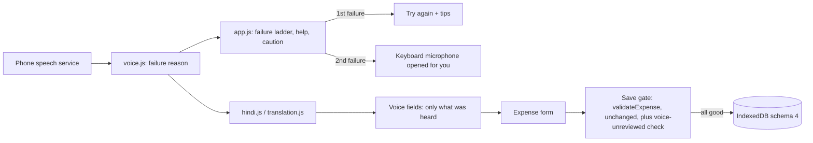

# 3.3.7: Hindi and Spanish voice as an assisted feature, and nothing blank or guessed gets saved. Architecture, design, mock, impact, plan

Status: **RELEASED 24 November 2026 as [v3.3.7](https://github.com/debasisr66/PennyExpenseManager/releases/tag/v3.3.7) (PR 31, merge `2d65c72`, 861 tests).** D1–D7 approved as recommended. Independent review (Opus 5.5) folded in (§12). Date 24 November 2026. Baseline: Penny 3.3.6 on `main` (`5eb8030`, 844 tests, released as v3.3.6). Gated Build Playbook stage: **Released**. 

Owner request (24 November 2026, after the 3.3.6 live check): "I understand this has difficulties with offline parser and iphone. Let's find the best possible feature behaviour for the app. It would appear with user caution that Hindi and Spanish is a restricted feature with some hint, help, keyboard corrections and phone keyboard microphone use. One additional check: nothing blank, wrong should be saved. If amount is 0 nothing should be saved."

## 1. Bottom line

**Hindi and Spanish voice on iPhone cannot be made reliable by Penny, so make it honest and safe instead.** The phone's speech service decides what is heard, and it fails or mishears in ways Penny cannot fix. What Penny controls is what it tells the user, how easy correction is, and what it lets through to Save.

| Evidence (24 Nov live check, 3.3.6, iPhone Chrome) | What it shows |
|---|---|
| 3 capture failures in a row at 06:01–06:03 UTC; the screen said "Listening stopped. You can try again." | That is the message for the recogniser error `aborted` (`voice.js:17`), so the three failures were `aborted`: the phone stopped listening and returned no text. The reason is shown to the user but **not logged** (the log event carries no reason). The parser never ran |
| An earlier run (05:28) had no final result and 5 unresolved words | The phone stopped before finishing, or returned junk |
| "कम से कम 500 रुपए" → amount empty, category empty, plain status, Save blocked until fields are filled | The 3.3.6 safety path works |
| 2–3 alternative guesses are returned by the phone | Alternatives exist, so D5 (use them) has data behind it |

**A second finding, from reading the save path for this spec (parser runs on `main`):**

| Check | Result on 3.3.6 | Verdict |
|---|---|---|
| Amount 0, 0.00, negative, blank, 0.001 | Refused three times over: the amount field (`min=0.01`, required), `validateExpense` (`toPaise` refuses ≤ 0), and CSV, JSON and edit all pass through the same checks | **Already safe. Prove it with guard tests** (V01) |
| Description blank, date invalid, category not in list | Refused by `validateExpense` | Already safe |
| **Voice-filled form, category not recognised** | `applyVoiceFields` sets `category = draft.category \|\| 'Other'` (`app.js:687`). One tap on Save stores "Other" | **Gap: a guessed category is saved** (English and Spanish; Hindi clears it) |
| **Voice-filled form, description is filler** | "Spent 250 rupees on expense today" → description `expense`; "…on something" → `something`. Saved as typed | **Gap: a placeholder description is saved** |
| Voice-filled date when none was heard | Stays at today | Acceptable (today is the stated default); shown to the user |

**So the new "nothing wrong saved" rule is mostly proving what is true plus closing two real gaps in voice-filled forms.** Zero amounts are already impossible; the new work is that a voice-filled expense can never reach Save with a category or description Penny guessed.

**Estimate:** about **9.5 build hours (range 8.5–11.5)** plus about **1 hour of owner time** (§8). Docs close-out of 3.3.6 is done in the same PR that carries this spec (docs only).

## 2. Architecture

No new runtime file, dependency, network path, storage key or schema change.



| Principle | How |
|---|---|
| Voice assists, never decides | A field Penny did not hear stays empty and must be chosen by the user. Nothing is defaulted on the user's behalf |
| One save gate | `validateExpense` stays the only gate for every entry path (form, voice, edit, CSV, JSON, tag removal). It is not changed in 3.3.7; tests prove each path goes through it |
| Honest labels | Hindi and Spanish are labelled **assisted** in the language list and in one caution line; English is not |
| Privacy | The failure reason is one of a fixed list of values (D6); no transcript, no audio, no free text |
| Freeze | Schema 4, CSV and JSON formats, F02 golden, `detect`, `detectMarked`, CSP, deploy file lists. All 844 tests pass unedited, except tests that assert the old "Other" default (§5, listed and changed first) |

## 3. Design

### 3.1 H1: honest labelling and one line of caution

| Where | Today | 3.3.7 |
|---|---|---|
| Language list | "Hindi · हिन्दी", "Spanish · Español" | "Hindi · हिन्दी (assisted)", "Spanish · Español (assisted)" |
| Voice panel note | "On iPhone, Penny uses its small offline expense parser for Hindi and Spanish. It recognizes common amounts…" | When Hindi or Spanish is chosen: "Hindi and Spanish voice is assisted. Your phone may mishear, and Penny understands only common words. Check the amount, category and date. Nothing is saved until you tap Save." English: no caution, as today |
| What's New, README, CHANGELOG | "Offline Hindi and Spanish expense parsing" | Same wording as the caution, so help text and docs agree |

### 3.2 H2: help that fits on a phone

A short **Tips** line under the example phrase for Hindi and Spanish only: say the amount in digits or common number words, say one expense, name the thing bought, pause when done. Examples are the ones in the corpus. No new dialog; one collapsed `details` element, 44 px target.

### 3.3 H3: a failure ladder instead of a dead end

**What 3.3.6 already does (verified in `app.js:605-609`, `voice.js:6-18`):** every error already shows a plain sentence per error name (permission, no speech, network, aborted…) and opens the phone keyboard microphone block with "Use phone keyboard microphone below." after the **first** error. The one case that does not is the quiet end, "Nothing was captured. Tap Try voice again…" (`voice.js:157-162`): no error is raised, so nothing opens and nothing is logged.

| Event | 3.3.6 | 3.3.7 |
|---|---|---|
| Error with a reason (all error names) | Sentence shown, keyboard block opens | Unchanged. The reason is also logged (H5) |
| Quiet end, nothing captured | Sentence only | **Counted as a failure**: logged as a capture failure with reason `no-capture`, and the keyboard block opens |
| 2 failures in a row (any kind) | Same as the first | The message adds: "Voice is not working well right now. Type or use your keyboard microphone." and the Tips line opens |
| Success | — | Counter resets |

So H3 does **not** delay the fallback (the first draft of this spec would have). It closes the quiet-end gap, adds a stronger message on repeat failure, and makes the log complete. Correction stays one tap away: **Correct heard words** (3.3.6 G2) is unchanged.

### 3.4 H4: the save guard (the owner's extra check)

| ID | Rule | Today | Change |
|---|---|---|---|
| H4a | **Amount must be above zero** on every entry path | Already enforced. The real backstop is `store.save`, which always runs `migrateState` (refuses `cents <= 0`); the form, `validateExpense`, CSV, JSON and edit are earlier layers | **No code change.** Guard tests V01–V03 prove it, including a behavioural test that `store.save` rejects `cents: 0` |
| H4b | **A voice fill never defaults the category.** Not recognised → the category is empty and Save is refused | `draft.category \|\| 'Other'` (`app.js:687`). The Hindi path overrides it only when the English draft is unchanged (`app.js:769-772`); if the user edits the draft, 'Other' stays | Change `applyVoiceFields` so the default never happens; this also fixes the edited-draft case. **The category list has no empty option at runtime** (`app.js:865` replaces the options), so add one disabled placeholder "Choose a category" and set `setCustomValidity("Choose a category.")` until a real one is picked |
| H4c | **A voice-filled description must contain something heard.** Filler is cleared; Save is refused with "Describe the expense." | Filler saved | Normalise in `parseVoice`'s caller: strip a leading "an amount on", then clear the result if it is empty or only filler: `expense`, `an expense`, `something`, `it`, `the`, `of`, `stuff`, `things`, `misc`. Stop untranslated Spanish tokens from entering the description (`translation.js:554`). Typed descriptions are never touched |
| H4d | **The voice date default.** If no date was heard, use today, not the browsed month's 1st | `openExpense` sets `${month}-01` when another month is shown (`app.js:840-844`), so a voice fill can keep a guessed date | Voice fill with no date heard sets today and says so |
| H4e | **Payment method** | `''` is accepted by `validateExpense` as unspecified (`data.js:44-47`); the Hindi path that clears it is protected only by native `required` | Documented, tested (a cleared payment method still saves as "Not specified" only when the user did not need it); no change |

Applies to **English too**: the English path fills the form with no accept step (`app.js:540-545`), so H4 matters most there.

### 3.5 H5 (measure, no behaviour change): why capture fails

The user already sees a sentence per error (3.3.6); only the **log** lacks it. `VOICE_CAPTURE_FAILED` gets one extra field `reason` from a fixed list, added to the diagnostics allowlist as an enum like `language`: `no-speech`, `not-allowed`, `service-not-allowed`, `audio-capture`, `network`, `aborted`, `language-not-supported`, `start-timeout`, `stuck`, `could-not-start`, `stop-failed`, `no-capture`, `other`. The log merges consecutive events with the same code and action, which would drop a changed `reason`; each Start makes a new action, so this is safe, and VD01 asserts it.

### 3.6 Carried over from 3.3.6 (only if D7 says yes)

Other substring regexes in `hindi.js` and `app.js` (`/कल/`), "रुपी 1000", and Latin "about/approx". Each is a small, separate, tested change; they are listed in `docs/IDEAS.md` and are not required for H1–H5.

## 4. Mock

**Phone, Hindi selected, after two failed captures:**
```
 ┌──────────────────────────────────────┐
 │ Spoken language [ Hindi · हिन्दी (assisted) ▾ ]
 │ Hindi and Spanish voice is assisted.  │
 │ Your phone may mishear, and Penny     │
 │ understands only common words. Check  │
 │ the amount, category and date.        │
 │ Nothing is saved until you tap Save.  │
 │ ▸ Tips for speaking                   │
 │ ─────────────────────────────────── │
 │ Your phone did not hear speech.       │
 │ [ Try voice again ]  [ Use keyboard ] │
 │ Use phone keyboard microphone         │
 │ Tap the box, then the microphone on   │
 │ your keyboard.                        │
 │ ┌───────────────────────────────────┐ │
 │ │ Dictated text                     │ │
 │ └───────────────────────────────────┘ │
 │ [ Prepare dictated expense ]          │
 └──────────────────────────────────────┘
```

**Form after a voice fill where only an amount was heard (Save pressed):** Category shows the placeholder "Choose a category" and the form refuses: "Choose a category." (an inline message, not a blank box). The description box is empty and refuses: "Describe the expense." Nothing is stored.

## 5. Impact

| Area | Change | Risk and control |
|---|---|---|
| `app.js` | H4b/H4c in `applyVoiceFields`; H3 ladder and reason text; H1 caution text switching with the language | Browser checks B01–B06; existing voice tests pass unedited except those asserting the "Other" default (below) |
| `core.js` | Pure helper for voice fields (category empty, filler description cleared); filler list | `validateExpense` untouched; U-tests; F02 golden unchanged |
| `voice.js` | Pass the recogniser's error name to the failure handler | Fake recogniser tests |
| `diagnostics.js` | `reason` enum on the allowlist; version | Existing allowlist tests; one new test per reason; unknown value dropped |
| `index.html`, `styles.css` | Language labels, caution line, Tips `details` | 3.3.3 contrast and 3.3.5 44 px rules; text audit table (§5.1) |
| Consumers of the "Other" default | Tests that expect `category: 'Other'` after a voice fill | None found by grep (review L1); re-run in step 1 |
| `VERSION` and copies | 3.3.7 | `tests/version.test.cjs` |
| Unchanged | Schema 4, CSV, JSON, F02, `detect`, `detectMarked`, CSP, deploy lists, Studio, `validateExpense` | Freeze hash check |

### 5.1 User-facing text audit (practice 9)

| Text | Before | After |
|---|---|---|
| Language option, Hindi | Hindi · हिन्दी | Hindi · हिन्दी (assisted) |
| Language option, Spanish | Spanish · Español | Spanish · Español (assisted) |
| Voice panel note | On iPhone, Penny uses its small offline expense parser… | The caution in §3.1 (Hindi, Spanish only) |
| Capture failure | Listening stopped. You can try again. Use phone keyboard microphone below. | Reason + Try voice again; after two failures the keyboard microphone is opened |
| Voice fill, category | Silently "Other" | "Choose a category." |
| Voice fill, filler description | `expense`, `something` saved | "Describe the expense." |
| What's New / README / CHANGELOG | "Offline Hindi and Spanish expense parsing" | Same assisted wording |

## 6. Plan

One branch from `origin/main`, one PR for the build; this spec goes in its own docs PR first. Sonnet 5.5 builds, Opus 5.5 reviews (the spec review is by a different model from the author).

| Step | Work | Gate |
|---|---|---|
| 0 | Owner decides D1–D7; independent review of this spec; merge the docs PR | **Owner** |
| 1 | Tests first, proven on 3.3.6: V01–V03 pass (characterisation); VF01–VF04 fail; no existing test asserts the old default (grep, review L1) | |
| 2 | H4 in `core.js` and `app.js` | |
| 3 | H1, H2, H3, H5 in `index.html`, `styles.css`, `app.js`, `voice.js`, `diagnostics.js`; version 3.3.7 | |
| 4 | Browser checks B01–B06 at 320, 375 and 390 px, both themes, console clean | |
| 5 | Opus review; fix Blocker and High; open the PR; CI `verify` | |
| 6 | Merge with `--match-head-commit` | **Owner approves** |
| 7 | Owner live check (the four phrases; counts only) and smoke, then "publish" | **Owner** |
| 8 | Release with zip and SHA-256; Studio sync; docs close-out the same turn (practice 26) | |

## 7. Tests

| ID | What it proves | On 3.3.6 |
|---|---|---|
| V01 | `validateExpense` refuses amount 0, 0.00, 00, 0.001, -5, "", "1e3", "abc" | passes (characterisation, honest) |
| V02 | CSV and JSON import refuse a zero or negative amount | passes |
| V03 | `store.save` rejects a state whose expense has `cents: 0` (behavioural); every write in `app.js` goes through `commit` (source-level) | passes |
| VF01 | A voice fill with no category leaves the category empty (English, Spanish, and a Hindi draft the user edited); source check that `|| 'Other'` is gone | **fails** |
| VF02 | Descriptions `expense`, `something`, `an amount on rent`, `of`, `it`, `the`, `stuff`, `misc` are cleared; a typed filler word is never cleared; "rent" and "maid advance" are kept | **fails** |
| VF05 | A voice fill with no date heard sets today even when another month is shown | **fails** |
| VF03 | A voice fill that heard amount, category and a real item fills all three | passes |
| VF04 | A Hindi draft's unresolved fields stay empty (3.3.6 behaviour, regression guard) | passes |
| VD01 | `VOICE_CAPTURE_FAILED` accepts each allowed `reason`; an unknown or free-text reason is dropped; two failures with different reasons in one session are not merged | **fails** |
| VD02 | A quiet end (nothing captured) is logged as `no-capture` and opens the keyboard block; two failures in a row show the stronger message; success resets (fake recogniser) | **fails** |
| VT01 | Language list labels and the caution line match §5.1 | **fails** |
| Browser B01–B06 | Amount 0 typed: no row added, error shown. Voice fill without category: Save refused with "Choose a category.", not a blank box. After a quiet end the keyboard block is open. Caution shows only for Hindi and Spanish. Layout at 320 px. Console clean | |

The 844 existing tests pass unedited. A grep found no test that asserts 'Other' after a voice fill, nor the language labels or caution text (review L1), so no test needs changing first.

### 7.1 Traceability (built)

All new tests are in `tests/voice-guard.test.cjs`. CI count: **861** (844 existing, unedited, plus 17 new). Proof column: result of running the new file against `origin/main` source (10 fail, 4 pass).

| Spec item | Test IDs | On 3.3.6 (proven) | Code |
|---|---|---|---|
| H4a amount above zero | V01, V02, V03 | pass (characterisation) | none (`validateExpense`, `migrateState`) |
| H4b category never defaulted, placeholder, message | VF01, VF03, VF04, VT02 | VF01, VT02 fail; VF03 fails only because `C.voiceFill` did not exist; VF04 passes | `core.js` `voiceFill`; `app.js` `applyVoiceFields`, `syncValidity`, placeholder option |
| H4c filler description cleared | VF02, VF06 | fail | `core.js` `cleanVoiceDescription`; `translation.js` safeDescription |
| H4d voice date today | VF05 | fail | `core.js` `voiceFill`; `app.js` |
| H4e payment method | unchanged (VF04 source guard) | pass | none |
| H5 reason enum | VD01 | fail | `diagnostics.js`, `voice.js` |
| H3 ladder, quiet end | VD02 (two tests) | fail | `voice.js` `failure`, `createLadder`; `app.js` |
| H1 labels, caution, H2 Tips | VT01 | fail | `index.html`, `app.js` `syncVoiceCaution`, `styles.css` |
| Version 3.3.7 | `tests/version.test.cjs` | n/a | all copies |
| Browser B01-B06 | scripted in the test harness page (`/voice-harness`), 320/375/390 px, light and dark | n/a | see status log |

Deviation recorded: the spec listed VF03 as passing on 3.3.6; it cannot run without the helper, so it fails there for that reason only. Review follow-ups add VF07, VD03 and VD04. Two small additions beyond the table: VF06 (untranslated Spanish words) and a 320 px style so "(assisted)" is not clipped in the language list.

## 8. Estimate

| Part | Hours |
|---|---|
| Tests V, VF, VD, VT | 2.5 |
| H4 save guard | 1.5 |
| H1–H3 UI and text | 2.5 |
| H5 reason plumbing | 1.0 |
| Browser checks and review fixes | 1.5 |
| **Total** | **9.5 (8.5–11.5)** (H4c and H4d added about 0.5 h) |

Owner time: about 1 hour (decide D1–D7, run the four-phrase check, smoke).

## 9. Decisions (approved 24 November 2026: all as recommended)

| # | Decision | Options | Recommendation |
|---|---|---|---|
| **D1** | Scope | (a) H1–H5; (b) H4 only (the safety check); (c) H1–H5 plus the 3.3.6 carry-overs | **(a).** H4 is the part you asked to be certain about; H1–H3 are the "user caution, hint, help" you described; H5 is small and tells us why the phone fails |
| **D2** | Label for Hindi and Spanish | (a) "(assisted)"; (b) "(beta)"; (c) no label, caution text only | **(a).** Says what it is without implying it will improve on its own |
| **D3** | Failure ladder | (a) keep today's first-error fallback, add the quiet-end case and a stronger message after 2 failures in a row; (b) change nothing | **(a).** The first-error fallback already exists and stays; the gap is the quiet end, which today shows no fallback and logs nothing |
| **D4** | Voice-filled category when unrecognised | (a) leave empty, Save refused; (b) keep "Other" but show it in a warning colour | **(a).** "Other" is a wrong answer you must notice; empty cannot be saved by mistake |
| **D5** | Using the phone's 2nd and 3rd guesses | (a) decide in 3.3.8 with more numbers; (b) build now; (c) never | **(a).** The 24 Nov log shows alternatives exist (2–3). Using them can fill a wrong amount, so it needs its own spec, tests and gate |
| **D6** | Failure reason logged | (a) fixed list of 13 values (§3.5); (b) do not log it | **(a).** The user already sees a sentence per error; the log does not, so we cannot count which failure dominates. No personal data |
| **D7** | 3.3.6 carry-overs (other substring regexes, "रुपी 1000", Latin "about") | (a) separate small release after 3.3.7; (b) inside 3.3.7 | **(a).** Keeps 3.3.7 to behaviour and safety; each carry-over needs its own test |

## 10. Status log

| Date | Event |
|---|---|
| 2026-11-24 | Owner ran the four-phrase live check on 3.3.6: phrase 3 ("कम से कम 500 रुपये") passes; phrases 1, 2 and 4 failed at capture (3 failures in a row, no reason logged) |
| 2026-11-24 | Owner asks for assisted-feature behaviour and a nothing-blank, nothing-wrong, no-zero save check |
| 2026-11-24 | Draft v1 (Sonnet 5.5): save path read; amount ≤ 0 already refused on every path; two voice-fill gaps found (guessed "Other", filler description); no code written |
| 2026-11-24 | Independent review (Opus 5.5): 4 High, 5 Medium, 3 Low, all accepted (§12). Draft v2 |
| 2026-11-24 | **Approved by the owner: D1–D7 all as recommended.** Docs PR opened (spec plus 3.3.6 close-out). Next: merge it, then build on one branch (Sonnet builds, Opus reviews) |
| 2026-11-24 | Built (Sonnet 5.5): tests first (new file run on `origin/main`: V01-V03 and VF04 pass, the other 10 fail), then H4, H1-H3, H5; 858 tests pass; browser checks B01-B06 at 320, 375 and 390 px in both themes, console clean (one flaky re-run of 390 dark was a script artefact of reopening the dialog quickly; a clean re-run passed). Independent review (Opus 5.5) and CI: see PR |
| 2026-11-24 | Independent review (Opus 5.5, briefed with code): 0 Blocker, 0 High, 2 Medium, 7 Low. Fixed: M1 date note was overwritten by the recogniser end event (now in the translation line, shown only when true), M2 app wiring tests (VD04), L1 error after a delivered transcript no longer counts (VD03), L2 note suppressed when the date is invalid or cleared, L3 filler survives punctuation and on/for (VF07), L5 Tips wording, L7 table row. Not changed: L4 the failure count lives for the page (noted: it resets on a direct-speech success), L6 weak VF04 (kept as a labelled source guard) |
| 2026-11-24 | Merged (PR 31, `2d65c72`, with `--match-head-commit 2d18725`); CI, Deploy Pages and Notify studio hub succeeded; 12 live runtime files matched `main`; live site V3.3.7 |
| 2026-11-24 | Owner live check on iPhone Chrome (debug logging on): safety phrase left the amount empty, nothing saved; one clean capture (0 unresolved) and one keyboard-microphone dictation saved correctly; an English draft needed "rs." before the amount was read (by design); 3 of 3 capture failures were `aborted`; no `VOICE_ALTERNATIVES` events (text came from interim words); the second-failure message was not seen on the phone but shows in a simulated browser test (open item for 3.3.8) |
| 2026-11-24 | Released v3.3.7 after the owner's "publish 3.3.7" (zip SHA-256 `0164e87f…61b2c`); Studio notify succeeded. Actual versus estimate: not recorded |

## 11. Limits of this evidence

- One owner, one phone, one afternoon: the failure rate is unknown. H5 exists to measure it.
- Whether the failures are phone, network or permission is unknown until H5 lands; the ladder works whatever the cause.
- "Filler" words come from the parser's own output (`expense`, `something`) and are a short list; a real item word is never filler. The list is tested, not exhaustive.
- No real-phone check of the new help text has been done; it is a design, not a measurement.
- Phrases 1, 2 and 4 have not yet been tested end to end on a device (capture failed). The parser gives the expected results offline.

## 12. Independent review (Opus 5.5, 24 Nov 2026): disposition

| Finding | Severity | Disposition |
|---|---|---|
| H3 ladder was built on a wrong premise: the keyboard block already opens after the first error; the quiet end is the real gap | High | **Accepted and verified** (`app.js:605-609`, `voice.js:157-162`): §3.3 and D3 rewritten |
| "No reason shown" was wrong (`aborted` message is shown); H5 list incomplete (missing `language-not-supported` and the no-error failures) | High | **Accepted and verified** (`voice.js:6-18`): §1, §3.5, D6 corrected; 13 values |
| Exact-match filler list misses "an amount on rent", untranslated tokens, "of", "it", "the" | High | **Accepted**: H4c normalises first; VF02 widened; about 0.5 h added |
| "Hindi clears it" only when the draft is unchanged; edited draft keeps 'Other' | High | **Accepted and verified** (`app.js:769-772`): H4b in `applyVoiceFields` fixes it; VF01 covers it |
| "Choose a category" cannot appear (no empty option at runtime; native message shows) | Medium | **Accepted and verified** (`app.js:865`): placeholder option plus `setCustomValidity` |
| Voice date default can be the browsed month's 1st | Medium | **Accepted**: H4d, VF05 |
| Payment guard rests on native `required` only | Medium | **Accepted**: H4e documented and tested |
| VF tests fail only because the helper is missing | Medium | **Accepted**: source-level check that `|| 'Other'` is gone |
| V03 weak; real backstop is `store.save` | Medium | **Accepted**: behavioural V03 |
| "Changed first" is a no-op; English path has no accept step; diagnostics merge could drop `reason` | Low | **Accepted**: §5, §3.4, VD01 |

Estimate with these: about **9.5 h (range 8.5–11.5)**.
