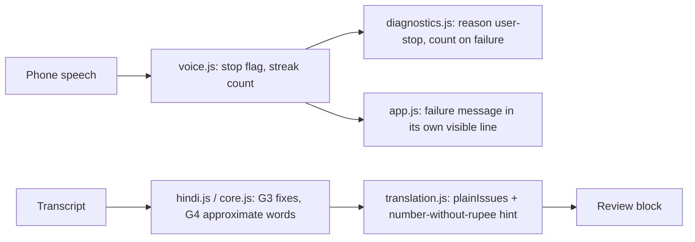

# 3.3.8: Voice hints, three Hindi parser fixes, and a diagnosis of capture failures. Architecture, design, mock, impact, plan

Status: **APPROVED 24 November 2026: D1–D8 all as recommended (owner: "all recommended"). No code written yet.** Independent review (Opus 5.5) folded in (§12). Date 24 November 2026. Baseline: Penny 3.3.7 on `main` (`602ce7d`, 861 tests, released as v3.3.7). Gated Build Playbook stage: **Plan** (Frame done in §1–§2).

Inputs: the owner's 3.3.7 live check on iPhone Chrome (24 November 2026): the log and screenshot, plus these words: "last one had right amount, picked up well. 3rd one in english, I had to add rs. and then amount was picked. There was no voice-not-working message. Dictated using phone speaker worked." And the owner's thought: give the build to a higher-effort Sonnet 5.5 or a better model (§9, D8).

## 1. Bottom line

**3.3.7 held up on the phone. 3.3.8 should be small: make the one missing message observable, tell the user why an amount was not filled, and fix three Hindi false refusals that parser runs on `main` show.** It should not build the phone's 2nd and 3rd guesses, because the live data says they are often absent.

| # | Evidence | Source | Verdict |
|---|---|---|---|
| E1 | The "second failure in a row" message was not seen. Two failures in a row occurred (07:49:59 and 07:50:35 UTC, no success between). A simulated browser test of the merged code shows the message and opens the Tips | Owner log; browser test on `2d65c72` | **Likely cause found in review (§12, H1):** the next tap on **Try voice again** runs `update('starting')`, which overwrites the status line, so the message is erased as soon as the user retries. It is also a fourth sentence on a line that reads almost the same as the first failure, the Tips it opens are hidden for English, and the status sits low on the phone. Fix the message first (G1), then confirm on the phone |
| E2 | All 3 capture failures were `aborted`, after 9 to 19 seconds. A tap on **Stop listening** calls `recognition.stop()` (`voice.js:220-226`); on iPhone that with nothing heard may be reported as `aborted`. `fail()` also ignores interim words already heard (`voice.js:115-121`), so a stop after some speech can lose the transcript | Owner log; code | **Hypothesis, not a finding.** The log cannot tell a user stop from a phone abort, nor whether words were lost. Two numbers-only values separate them |
| E3 | 0 of 4 successful 3.3.7 captures logged `VOICE_ALTERNATIVES`; 2 of 3 did on 3.3.6. The text came from interim words, not a final result | Owner logs | **Alternatives are not reliable.** 2 of 7 captures overall. Do not build (D4, §9) |
| E4 | An English draft needed "rs." before the amount was read | Owner words | By design (a rupee marker or a spend cue is required). The user is never told why. **Hint (G2)** |
| E5 | "सब्जी 350" (no rupee word) leaves the amount empty with the generic "Amount not clear." | Parser run on `main` | Safe, but not helpful. **Hint (G2)** |
| E6 | "गुरु 500 रुपये", "गुरू 500 रुपये" and "शुरू 500 रुपये" (a very common word) give "multiple amounts" and an empty amount. **Two** causes: the marker pattern accepts "रु" at the end of a word (`hindi.js:390`, `:392`, no left boundary), and the rewrite turns any word ending in "रू" into "रुपये" (`hindi.js:372`: "शुरू" → "शुरुपये") | Parser runs on `main` | **False refusal.** Fix (G3a) |
| E7 | In the parser, "कल, 500 रुपये सब्जी" raises no "choose yesterday or tomorrow" issue; "कल सब्जी 500 रुपये" does (`hindi.js:475` needs a space after कल). The **app already** clears the date and says so for any "कल" (`app.js:570`, `:702`, `/कल/` with no boundary), so the user sees the message; that regex also over-matches "कलम" (pen) | Parser runs; review | **Parser gap, small user impact.** Fix both with a whole-word rule (G3b) |
| E8 | "कैशबैक 500 रुपये मिला" fills ₹500 as spent **and sets the payment method to cash** (the "कैश" inside it). Cashback is money received. "वापस" and "रिफंड" are already in the uncertain list; "कैशबैक" is not | Parser runs on `main`; review | **Wrong amount and wrong method, guarded by review.** Add the word and stop it setting cash (G3c) |
| E9 | English "about / approx / around / roughly / at least / over / under 500 rupees" fill ₹500 with no warning, and the English path applies with no accept step. Hindi's equivalent ("लगभग") leaves the amount empty | Parser runs; review | **Inconsistent.** Make English match Hindi (G4) |
| E10 | "यूरोप 500 रुपये" is refused as a foreign currency | Parser run on `main` | Safe false positive; **leave** (logged in IDEAS) |

**Estimate:** about **9.5 build hours (range 8.5–11)**, plus about 1 hour of owner time. One PR (§8).

## 2. Architecture

No new runtime file, dependency, network path, storage key or schema change.



| Principle | How |
|---|---|
| Never guess an amount | The G2 hint only **shows** the digits heard; it never fills the amount. The amount still needs a rupee marker or a spend cue, or the user types it |
| Observe before building | G1 adds numbers only (a streak count and a `user-stop` reason). No transcript, audio or free text |
| Smallest valuable step | Each item is one rule with its own tests. Alternatives, longer listening and new vocabulary are left out (§3.6) |
| Freeze | Schema 4, CSV and JSON formats, F02, `detect`, `detectMarked`, CSP, deploy file lists, `validateExpense` and the save guard from 3.3.7. All 861 tests pass unedited |

## 3. Design

### 3.1 G1: make capture failures observable, and keep the failure message on screen

| Item | Change |
|---|---|
| Streak in the log | `VOICE_CAPTURE_FAILED` carries `count` = failures in a row (existing allowlist field). The streak lives in `app.js` (`voiceLadder`); record it **before** the log call. Separate captures have separate action IDs, so merging does not lose it. Shows from the log alone whether the second failure reached the "strong" step |
| User stop vs phone abort | `voice.js` remembers that the user tapped **Stop listening**, set in `stop()` and reset in `start()`. The 25-second listen timer also calls `stop()` and is **not** a user stop. If `aborted` follows a user stop the reason is `user-stop`. One new value in the reason list (13 → 14) |
| Words lost on abort | On any failure, also log `VOICE_END` with `count` = words already heard (interim or final) and `durationMs`. Shows whether a stop followed by `aborted` threw words away (`fail()` ignores `partialText`). Numbers only |
| The message itself | The sentence "Voice is not working well right now. Type or use your keyboard microphone." moves out of the shared status line into its **own element** under **Try voice again** (`role="status"`, 44 px rules). **`start()` does not clear it**; it is cleared on a success or when the user taps a **Dismiss** button. It shows for **every** language (the Tips it opens stay Hindi and Spanish only, so for English the sentence itself is the guidance) |
| What is **not** done | No change to which failures count. If the log later shows `user-stop` dominates, a user stop with nothing heard should stop counting as a failure (decided in 3.3.9 with numbers). The ladder is not reset by closing the voice panel; this is harmless and noted |

### 3.2 G2: say why no amount was filled (Hindi, and English via its own warning)

When the parser finds **no amount** because the number had no rupee word, the status says so in plain words, with the number shown as text only:

> "A number (350) was heard, but not as rupees. Say 'rupees' after it, or type the amount below."

| Rule | Detail |
|---|---|
| Trigger (Hindi) | **Only** when "amount: extra numeric evidence" is the sole amount issue: no "multiple amounts", no foreign-currency, paise, uncertain-wording or "explicit correction" issue, and **exactly one** digit run in the transcript. Otherwise the generic sentence stays. This avoids false hints for "500 रुपये 2 किलो", "50 डॉलर सब्जी", "लगभग 500 रुपये" and "500 रुपये 50 पैसे" |
| Plumbing | `plainIssues(issues)` does not see the transcript today (`translation.js:605`); its signature gains the transcript, or the app passes the number in. The number is inserted with `textContent` only |
| English | English never reaches `plainIssues` (`translate('en')` returns no issues; the form is filled by `applyVoiceFields`, which already writes "No amount was recognised; enter it below." to `#form-error`). For English the **warning in `core.parseVoice`** (`core.js:433`) gains the same wording when a lone number was spoken without a rupee word or spend cue |
| Spanish | **Left out.** Its issue codes cannot tell "verdura 350" from "verdura 350 rupias" apart, so the hint would be wrong. Logged in IDEAS |
| Safety | No field is filled by this. The amount stays empty. Uncertain wording ("कम से कम 500 रुपए") keeps its own message |

### 3.3 G3: Hindi false refusals and one wrong amount (`hindi.js`, `app.js`)

| ID | Rule | Today (parser run) | After |
|---|---|---|---|
| G3a | A left boundary (`W0`) on the "रु" marker at `hindi.js:390` and `:392`, and on the "रू" rewrite at `:372` | "गुरु / गुरू / शुरू 500 रुपये" → no amount, "multiple amounts" | ₹500; the word is reported as unknown. "500रु" and "रु 500" still work (a digit is not a letter) |
| G3b | "कल" is ambiguous with punctuation too (`कल,` `कल.`) in the parser (`:475`), and the app's `/कल/` checks (`app.js:570`, `:702`) match as whole words | Parser: "कल," no issue. App: also matches "कलम" | One whole-word rule in both places; "कलम" no longer clears the date |
| G3c | "कैशबैक" and "कैश बैक" join the uncertain-amount words, and must **not** set the payment method to cash | ₹500 filled, method cash | amount empty; "Amount not clear"; method not set. "कैश 500 रुपये" (cash payment) unchanged |

Each has fail-first tests. The 250-case corpus has no such phrases and is unchanged (the reviewer prototyped G3a–G3c on a scratch copy: 861 tests still pass).

### 3.4 G4: English "approximately" matches Hindi

`core.parseVoice` fills the amount for "about", "approx", "around", "roughly", "at least", "over" and "under" and says nothing. G4 leaves the amount empty and warns "The spoken amount is approximate; enter the exact amount below." when such a word is **next to the amount** ("about 500 rupees", not "about 2 kg … 500 rupees"). "Spent 500 rupees" and "500 rs" are unchanged. **Side effect to test:** `translation.js:587-589` compares the source amount with the Spanish on-device translation through `parseVoice`; a translation that says "about 500 rupees" becomes an amount mismatch (`complete: false`), which is the safe outcome.

### 3.5 Gate for D4 (the phone's 2nd and 3rd guesses)

| Part | Rule |
|---|---|
| Data so far | 7 captures with an end event (3 on 3.3.6, 4 on 3.3.7); 2 had a final result with alternatives |
| Minimum to decide | At least **20** captures logged across versions and phones. `VOICE_ALTERNATIVES` and `VOICE_END` are **debug-level** events, recorded only in the 30-minute debug window, so these are 20 debug-mode captures; repeats of one action merge and keep only the first `count` |
| Threshold | Build only if **≥ 50 %** of captures have 2 or more alternatives **and** a spec shows how a wrong amount is prevented |
| Fallback (agreed now, practice 24) | If 20 captures are not reached by 31 January 2027, or fewer than half have alternatives, close the idea as not worth building. Until then, no build and no change to the top-guess rule |

### 3.6 Not in 3.3.8 (logged in IDEAS)

Alternatives and pause handling; "यूरोप" as a place name (E10); number-word variants ("दौ हजार", "hazaar"); "रुपी 1000" (marker before the number); Spanish mirrors of G3.

## 4. Mock

**Phone, 390 px, English draft "chai 50" (no rupee word):**
```
 ┌──────────────────────────────────────┐
 │ Heard: "chai 50"                      │
 │ [ Correct heard words ]               │
 │ English draft                         │
 │ ┌───────────────────────────────────┐ │
 │ │ Spent an amount on tea            │ │
 │ └───────────────────────────────────┘ │
 │ A number (50) was heard, but not as   │
 │ rupees. Say 'rupees' after it, or     │
 │ type the amount below.                │
 └──────────────────────────────────────┘
```

**After two failures in a row (G1):**
```
 │ Listening stopped. You can try again. │
 │ [ Try voice again ]  [ Use keyboard ] │
 │ ┌ Voice is not working well right now.┐
 │ └ Type or use your keyboard microphone.┘
```

## 5. Impact

| Area | Change | Risk and control |
|---|---|---|
| `voice.js` | Stop flag (not the 25 s timer); `user-stop` reason; words heard on failure | Fake-recogniser tests; `createLadder` unchanged |
| `diagnostics.js` | `user-stop` in the reason list; `count` already allowed on the event; `appVersion` literal (two places) | Existing allowlist tests plus VD tests |
| `app.js` | Streak recorded before the log call; strong message in its own element with Dismiss; whole-word `/कल/`; hint line | Browser checks B01–B05; existing tests unedited |
| `translation.js` | `plainIssues` gains the transcript and the number-without-rupee sentence; G4 side effect on the Spanish amount check | U-tests |
| `hindi.js` | G3a–G3c | 250-corpus unchanged; new fail-first tests |
| `core.js` | G4 approximate words; the lone-number warning (English) | Existing English voice tests unedited; new tests |
| `index.html`, `styles.css` | Element for the message; What's New; version 3.3.8 | 44 px, contrast and text audit (§5.1) |
| Consumers | Any test or code reading `unknownSpans` or the "extra numeric evidence" issue | Found by `grep` in step 1 |
| Unchanged | Schema 4, CSV, JSON, F02, `detect`, `detectMarked`, CSP, deploy lists, Studio, `validateExpense`, the save guard | Freeze hash check |

### 5.1 User-facing text audit

| Text | Before | After |
|---|---|---|
| Amount empty, number heard, no rupee word | "Amount not clear. Tap Correct heard words, or type the amount below." | "A number (350) was heard, but not as rupees. Say 'rupees' after it, or type the amount below." |
| Second failure in a row | Sentence appended to the status line, erased by the next tap | Own line under **Try voice again**, kept until a success or Dismiss, for every language |
| English "about 500 rupees" | ₹500 filled, no warning | Amount empty; "The spoken amount is approximate; enter the exact amount below." |
| Hindi "कल," | App already warns for any "कल" (also "कलम"); parser silent | One whole-word rule; "कलम" no longer triggers it |
| What's New, README, CHANGELOG | 3.3.7 | 3.3.8 entries in the same words |

## 6. Plan

One branch from `origin/main`, one PR. Tests first, each proven to fail on 3.3.7. Builder and reviewer per D8.

| Step | Work | Gate |
|---|---|---|
| 0 | Owner decides D1–D8; independent review of this spec; merge the docs PR | **Owner** |
| 1 | Tests first: G1–G4, shown failing on 3.3.7 (E6–E9 reproduce as failing assertions) | |
| 2 | G3 and G4 (`hindi.js`, `core.js`) | |
| 3 | G2 (`translation.js`, `app.js`) | |
| 4 | G1 (`voice.js`, `diagnostics.js`, `app.js`, `styles.css`); version 3.3.8; What's New | |
| 5 | Browser checks B01–B05 at 320, 375 and 390 px, both themes, console clean; plus the failure-ladder run with a fake recogniser | |
| 6 | Independent review on a different model; fix Blocker and High; docs in the same PR (CHANGELOG, README, ARCHITECTURE, SECURITY-REVIEW, spec traceability); open the PR; CI `verify` | |
| 7 | Merge with `--match-head-commit` | **Owner approves** |
| 8 | Owner live check, with debug logging on: four phrases plus two taps of **Stop listening** with nothing said; report counts and the log | **Owner** |
| 9 | "Publish"; release with zip and SHA-256; docs close-out the same turn (practice 26) | **Owner** |

## 7. Tests

| ID | What it proves | On 3.3.7 |
|---|---|---|
| VH01 | "सब्जी 350": amount stays empty; the status contains "A number (350) was heard" (text only); no field is filled. English "chai 50": the warning has the same wording | **fails** |
| VH04 | No hint for "500 रुपये 2 किलो", "50 डॉलर सब्जी", "लगभग 500 रुपये", "500 रुपये 50 पैसे", "2 किलो सब्जी 350" (several numbers) | **fails** |
| VH02 | "कम से कम 500 रुपए" still shows the uncertain-wording message, not the number hint | passes (regression guard) |
| VH03 | The hint cannot inject markup (a transcript with `<b>` is shown as text) | **fails** |
| HG01 | "गुरु / गुरू / शुरू / शुरु 500 रुपये" → ₹500, the word unknown; "गुरु", "मेरु", "तरु" never count as a rupee marker; "500 रु", "500रु", "रु 500" still do | **fails** |
| HG02 | Parser: "कल, …" and "कल. …" raise the date issue ("कल सब्जी …" already does); "कलम" does not clear the date in the app; "आज" unchanged | **fails** (the "कल सब्जी" part passes) |
| HG03 | "कैशबैक 500 रुपये मिला" → amount empty and payment method not cash; "कैश 500 रुपये" (cash payment) unchanged | **fails** |
| EN01 | "about / approx / around / roughly / at least / over / under 500 rupees" → amount empty with the approximate warning; "about 2 kg … 500 rupees" fills ₹500; "Spent 500 rupees", "500 rs" unchanged; a Spanish translation saying "about 500 rupees" is `complete: false` | **fails** |
| VD01 | `VOICE_CAPTURE_FAILED` logs `count` = failures in a row; success resets it | **fails** |
| VD02 | A Stop tap followed by `aborted` logs reason `user-stop`; `aborted` without a Stop tap, or after the 25 s timer, logs `aborted`; a failure logs `VOICE_END` with the words heard; unknown values are dropped | **fails** (the "unknown dropped" part passes) |
| VD03 | The strong message is its own element, shown on the second failure in a row **and still shown after the next Try voice again tap** until a success or Dismiss; shown for English too (fake recogniser, app wiring) | **fails** |
| F01 | The 861 existing tests pass unedited, including the 250 corpus cases | passes |
| Browser B01–B05 | Hint and message layout at 320, 375, 390 px, both themes; console clean | |

## 8. Estimate

| Part | Hours |
|---|---|
| Tests (VH, HG, EN, VD) | 3.0 |
| G3 and G4 | 1.5 |
| G2 | 1.5 |
| G1 | 2.0 |
| Browser checks, review fixes, docs | 1.5 |
| **Total** | **9.5 (8.5–11)** (review added about 1 h) |

Owner time: about 1 hour (decide D1–D8, the live check, smoke).

## 9. Decisions (approved 24 November 2026: all as recommended)

| # | Decision | Options | Recommendation |
|---|---|---|---|
| **D1** | Scope | (a) G1–G4; (b) G1 and G2 only (observe and explain, no parser change); (c) G1–G4 plus the 3.3.7 leftovers in §3.6 | **(a).** Every item has parser or log evidence (E1–E9); §3.6 items have none yet |
| **D2** | The missing second-failure message (E1) | (a) fix the message (own line, survives the next tap, all languages) and log the streak; leave the counting rule alone; (b) also change what counts as a failure now; (c) do nothing | **(a).** The review found a concrete cause (the next tap erases it). Changing the counting rule without data could hide real failures |
| **D3** | Number-without-rupee hint (G2) | (a) show the number as text, fill nothing; (b) fill the amount when the only number is the amount | **(a).** (b) is the guess the product is built to avoid: "सब्जी 350" could be a quantity |
| **D4** | The phone's 2nd and 3rd guesses | (a) no build; keep measuring; revisit at 20 captures; if not reached by 31 January 2027, close it as not worth building; (b) build now | **(a).** E3: 2 of 7 captures had them. Fallback agreed now (practice 24) |
| **D5** | English "about / approx / around / roughly / at least" | (a) leave the amount empty and warn (matches Hindi); (b) fill it as today with a warning | **(a).** An approximate amount saved as exact is a wrong value |
| **D6** | "कैशबैक" | (a) treat as uncertain (money in, not out); (b) leave | **(a).** One word, same list as "रिफंड" and "वापस" |
| **D7** | A user Stop that ends in `aborted` | (a) log as `user-stop`, keep counting it as a failure this release; (b) stop counting it now | **(a).** No evidence yet that it is the user's tap (E2) |
| **D8** | Who builds and reviews | (a) Sonnet 5.5 at **high** effort builds; Opus 5.5 at high effort reviews; the same pair as 3.3.7 with the effort raised; (b) Opus 5.5 builds, Sonnet 5.5 reviews; (c) the highest-tier model builds, Opus 5.5 reviews | **(a)**, see below |

**D8 reasoning (your thought, weighed against the record):**
- **Evidence from this arc:** 3.3.6 (Sonnet build) needed an independent review to catch a Blocker (inflected "कम" forms could fill amounts) and a High (iOS focus). 3.3.7 (Sonnet build at **medium** effort) came back with 0 Blocker, 0 High, 2 Medium, 7 Low; the live check then found a gap (E1) that the tests missed because they checked the message right after it was set, not after the next tap. That is a testable gap, and the spec author missed it too: this spec's own independent review found two root causes (E1 and the second "रू" cause in E6) that the author did not. Three data points now point to review catching what builders and authors miss, rather than to the builder's model or effort.
- **What raising effort buys:** the part of 3.3.8 with the highest defect cost is the Hindi parser (G3), where the 3.3.6 Blocker came from. A higher-effort build spends more on edge cases there. It costs more tokens per build and the live-check risk is unchanged.
- **What this means for the choice:** the review step is where the defects were caught every time. Keep it independent and at high effort; the builder change is a cheap hedge, not the main safeguard.
- **Why not a better model for everything:** the playbook rule is a different model reviews than builds; keeping Opus as reviewer keeps that. Moving the build to a stronger model costs more, and the evidence (two builds, 0 Blockers in the latest at medium effort) does not yet show a gap that a stronger builder would close.
- **A rule to make it measurable:** if the Opus review of 3.3.8 finds a Blocker or High in G3 despite high effort, the next Hindi parser change moves to the stronger builder and the review stays on Opus. Record effort and findings in the PR so the next decision has three data points.

## 10. Status log

| Date | Event |
|---|---|
| 2026-11-24 | Owner four-phrase live check of 3.3.7: safety phrase left the amount empty; one clean capture; keyboard dictation worked; an English draft needed "rs."; the second-failure message was not seen; 3 of 3 failures `aborted` |
| 2026-11-24 | Draft v1 (Sonnet 5.5): parser runs on `main` for E5–E10; simulated browser test of the failure ladder; no code written |
| 2026-11-24 | Independent review (Opus 5.5): 0 Blocker, 4 High, 4 Medium, 2 Low, all accepted (§12). Draft v2 |
| 2026-11-24 | **Approved by the owner: D1–D8 all as recommended** (builder Sonnet 5.5 at high effort, reviewer Opus 5.5 at high effort). Docs PR opened. Next: merge it, then build on one branch |

## 11. Limits of this evidence

- One owner, one phone, one afternoon: 7 captures and 3 failures. Rates are unknown.
- E2 (a user Stop reported as `aborted`) is a hypothesis from the code and the timings (9 to 19 s), not a measurement.
- The failure-ladder browser test used a fake recogniser: it proves the code path, not iPhone behaviour.
- The parser runs in E5–E10 use single phrases chosen to test each rule; the 250-case synthetic corpus has never had a native-speaker review.
- D8 rests on two builds.

## 12. Independent review (Opus 5.5, 24 Nov 2026): disposition

| Finding | Severity | Disposition |
|---|---|---|
| E1 cause: the next **Try voice again** tap overwrites the message; it reads almost like the first failure; Tips hidden for English; status sits low; the test checked only right after the failure | High | **Accepted and verified in code** (`app.js:613`, `voice.js:197`, `app.js:656`): §1 E1, §3.1, D2, VD03 rewritten |
| G3a has a second cause: the "रू" rewrite at `hindi.js:372` turns "शुरू" into "शुरुपये"; the `end` search at `:392` also lacks a boundary | High | **Accepted and verified by parser run** (शुरू and गुरू give "multiple amounts"): §1 E6, G3a, HG01 |
| G2 trigger fires falsely for several numbers, foreign currency, paise, uncertain wording; Spanish cannot tell the cases apart; `plainIssues` has no transcript | High | **Accepted**: sole-issue and one-digit-run trigger; Spanish left out; signature change; VH04 |
| English never reaches `plainIssues` | High | **Accepted**: English uses the `core.js:433` warning |
| E7 overstated: the app already warns for any "कल" and over-matches "कलम" | Medium | **Accepted and verified** (`app.js:570`, `:702`): E7, G3b, §5.1 corrected |
| G4 changes the Spanish amount comparison (`translation.js:587-589`); "next to the amount" needs defining | Medium | **Accepted**: §3.4, EN01 |
| A Stop then `aborted` can discard interim words (`voice.js:115-121`) | Medium | **Accepted**: failure logs words heard (§3.1, VD02) |
| The D4 gate counts debug-mode captures only; repeats merge | Medium | **Accepted**: §3.5 |
| G1 implementation notes (streak in `app.js`, record before emit, reset Stop flag, 25 s timer, `appVersion` twice, ladder not reset on close) | Low | **Accepted**: §3.1, §5 |
| D8 overclaims ("no test could have caught" E1); §12 names the wrong author | Low | **Accepted**: D8 rewritten with three data points; author named correctly |
| Also found: "कैशबैक" sets payment method to cash | (extra) | **Accepted and verified**: E8, G3c, HG03 |

Verified true by the reviewer: 861 tests pass; E5–E10 reproduce; G3a–G3c prototyped on a scratch copy keep all 861 passing including the 250 corpus; "500रु" still works; "कैश 500 रुपये" unchanged; status text is set with `textContent`.
